<div align="center">

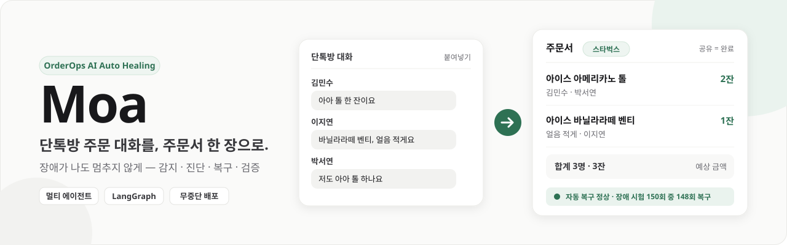

<h1>Moa — OrderOps AI Auto Healing</h1>

<h3>단톡방 주문 대화를, 주문서 한 장으로. 장애가 나도 멈추지 않게.</h3>

<p><code>FastAPI</code> &nbsp;·&nbsp; <code>LangGraph</code> &nbsp;·&nbsp; <code>Multi-Agent</code> &nbsp;·&nbsp; <code>Auto Healing</code> &nbsp;·&nbsp; <code>Docker Compose</code> &nbsp;·&nbsp; <code>GitHub Actions</code></p>

</div>

> 단톡방 주문 대화를 붙여넣으면 갈 매장을 찾아 메뉴 묶음 · 수량 · 주문한 사람 · 합계 예상 금액이 담긴 주문서 한 장을 만들어 주는 서비스입니다.
> 그리고 이 서비스를 지키는 **장애 자가 복구(Auto Healing) 워크플로**가 장애를 먼저 알아채고, 허용된 조치로 고치고, 정상화를 수치로 증명합니다.

## 프로젝트 개요

모임에서 커피를 한꺼번에 시킬 때 담당자는 대화를 위아래로 훑으며 약칭("아아 톨") · 옵션 · 변경 · 취소를 반영하고 금액을 손으로 계산합니다. AI에 맡겨도 두 가지 문제가 남습니다. **AI가 없는 메뉴나 가격을 지어낼 수 있고**, **처리 중 장애가 나면 주문이 겹치거나 사라질 수 있습니다.**

Moa는 이 두 문제를 두 개의 층으로 나눠 풉니다.

| 층                     | 무엇을 하나                                                  | 어떻게 만들었나                                                                                                        |
| ---------------------- | ------------------------------------------------------------ | ---------------------------------------------------------------------------------------------------------------------- |
| **업무 층**      | 대화 → 주문 이벤트 → 메뉴 정규화 → 검증 → 정산 → 주문서 | LLM 에이전트 3개(Intake · Menu · Review) + 규칙. 메뉴 확정 · 가격 · 검증 통과는 **규칙이** 정한다            |
| **장애 대응 층** | 감지 → 진단 → 복구 → 검증                                 | `healing` 서비스. **LLM을 쓰지 않는** 결정적 워크플로(Monitor · Diagnosis · Recovery Worker · Verification) |

<p align="center">
  
</p>

> [!TIP]
> **Moa의 핵심 원칙** — LLM은 해석 · 후보 · 의견만 냅니다. 메뉴 확정, 가격, 검증 통과, 상태 전이, 복구 판단은 전부 규칙이 합니다. 그래서 같은 장애에는 항상 같은 판정이 나오고, 탐지 · 복구 시간을 반복해서 잴 수 있습니다.

<br>

## 목차

### 발표

1. [팀원 소개](#팀원-소개)
2. [주요 기능](#주요-기능)
3. [서비스 동작 방식](#서비스-동작-방식)
4. [시스템 구성도](#시스템-구성도)
5. [핵심 기술 1: 업무 층 멀티 에이전트](#핵심-기술-1-업무-층-멀티-에이전트)
6. [핵심 기술 2: 장애 대응 층 Auto Healing](#핵심-기술-2-장애-대응-층-auto-healing)
7. [배포 구조: 공용 스택 + 앱 스택 A/B](#배포-구조-공용-스택--앱-스택-ab)
8. [CI/CD 파이프라인](#cicd-파이프라인)
9. [성공 기준과 측정 결과](#성공-기준과-측정-결과)
10. [회고](#회고)

### 프로젝트 문서

1. [폴더 구조](#폴더-구조)
2. [화면](#화면)
3. [실행 방법](#실행-방법)
4. [테스트](#테스트)
5. [CI 설정](#ci-설정)
6. [관련 문서](#관련-문서)

<br>

## 팀원 소개

<table>
  <thead>
    <tr>
      <th width="18%" align="center">이름</th>
      <th width="22%" align="left">역할</th>
      <th align="left">담당 영역</th>
    </tr>
  </thead>
  <tbody>
    <tr><td align="center">이성우</td><td>팀장 · 서비스 · 멀티 에이전트 (PM 겸임)</td><td>주문 정리 서비스 본체(업무 층 에이전트 · 툴 · API), 담당자 화면 · 운영 대시보드, PM 문서</td></tr>
    <tr><td align="center">노지훈</td><td>Auto Healing</td><td>장애 감지 · 진단 · 복구 · 검증 워크플로(healing), 고장 주입기, 사건 기록 · 지표</td></tr>
    <tr><td align="center">강민우</td><td>CI · QA</td><td>테스트 작성, 자동 테스트 파이프라인(GitHub Actions), 품질 측정, 정답 데이터</td></tr>
    <tr><td align="center">이홍진</td><td>CD · 배포</td><td>컨테이너 구성(공용 스택 + 앱 A/B · HAProxy 게이트웨이), 클라우드(EC2) 배포, 시스템 구성 문서</td></tr>
    <tr><td align="center">백승주</td><td>측정 · 검증</td><td>장애 주입 · 측정 · 독립 검증, 데모 총괄 · 제출 책임, CI · 시연 영상 · 발표자료 보조</td></tr>
  </tbody>
</table>

<br>

## 주요 기능

| 기능                             | 내용                                                                                        | 사용자 가치                                        |
| :------------------------------- | :------------------------------------------------------------------------------------------ | :------------------------------------------------- |
| 대화 붙여넣기 · `.txt` 올리기 | 단톡방 대화를 그대로 붙여넣거나 `.txt` 파일(UTF-8 · CP949)을 올린다                      | 정리하기 2회(되묻기가 나오면 3회) 만에 정리 시작   |
| 매장 기준 자동 판별              | 브랜드 선택 UI 없이, 대화 · 끝의 요청 한 줄에서 별칭 사전으로 스타벅스 · 일반 카페를 판별 | 엇갈릴 때만 한 번 묻는다                           |
| 주문 이벤트 추출                 | 메시지마다 ADD · UPDATE · CANCEL · CONFIRM · IGNORE 로 해석하고 앞선 주문과 연결        | "아까 샷 추가한 한 잔 취소"도 정확한 잔에 반영     |
| 메뉴 정규화                      | "아아" → 아이스 아메리카노, 사이즈 · 옵션을 매장 기준 메뉴판에 맞춤                       | 없는 메뉴 · 가격을 지어내지 않는다(자동 확정 0건) |
| 확인 질문                        | 모호 · 미등록 · 후보 여럿인 항목만 한 번에 하나씩 묻는다                                  | AI가 임의로 정하지 않는다                          |
| 주문서 · 공유 = 완료            | 같은 메뉴 · 옵션끼리 묶은 주문서, 텍스트 복사 · 이미지 저장                               | 단톡방 카드 한 장으로 확인                         |
| 변경 요청 받기                   | 답장을 붙여넣으면 분명한 변경은 바로 반영(+ 되돌리기), 불분명한 것은 확인 질문              | 바뀐 것만 반영해 다시 공유                         |
| 운영 대시보드                    | 사건 · 복구 승인 · 지표(MTTD · MTTR · 무인 복구율) · 주문 처리 기록 · 장애 시험       | 장애를 수치로 확인하고 못 고친 것만 사람이 결정    |

<br>

## 서비스 동작 방식

### 화면 흐름

담당자 화면은 3개입니다. 확인 질문 · 채팅 수정 · 변경 요청 받기는 별도 화면 없이 주문 정리 · 주문서 화면 안에서 처리합니다.

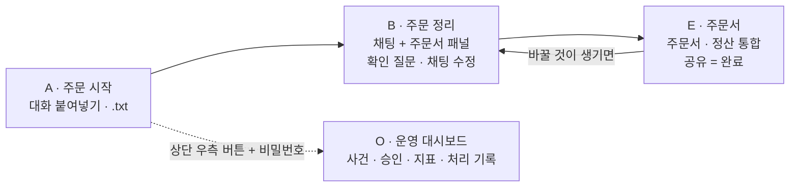

### 이용 흐름

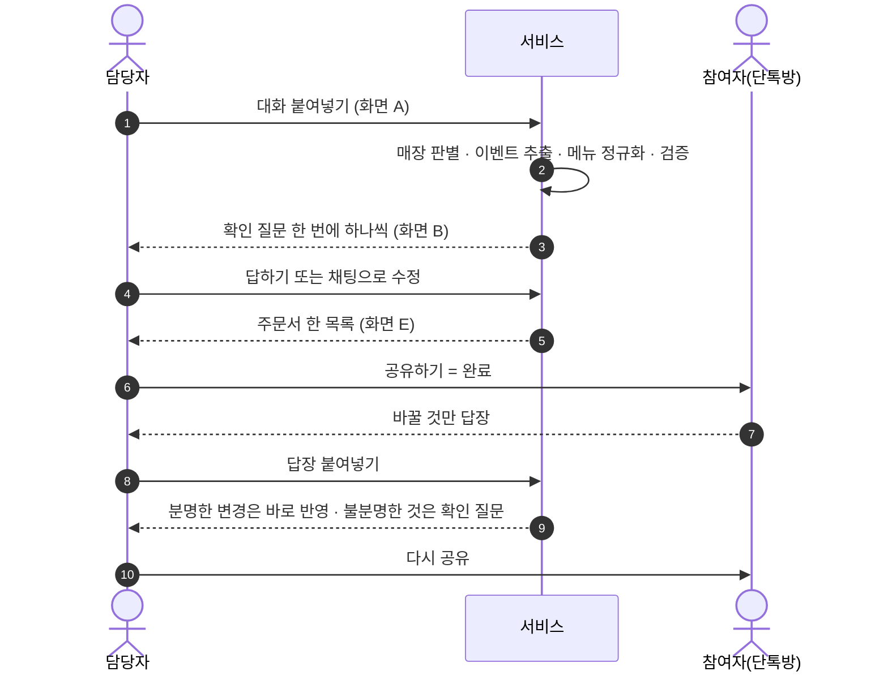

공유는 세 조건을 모두 만족할 때만 열립니다 — 확인 필요 항목 0건, 반영 여부를 정하지 않은 제안 0건, 개인 합계 = 전체 금액. 조건을 못 맞추면 주문서는 그대로 보이고 [공유하기]만 막히며 막힌 이유를 한 줄로 보여줍니다.

### 처리 예시

입력 (대화 끝 매장 요청: "스타벅스 기준으로 정리해줘")

```text
[김민수] 아이스 아메리카노 톨 2잔, 하나는 샷 추가요.
[이지연] 바닐라라떼 큰 거 얼음 적게요.
[박서연] 아아 톨 한 잔이요.
[김민수] 아까 샷 추가한 한 잔 취소할게요.
[이지연] 사이즈는 벤티로 할게요.
```

| 단계        | 담당                          | 이 예시에서는                                                                                        |
| ----------- | ----------------------------- | ---------------------------------------------------------------------------------------------------- |
| 매장 판별   | 규칙(별칭 사전)               | 요청 줄에 "스타벅스" 1종 → `starbucks`                                                            |
| 처리 계획   | Planner(규칙)                 | 저장본 없음 → 처음부터, 1차 해석 서비스, 묶음 2개                                                   |
| 이벤트 추출 | Intake Agent (LLM)            | 1~3줄 `add`, 4줄 `cancel`(1줄 샷 추가 잔), 5줄 `update`(2줄 사이즈)                            |
| 메뉴 정규화 | 규칙 → Menu Agent (LLM + 툴) | "아아" → 아이스 아메리카노, "큰 거"는 모호했다가 5줄 "벤티"로 정해짐                                |
| 검증        | Validation (규칙)             | 수량 · 옵션 · 변경 관계 통과                                                                       |
| 정산        | Settlement (계산 규칙)        | 아이스 아메리카노 톨 2잔(김민수 · 박서연), 아이스 바닐라라떼 벤티 얼음 적게 1잔(이지연) — 모두 3잔 |

### 매장 기준 판별

화면에서 브랜드를 고르지 않습니다. 스타벅스는 톨 · 그란데 · 벤티, 일반 카페는 레귤러 · 라지처럼 사이즈와 옵션 가격이 다르므로 분석 전에 매장 기준을 하나로 정합니다.

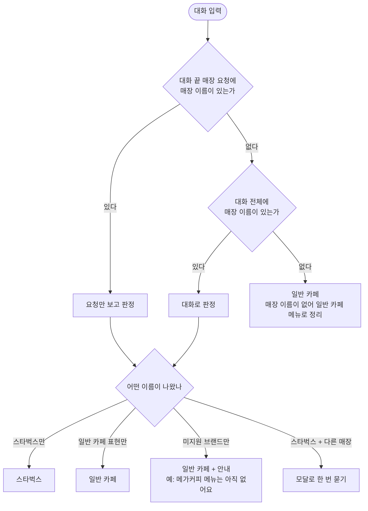

<br>

## 시스템 구성도

업무 층과 장애 대응 층은 **다른 컨테이너에서 돌고, 공용 DB를 통해서만 만납니다.** 장애 대응 층은 업무 데이터를 직접 고치지 않고 사전 허용된 조치만 호출합니다.

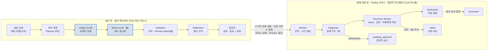

### 아키텍처 선택 이유

| 대안                                                                 | 채택하지 않은 이유                                                                                                 |
| -------------------------------------------------------------------- | ------------------------------------------------------------------------------------------------------------------ |
| LLM Supervisor가 다음 담당을 고르는 구조                             | 조정 단계마다 LLM 왕복이 늘어 호출 제한 5초와 충돌. 같은 입력에 다른 경로를 탈 수 있어 반복 측정을 보장하지 못한다 |
| 에이전트끼리 직접 메시지를 주고받는 분산형                           | 공통 검사를 경로마다 넣어야 해 한 곳을 빠뜨리면 그 경로만 조용히 깨진다. 재시도 횟수를 한 곳에서 셀 수 없다        |
| 장애 대응도 LLM 에이전트로                                           | 장애 원인(LLM)과 복구 수단이 같은 계통에 묶인다. 판정이 매번 달라 MTTR을 반복 측정할 수 없다                       |
| **채택: 업무 층 고정 그래프 + 장애 대응 층 결정적 파이프라인** | 응답 속도 · 결정 일관성 · 장애 격리를 모두 수치로 검증할 수 있다                                                 |

> **복구 경계** — 요청 안 복구(대체 서비스 1회 전환 · 재생성 · 규칙 폴백 · 메뉴 캐시)는 업무 층이 요청 안에서 실행하고 관측값만 남깁니다. Recovery Worker는 그 신호로 프로세스 수준 조치(허용목록 재시작 · 회로 probe · 에스컬레이션)만 합니다. 두 층이 함께 재시도하면 시도 상한이 깨지기 때문입니다.

<br>

## 핵심 기술 1: 업무 층 멀티 에이전트

조정자는 LLM이 아니라 **상태기계(Orchestrator)** 입니다. LangGraph 노드 10개가 고정 순서로 흐르고, 진입(N-01)과 출구(N-10)가 하나씩이라 공통 검사를 한 곳에만 둡니다. 자연어 해석이 필요한 단계만 LLM 에이전트로 만들었습니다.

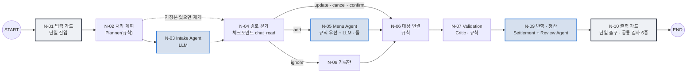

| 에이전트 · 구성요소   | 노드                 | 형태                 | 하는 일                                                                | 하지 못하는 것               |
| ---------------------- | -------------------- | -------------------- | ---------------------------------------------------------------------- | ---------------------------- |
| Orchestrator           | N-01 · N-04 · N-10 | 상태기계             | 진입 · 경로 분기 · 출구, 체크포인트 저장, 공통 검사 6종              | 주문 해석 · 수정, 복구 실행 |
| Planner                | N-02                 | 규칙                 | 재개 여부 · 해석 서비스 선택 · 묶음 분해 · LLM 예산(300회) 배정     | LLM 호출                     |
| **Intake Agent** | N-03                 | LLM, 툴 0개          | 메시지마다 이벤트 유형 5종 · 주문자 · 근거 · 가리키는 앞 주문 추출  | 메뉴 · 가격 판정            |
| **Menu Agent**   | N-05                 | 규칙 → LLM + 툴 3종 | 규칙(별칭 · 엄격 매칭)이 못 정한 항목만 툴로 메뉴판 검색 → 후보 정렬 | 메뉴 확정 — 확정은 규칙     |
| 대상 연결              | N-06                 | 규칙                 | 변경 · 취소 · 확인이 가리키는 항목 찾기                              | 대상이 여럿일 때 임의 선택   |
| Validation             | N-07                 | 규칙                 | 옵션 허용 · 수량 · 사양 판정, 모호하면 `needs_review`              | LLM 의견만으로 통과          |
| **Review Agent** | N-09                 | LLM + 툴 3종         | 대상이 모호한 항목만 기존 주문을 보고 의견 · 사유                     | 검증 상태 변경               |
| Settlement             | N-09                 | 계산 규칙            | 기준가 + 옵션 추가금, 묶음별 금액, 개인 합계 = 전체 금액 검증          | 합계 불일치 때 공유 허용     |

### 툴 5종과 권한

에이전트는 세션 · 매장 같은 식별자를 **LLM 인자로 받지 않습니다.** 툴이 `ToolContext`에서 주입받으므로 다른 세션의 주문에 접근할 수 없습니다.

| 툴                      | Intake | Menu | Review |
| ----------------------- | :----: | :--: | :----: |
| `search_menu`         |   -   |  O  |   -   |
| `find_menu_by_traits` |   -   |  O  |   -   |
| `get_menu`            |   -   |  O  |   O   |
| `list_order_items`    |   -   |  -  |   O   |
| `get_order_item`      |   -   |  -  |   O   |

### 툴 호출 루프 (Menu Agent 1항목 기준)

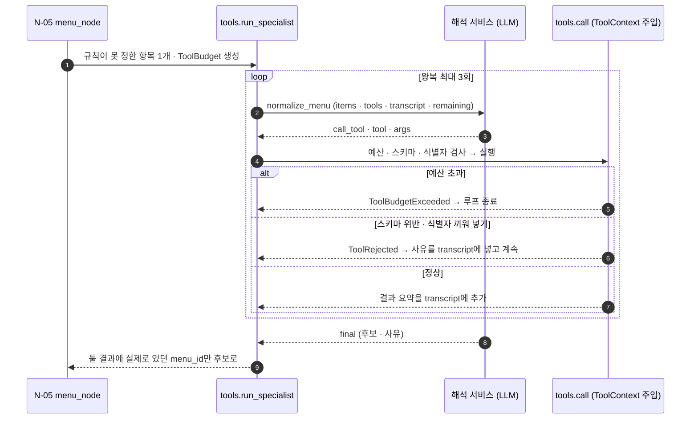

### 주문 해석 서비스 2계통 + 규칙 폴백

Intake · Menu · Review Agent는 LLM을 직접 부르지 않고 **주문 해석 서비스(Interpreter)** 를 거칩니다. 두 계통은 같은 입출력 형식을 쓰므로 전환은 호출 주소 교체로 끝납니다.

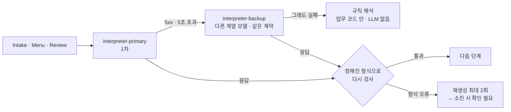

- 해석 서비스로 나가는 요청 본문 전체는 **PII 마스킹** 후 전송하고, 로그에는 마스킹 종류만 남깁니다
- 어느 계통 · 모델이 답했는지 호출마다 기록하고, 대체 · 폴백 비율은 운영 대시보드에 표시합니다

<br>

## 핵심 기술 2: 장애 대응 층 Auto Healing

한 역할이 혼자 판단 · 실행 · 종료하지 못하게 나눴습니다. **판단은 Diagnosis, 실행은 Recovery Worker, 종료(`recovered`)는 Verification만** 합니다.

| 역할                           | 하는 일                                                                                                      | 못 하는 일                               |
| ------------------------------ | ------------------------------------------------------------------------------------------------------------ | ---------------------------------------- |
| Gateway (HAProxy)              | 앱 A/B backend `/ready` 2초 간격 확인, 2회 실패 시 제외, 2회 연속 성공 시 재등록 — Recovery보다 먼저 격리 | 업무 데이터 복구, 실패 요청 재처리       |
| Monitor                        | 1초 순회로 최근 60초 관측값을 규칙표로 판정, 사건 생성, 같은 대상 · 원인의 열린 사건이 있으면 증거만 추가   | 임계값 변경, 복구                        |
| Diagnosis                      | 고정 결정표로 장애 코드 7종 분류, 자동 경로 / 사람 경로 분기                                                 | 직접 복구, LLM으로 명령 생성             |
| Recovery Worker                | 사건 lease 획득 후 허용목록 액션만 실행(재시작 · probe), 시도 상한 관리                                     | 스스로 완료 선언, 임의 셸 · Docker 명령 |
| 허용목록 어댑터 + socket-proxy | 고정 컨테이너 이름에 대한 상태 조회 · 재시작만 통과                                                         | 생성 · 삭제 · 이미지 변경              |
| Verification                   | 조치와 독립된 모듈에서 연속 정상 · 기능 샘플 · 데이터 무결성 확인                                          | 복구 실행                                |
| 운영 대시보드                  | 사건 · 지표 표시, 승인 · 거부 기록(상태만 전환)                                                            | 정책 변경, 복구 실행                     |

### 사건 처리 상태

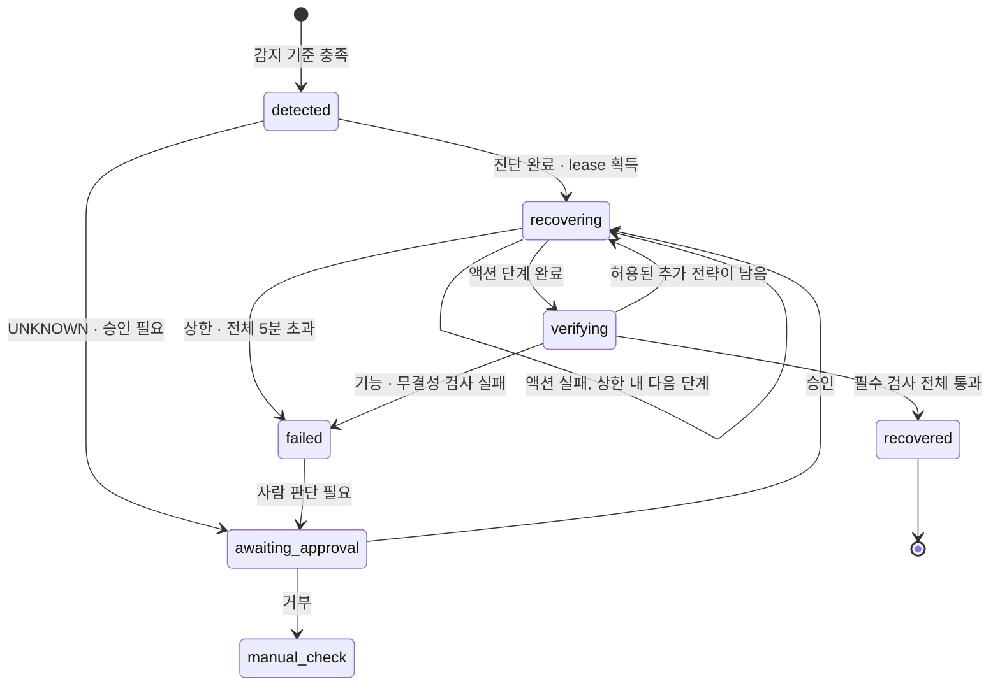

### 대상 장애 F-1 ~ F-6 과 복구 정책

| ID  | 장애                     | 장애 코드                | 1차 복구                               | 2차 복구                                      | 상한                      | 성공 판정                                     |
| --- | ------------------------ | ------------------------ | -------------------------------------- | --------------------------------------------- | ------------------------- | --------------------------------------------- |
| F-1 | HTTP 5xx                 | `DEP_HTTP_5XX`         | 1 · 2 · 4초 재시도                   | 대체 서비스 전환 → 규칙 해석 폴백            | 1차 3회 · 대체 2회       | 상태 점검 3회 연속 정상 · 검증 요청 5건 성공 |
| F-2 | 5초 초과 지연            | `DEP_TIMEOUT`          | F-1과 같음                             | F-1과 같음                                    | 합계 15초                 | 응답 시간이 기준선 2배 이내                   |
| F-3 | 앱 backend 중단          | `WORKER_DOWN`          | 게이트웨이 전환 → 허용목록 재시작     | 마지막 체크포인트부터 재개                    | 10분 안 재시작 2회        | 중복 · 유실 0, 반영한 변경 보존              |
| F-4 | 같은 장애 반복           | `REPEATED_FAILURE`     | 3회 연속 실패 시 회로 차단             | 60초 뒤 probe 1회                             | probe 실패 시 운영자 승인 | 회로 상태 · 에스컬레이션 기록                |
| F-5 | 잘못된 에이전트 출력     | `AGENT_OUTPUT_INVALID` | 같은 입력으로 재생성                   | 확인 필요(`NEEDS_REVIEW`)로 담당자에게      | 재생성 2회                | 재생성 출력이 형식 검사 통과                  |
| F-6 | 메뉴 저장소(DB) 장애     | `DB_UNAVAILABLE`       | 1 · 2 · 4초 재연결 · 연결 풀 재생성 | 세션에 고정된 메뉴 버전 캐시로 읽기 전용 조회(매장 · 버전 · checksum 일치 시만) | 재연결 3회                | DB 정상 · 캐시와 DB 결과 일치. 안전한 캐시가 없거나 DB 전체 장애면 성공 처리하지 않음 |
| -   | 모호하거나 미등록된 장애 | `UNKNOWN`              | 자동 실행 없음                         | 운영자 승인 · 거부                           | -                         | 승인 대기 전환 100%                           |

### 장애 유형별 처리 경로

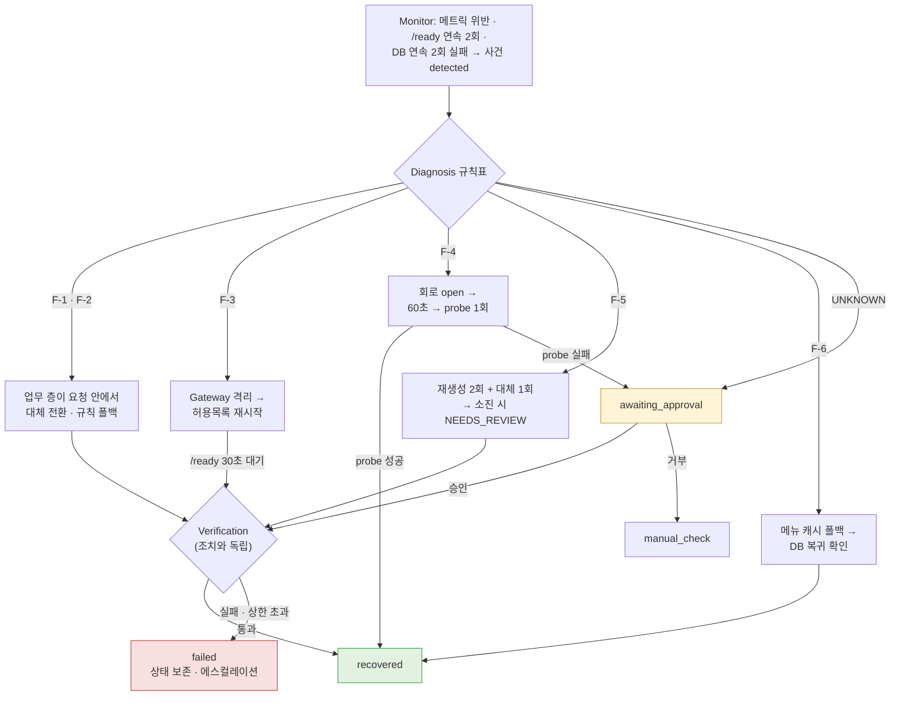

### 두 층의 접점 — F-1 예시

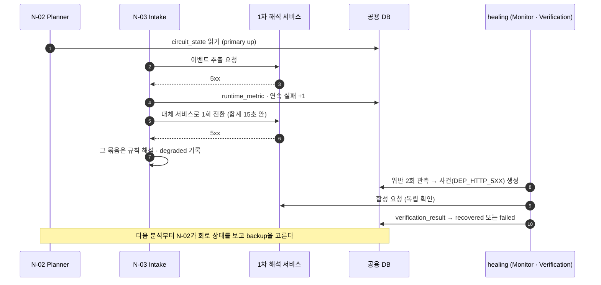

### 자율성 경계 — Human-in-the-loop

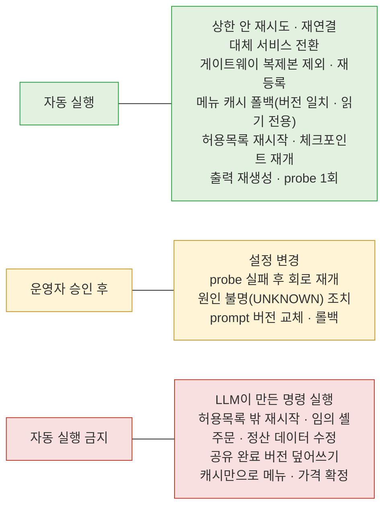

### 고의 장애 시험 workflow

운영 대시보드의 장애 시험 영역에서 템플릿을 고르고 사전 점검을 통과해야만 장애를 주입합니다. 시험은 `ENVIRONMENT=lab`에서만, 한 번에 하나만, 합성 데이터(`run_id`)로만 실행합니다.

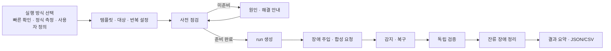

- 정식 측정은 처음에 복구 가능 5종 × 5회 = 25회로 계획했으나, 실제 시험은 **F-4까지 포함한 6종 × 25회 = 150회**로 늘려 수행했습니다([결과](#장애-시험-결과-150회))
- 사전 점검 항목: lab 환경 · DB · 스키마 · 게이트웨이 · 앱 A/B · worker heartbeat · socket-proxy 허용목록 · 포트 · 해석 서비스 · 정책 버전. 하나라도 준비되지 않으면 주입은 **0회**입니다
- 실행 범위: 순차 실행, 동시에 활성 workflow 하나, 단계 1 ~ 20개 · 반복 1 ~ 10회 · 주입 1 ~ 120초
- 상태는 셋을 구분합니다 — workflow `completed`(주입 · 정리 단계 종료), 사건 `recovered`(복구 성공), 독립 검증 `PASS`(기능 · 데이터 무결성 확인). 회차 판정(`PASS` · `FAIL` · `INVALID` · `AWAITING_APPROVAL`)은 따로 저장합니다
- 중지하면 합성 트래픽 정지 → 주입 해제 → 잔류 재확인 순서로 정리하고, 10초 안에 확인되지 않으면 `needs_operator_action`으로 남깁니다. worker가 재시작되면 lease를 다시 잡고 TTL로 남은 주입을 정리해 중복 실행을 막습니다

<br>

## 배포 구조: 공용 스택 + 앱 스택 A/B

Docker Engine 1대에 compose 파일 2개로 띄웁니다. 같은 앱 파일을 프로젝트 이름만 바꿔 두 번 띄워 **앱 복제본 A · B**를 만들고, 공용 스택의 게이트웨이가 두 스택에 요청을 나눕니다. 운영 대시보드는 A · B가 함께 죽어도 승인할 수 있도록 별도 스택(`moa-ops`)으로 둡니다.

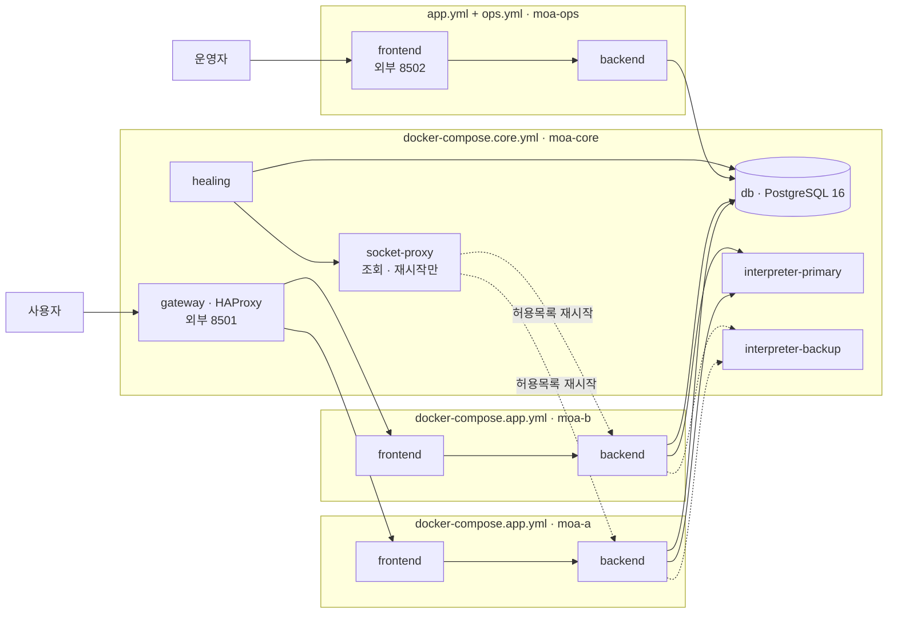

| 서비스                                 | 역할                                                                                | 재시작 정책                                                    |
| -------------------------------------- | ----------------------------------------------------------------------------------- | -------------------------------------------------------------- |
| `gateway`                            | 외부 8501 유일 공개, 쿠키 고정 · round-robin, 상태 확인으로 앱 스택 제외 · 재등록 | `unless-stopped`                                             |
| `db`                                 | 두 앱 스택과 healing이 공유하는 주문 · 사건 저장소(DB는 하나)                      | `unless-stopped`                                             |
| `interpreter-primary` · `-backup` | 주문 해석 서비스 1차 · 대체                                                        | primary `"no"`(장애 주입 대상) · backup `unless-stopped`  |
| `healing`                            | Monitor · Diagnosis · Recovery Worker · Verification. 외부 포트 없음             | -                                                              |
| `socket-proxy`                       | Docker 소켓 앞에서 허용목록 컨테이너의 상태 조회 · 재시작만 통과                   | `unless-stopped`                                             |
| 앱 `frontend` · `backend`         | Streamlit 화면 · FastAPI 업무 층                                                   | backend `"no"` — 재시작은 Recovery Worker의 허용목록 액션만 |

- 게이트웨이는 같은 스택 backend의 `/ready`를 2초 간격으로 보고, 2회 연속 실패하면 그 스택을 빼서 **15초 안에** 다른 스택으로 넘깁니다. 재시작 뒤에는 `/ready` 2회 연속 정상이어야 다시 넣습니다
- 게이트웨이는 제외 · 재등록만 하고, 재시작은 Recovery Worker가 허용목록 backend에 한해 **10분 안 최대 2회** 합니다. 재시작 성공만으로는 복구로 치지 않고 30초 안에 `/health` · `/ready` · frontend 연결과 기능을 다시 확인합니다
- 화면 상태는 Streamlit 메모리로 복구하지 않습니다. 다시 접속하면 세션 토큰으로 DB에서 주문 · 진행 상태를 다시 불러옵니다
- 실행 호스트 · 게이트웨이 · DB 자체의 장애는 범위 밖이며 앱 복제본 복구율과 분리해 기록합니다

<br>

## CI/CD 파이프라인

GitHub Actions 워크플로 `CI / CD` 하나로 검사 → 빌드 → 무중단 배포까지 자동화했습니다. **필수 검사 4종이 실패하면 PR은 merge되지 않고 배포도 일어나지 않습니다.**

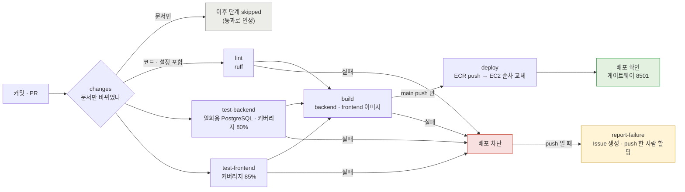

### 무중단 순차 배포 (`scripts/deploy.sh`)

두 앱 스택을 동시에 내리지 않습니다. A가 healthy · 게이트웨이 UP이 되지 않으면 B는 건드리지 않고 멈춥니다.

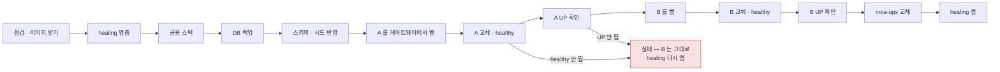

### 실측 (main `0cf85ac` · 2026-11-06)

| 지표                   | 기준      | 실측                                                                   |
| ---------------------- | --------- | ---------------------------------------------------------------------- |
| backend 커버리지       | 80%       | **84.64%**                                                       |
| frontend 커버리지      | 85%       | **99.30%**                                                       |
| backend 테스트         | 전부 통과 | **592 통과** (4 skipped · 1 xfailed)                            |
| frontend 테스트        | 전부 통과 | **109 통과**                                                     |
| 무중단 배포 소요       | -         | A 10초 → B 9초 → moa-ops 8초 · 전체 4분 50초                        |
| 앱 복제본 전환 (SC-12) | 15초 이내 | **2.1초** (재등록 0.8 ~ 2.2초, 순차 배포 중 요청 180건 모두 200) |

### 배포 차단 실증

<p align="center">
  <strong>SC-7 · 금액 계산을 망가뜨린 PR — test-backend 실패, build · deploy skipped, merge 막힘</strong><br>
  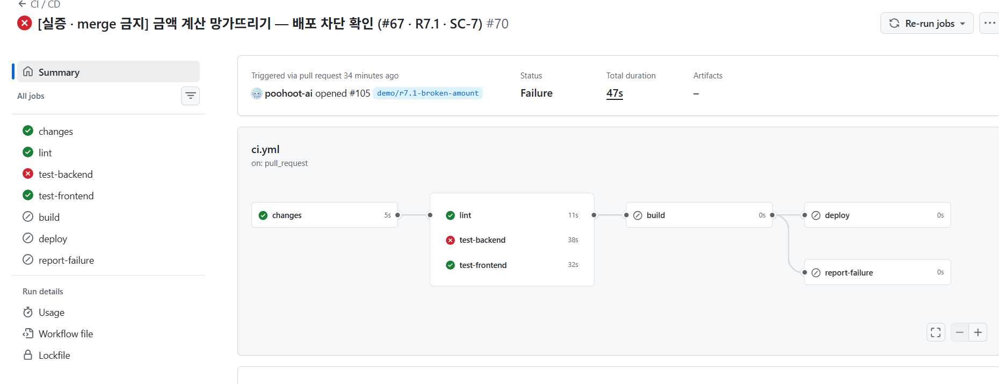<br>
  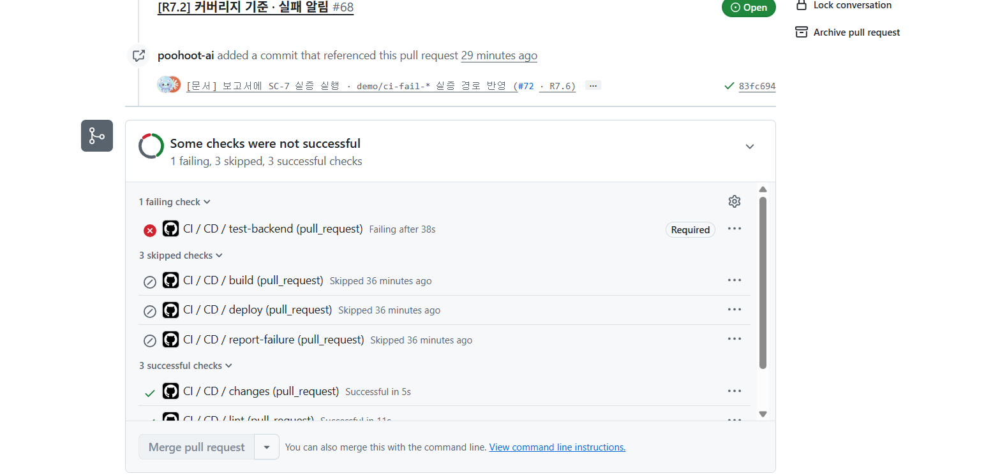
</p>

<p align="center">
  <strong>SC-10 · 테스트를 지워 통과시키려는 변경 — 커버리지 74.29% < 80% 로 실패</strong><br>
  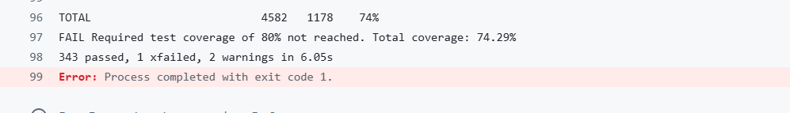
</p>

<p align="center">
  <strong>SC-11 · 실패 시 GitHub Issue 자동 생성 · push 한 사람 할당</strong><br>
  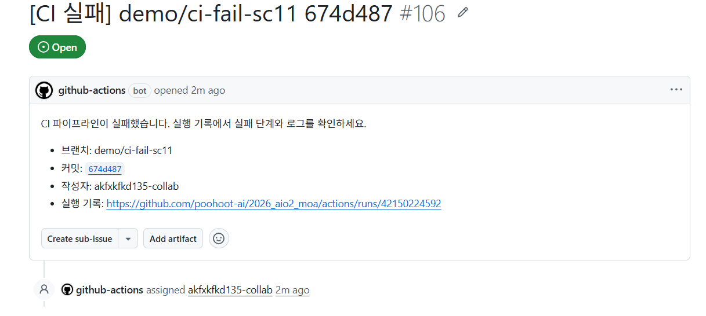
</p>

<br>

## 성공 기준과 측정 결과

| ID    | 지표                | 목표                                          | 상태                                              |
| ----- | ------------------- | --------------------------------------------- | ------------------------------------------------- |
| SC-1  | 정상 기준선         | 기준 채팅 5건 수량 · 정산 100% 일치          | 테스트로 검증                                     |
| SC-2  | MTTD                | 15초 이하                                     | 장애 시험 측정 대상                               |
| SC-3  | MTTR                | F-1 · F-2 · F-5 · F-6 60초, F-3 90초 이하  | 장애 시험 측정 대상                               |
| SC-4  | 무인 복구율         | 80% 이상                                      | **98.67%** (150회 중 148회, 아래 표)        |
| SC-5  | 데이터 무결성       | 중복 · 유실 0건, 개인 합계 = 전체 금액       | 장애 시험 측정 대상                               |
| SC-6  | 안전 에스컬레이션   | 승인 대기 전환 · FAILED 보존 100%            | 장애 시험 측정 대상                               |
| SC-7  | 배포 차단           | 테스트를 깨뜨린 변경 100% 차단                | **실증 완료** (PR #105)                     |
| SC-8  | 미등록 메뉴 차단    | 자동 확정 0건                                 | 테스트로 검증                                     |
| SC-9  | LLM 출력 통제       | 형식 미통과 전달 0건, LLM 의견만으로 통과 0건 | 테스트로 검증                                     |
| SC-10 | 테스트 커버리지     | 판정 규칙 · 장애 대응 모듈 80% 이상          | **84.64%** · 미달 시 실패 실증(Issue #109) |
| SC-11 | CI 실패 담당자 할당 | Issue 자동 생성 · 할당 100%                  | **실증 완료** (Issue #106)                  |
| SC-12 | 복제본 전환         | 감지 · 전환 각 15초 이내                     | **2.1초**                                   |

무인 복구율 산식: `수동 개입 없이 정상화된 유효 회차 ÷ 유효 장애 주입 회차 × 100`. 사람이 개입해야 끝난 회차는 분모에 남기고 실패로 셉니다.

### 장애 시험 결과 (150회)

150번 일부러 고장 내 봤습니다. 계획(5종 × 5회 = 25회)보다 범위를 넓혀 **6종 × 25회 = 150회**를 수행했습니다.

| ID             | 시나리오                       |          수행 |          성공 |        실패 |           성공률 |
| -------------- | ------------------------------ | ------------: | ------------: | ----------: | ---------------: |
| F-1            | HTTP 5xx · 대체 경로          |            25 |            25 |           0 |             100% |
| F-2            | 5초 초과 지연 · 15초 상한     |            25 |            25 |           0 |             100% |
| F-3            | App A/B 우회 · 재시작         |            25 |            25 |           0 |             100% |
| F-4            | 반복 장애 · 회로 차단 · 전환 |            25 |            23 | **2** |              92% |
| F-5            | 출력 오류 재생성 · 검증       |            25 |            25 |           0 |             100% |
| F-6            | 메뉴/DB 장애 · 캐시 폴백      |            25 |            25 |           0 |             100% |
| **합계** | 6개 유형                       | **150** | **148** | **2** | **98.67%** |

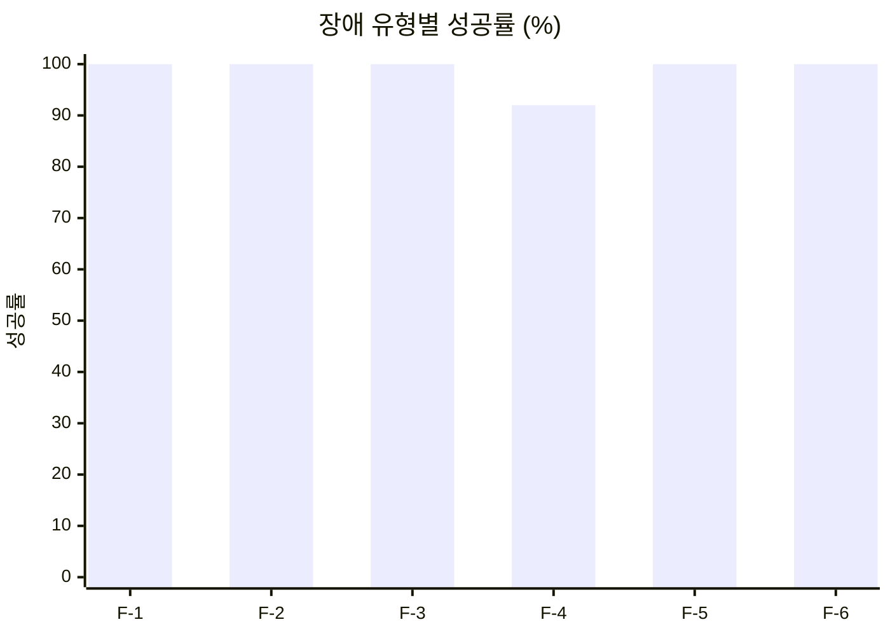

> [!WARNING]
> **F-4 실패 2회 — 원인 미확인.** 25회 중 2회에서 Interpreter Primary → Backup 전환이 정상적으로 수행되지 않았습니다. 전환 로직과 Circuit Breaker 상태 처리(회로 차단 · probe)를 점검한 뒤 재시험하는 것이 주요 개선 과제입니다.

> [!NOTE]
> **결과를 읽을 때 알아 둘 점**
>
> - 시험자 보고 기준입니다. 보고된 150회를 모두 시험 회차로 집계했고 무효 회차 정보는 없습니다. App 장애 중 운영 화면 접근 · 중지 · 잔류 주입 정리 시험(T-OPS)은 아직 결과가 없습니다
> - 성공률 산식: 전체 148 ÷ 150 × 100 = 98.67%, F-4 23 ÷ 25 × 100 = 92%
> - PRD는 F-4를 무인 복구율 분모에서 빼고 별도 안전성 시험으로 셉니다. 이 기준으로 F-4를 빼면 복구 가능 5종은 **125회 중 125회(100%)** 입니다
> - 회차별 실행 로그와 감지 · 복구 소요 시간은 제공되지 않아 MTTD · MTTR · 데이터 무결성(SC-2 · SC-3 · SC-5) 수치는 이 결과에 들어 있지 않습니다. 운영 환경의 가용성이나 복구 시간을 따로 입증한 결과도 아닙니다. 자세한 내용은 [MOA 배포 및 장애 복구 보고서](docs/배포_및_장애_복구_보고서.md)에 있습니다

<br>

---

# 프로젝트 문서

> 아래 내용은 저장소를 실행하거나 배포하는 개발자를 위한 문서입니다.

<br>

## 폴더 구조

```
2026_aio2_moa/
├── backend/                 # FastAPI (API 서버, 8000 포트)
│   ├── app/
│   │   ├── main.py          # 앱 생성 · trace_id · 오류 포장 · 라우터 등록
│   │   ├── api/             # HTTP 층 — 인증 · 입력 검사 · 포장
│   │   └── services/        # 업무 로직 — 매장 판별 · 해석 · 메뉴 매칭 · 검증 · 정산 · 사건
│   ├── healing/             # 장애 대응 층 — Monitor · Diagnosis · Recovery Worker · Verification
│   ├── interpreter/         # 주문 해석 서비스 (primary · backup 컨테이너로 뜬다)
│   ├── prompts/             # 에이전트 런타임 프롬프트 (제품 자산)
│   ├── sql/                 # 스키마 · 시드 · run_sql.py (DB 초기화)
│   ├── tools/seed_demo.py   # 시연 세션 3건
│   ├── tests/
│   ├── requirements.txt · requirements-dev.txt
│   └── Dockerfile
├── frontend/                # Streamlit (화면, 8501 포트)
│   ├── app.py               # 페이지 등록만 한다 (st.navigation)
│   ├── api_client.py        # 에이전트 서버 호출 (BACKEND_URL 환경변수)
│   ├── screens/             # 화면 4종 — start · review · order · ops
│   ├── moa/                 # 토큰 · 문구 · 레이아웃 · 컴포넌트 · 대화상자 · 상태 · 모의 응답
│   ├── tests/
│   └── Dockerfile
├── docker-compose.core.yml  # 공용 스택 — gateway(8501) · db · 해석 서비스 2계통 · socket-proxy · healing
├── docker-compose.app.yml   # 앱 스택 — frontend · backend. -p moa-a · -p moa-b 로 두 번 띄운다
├── docker-compose.ops.yml   # 운영 대시보드 전용 덧씌우기 (-p moa-ops, 8502)
├── docker-compose.*.dev.yml # 로컬 개발용 덧씌우기 — 127.0.0.1 에만 포트를 연다
├── gateway/haproxy.cfg      # A/B 분산 · 쿠키 고정 · /ready 로 제외 · 재등록
├── socket-proxy/haproxy.cfg # Docker API 관문 — 조회 + 허용목록 컨테이너 재시작만
├── scripts/                 # init-networks · deploy · db-backup · dep-test · fault · server-check
├── docs/                    # PRD · 설계서 · 보고서
└── .github/workflows/ci.yml # CI/CD
```

프론트엔드는 백엔드 코드를 import하지 않고 HTTP로만 통신합니다. `backend/` 폴더만 따로 받아도 실행 · 테스트 · DB 초기화가 됩니다 — 방법은 [backend/README.md](backend/README.md)에 있습니다.

<br>

## 화면

| URL                      | 화면          | 내용                                                                                                  |
| ------------------------ | ------------- | ----------------------------------------------------------------------------------------------------- |
| `/`                    | 주문 시작     | 서비스 소개 대화 · 예시 채우기 · `.txt` 올리기 · 대화 미리보기 · [정리하기] · 매장 되묻기 모달 |
| `/s?s={관리 토큰}`     | 주문 정리     | 왼쪽 주문서 패널 + 오른쪽 채팅 · 진행 4단계 · 확인 질문(한 번에 하나) · 채팅 수정 · 행 편집       |
| `/order?s={관리 토큰}` | 주문서        | 묶음 목록 · 이름 눌러 바꾸기 · 답장 반영 · 공유하기(= 완료 처리)                                   |
| `/ops`                 | 운영 대시보드 | 비밀번호 · 승인 필요 · 지금 상태 · 사건 · 지표 · 주문 처리 기록 · 장애 시험                     |

세션 관리 토큰은 **쿼리 파라미터로 받아 `X-Session-Token` 헤더로** 보냅니다. API 경로에 넣지 않습니다.

**화면 미리보기 모드** (`MOA_UI_PREVIEW=1`, 기본 꺼짐) — 켜면 서버가 응답하지 않는 구간을 예시 데이터(`frontend/moa/mock.py`)로 채워 서버 없이 화면을 볼 수 있습니다. 서버와 함께 쓸 때는 켜지 않습니다 — 세션을 잃었을 때 오류 대신 예시 주문서가 그려집니다.

<br>

## 실행 방법

### 방법 1: Docker Compose (권장)

Docker Desktop을 켠 뒤 프로젝트 루트에서 실행합니다. 루트 `.env` 에 `POSTGRES_PASSWORD` · `HEALING_RW_PASSWORD`, `backend/.env` 에 LLM 키 등 앱 비밀값을 둡니다(각각 `.env.example` · `backend/.env.example` 을 복사해 채웁니다).

```bash
sh scripts/init-networks.sh                                                         # 처음 한 번: 네트워크 3개
docker compose -f docker-compose.core.yml -p moa-core up -d --build                 # 공용 스택을 먼저
docker compose -f docker-compose.app.yml  -p moa-a    run --rm backend python sql/run_sql.py   # 처음 한 번: 롤 · 스키마 · 시드
docker compose -f docker-compose.app.yml  -p moa-a    up -d                         # 앱 복제본 A
docker compose -f docker-compose.app.yml  -p moa-b    up -d                         # 앱 복제본 B
docker compose -f docker-compose.app.yml -f docker-compose.ops.yml -p moa-ops up -d # 운영 대시보드 (:8502)
```

- 화면: http://localhost:8501 (게이트웨이) · 운영 대시보드: http://localhost:8502
- 개발용 덧씌우기(127.0.0.1 에만 열림)
  - `docker compose -f docker-compose.core.yml -f docker-compose.core.dev.yml -p moa-core up -d` → DB `5434` · 게이트웨이 상태 페이지 http://localhost:8404/stats
  - `DEV_FRONT_PORT=8511 DEV_BACK_PORT=8001 docker compose -f docker-compose.app.yml -f docker-compose.app.dev.yml -p moa-a up -d` → A 화면 `8511` · API http://localhost:8001/docs (B 는 8512 · 8002)
- 주문 해석 서비스는 기본이 LLM 해석(`INTERPRETER_SOURCE=llm`)입니다. 장애 실험을 반복할 때처럼 같은 입력에 같은 결과가 필요하면 공용 스택을 `INTERPRETER_SOURCE=rules` 로 띄웁니다
- compose 의 `depends_on` 은 프로젝트를 넘지 못하므로 공용 스택을 먼저 띄웁니다. 정리는 앱 스택 · 공용 스택 순서로 `down` (**`-v` 금지** — DB 볼륨 `moa_pgdata` 가 지워집니다)

### 방법 2: 직접 실행

[uv](https://docs.astral.sh/uv/)로 가상환경을 **두 개** 만듭니다. Streamlit 1.66 은 `starlette>=0.46` 을, FastAPI 0.115.6 은 `starlette<0.42` 를 요구해 한 환경에 함께 설치하면 나중에 설치한 쪽이 다른 쪽을 깨뜨립니다.

```bash
uv venv -p 3.11                      # .venv          — backend
uv venv -p 3.11 .venv-frontend       # .venv-frontend — frontend

cd backend  && uv pip install --python ../.venv/Scripts/python.exe -r requirements-dev.txt
cd frontend && uv pip install --python ../.venv-frontend/Scripts/python.exe -r requirements-dev.txt
```

```bash
cd backend  && ../.venv/Scripts/python.exe -m uvicorn app.main:app --reload --port 8000
cd frontend && ../.venv-frontend/Scripts/python.exe -m streamlit run app.py
```

macOS · Linux 는 `../.venv/bin/python` 입니다. 프론트엔드는 기본으로 `http://localhost:8000`에 접속하며, 다른 주소는 `BACKEND_URL` 로 지정합니다.

### 방법 3: EC2 서버 (ECR 이미지)

서버는 빌드하지 않고 ECR 에서 이미지를 받습니다. 로컬과 같은 compose 파일을 쓰고, 이미지 주소만 `.env` 의 `REGISTRY` 로 바꿉니다. 평소에는 **main 에 merge 하면 CI 가 배포까지 합니다.** 수동 배포는 아래와 같습니다.

```
~/moa/
├── docker-compose.core.yml · docker-compose.app.yml · docker-compose.ops.yml
├── gateway/haproxy.cfg · socket-proxy/haproxy.cfg
├── scripts/                 # CI 가 배포마다 복사
├── logs/<컨테이너>/        # 14일 보관
├── backups/                # DB 백업 (배포마다 자동 · 최근 14개)
├── .env                    # POSTGRES_PASSWORD · HEALING_RW_PASSWORD · REGISTRY=<계정 ID>.dkr.ecr.ap-northeast-2.amazonaws.com/
└── backend/.env
```

```bash
cd ~/moa
aws ecr get-login-password --region ap-northeast-2 | docker login --username AWS --password-stdin <계정 ID>.dkr.ecr.ap-northeast-2.amazonaws.com
sh scripts/init-networks.sh
bash scripts/deploy.sh        # 공용 → DB 백업 · 스키마 반영 → 해석 서비스 → 앱 A → (A UP 확인) → 앱 B → moa-ops
```

- 처음 배포 전 점검: `bash scripts/server-check.sh` (읽기만 한다 — 메모리 · compose 기능 · `.env` 키)
- **호스트를 재부팅했으면 `bash scripts/deploy.sh` 를 한 번** 돌립니다 — `restart: "no"` 인 backend · interpreter-primary 는 자동으로 뜨지 않습니다
- DB 백업 직접 실행: `bash scripts/db-backup.sh` · 목록 `list` · 복원 `restore <파일>`
- 이미지는 x86(amd64) 로 빌드됩니다. Arm(Graviton) 인스턴스에서는 뜨지 않습니다

<br>

## 테스트

직접 실행의 가상환경 · 패키지 설치를 마친 뒤 각 폴더에서 실행합니다. CI도 같은 명령을 씁니다.

```bash
cd backend
../.venv/Scripts/python.exe -m pytest -q                                                       # 계약 테스트 (DB 없이)
MOA_LIVE_DB=1 ../.venv/Scripts/python.exe -m pytest -q --cov=app --cov-fail-under=80           # .env 의 DB 로 전체 흐름까지
```

```bash
cd frontend
../.venv-frontend/Scripts/python.exe -m pytest -q --cov=api_client --cov-fail-under=85
```

이중화 배포 시험(DEP-1 ~ 5)은 `scripts/dep-test.sh`, 단발 F-3 주입은 `scripts/fault.sh` 입니다.

<br>

## CI 설정

`main` · `dev` push, 그쪽으로 향하는 PR, 실증 전용 `demo/ci-fail-*` push 에서 실행됩니다. `deploy` 는 **main push 일 때만** 돕니다. 룰셋 `dev-main-protect` 가 PR 필수 · 필수 검사 4종(`lint` · `test-backend` · `test-frontend` · `build`) 통과를 강제합니다.

`deploy` 에 필요한 GitHub Secrets:

| 이름                                               | 값                                                                                                                    |
| -------------------------------------------------- | --------------------------------------------------------------------------------------------------------------------- |
| `AWS_ACCESS_KEY_ID` · `AWS_SECRET_ACCESS_KEY` | ECR push 권한 + `ec2:AuthorizeSecurityGroupIngress` · `ec2:RevokeSecurityGroupIngress` 권한이 있는 IAM 사용자 키 |
| `EC2_HOST`                                       | EC2 퍼블릭 IP 또는 DNS                                                                                                |
| `ECR_REGISTRY`                                   | `<계정 ID>.dkr.ecr.ap-northeast-2.amazonaws.com` (끝에 / 없음)                                                      |
| `EC2_SSH_KEY`                                    | 키 페어 `.pem` 파일 내용 전체                                                                                       |
| `EC2_SG_ID`                                      | EC2 보안 그룹 ID — 배포 동안만 러너 IP 를 22번에 허용하고 끝나면 지운다                                              |

SSH 사용자는 기본 `ubuntu` 입니다. 다른 사용자면 Secrets 가 아니라 **Variables** 에 `EC2_USER` 를 둡니다.

<br>

## 관련 문서

| 문서                                                                                                       | 내용                                                                                  |
| ---------------------------------------------------------------------------------------------------------- | ------------------------------------------------------------------------------------- |
| [PRD](docs/PRD.md)                                                                                          | 목표 · 사용자 흐름 · 매장 판별 · 시스템 구성 · 장애 정책 수치 · 성공 기준 (정본) |
| [멀티 에이전트 아키텍처 설계서](<docs/멀티에이전트%20아키텍처%20설계서.md>)                                 | 두 층 구조와 선정 이유, 역할별 책임, Handoff, 공유 상태, 가드레일                     |
| [MOA 배포 및 장애 복구 보고서](docs/배포_및_장애_복구_보고서.md)                                        | 배포 구성 · 장애 위치도, F-1 ~ F-6 복구 정책 · 검증 기준, 고의 장애 시험 150회 결과 |
| [파이프라인 구현 결과 보고서](docs/파이프라인_구현_결과_보고서.md)                                          | CI/CD 단계별 입출력 · 블로킹 정책 · 실행 기록 · SC-7 · SC-10 · SC-11 실증        |
| [시스템정의서](docs/시스템정의서.md)                                                                        | 기술 스택 · 배포 형태 · 운영 절차                                                   |
| [자동장애복구 계획서](docs/자동장애복구_계획서v0.md) · [자동복구 흐름설계서](docs/자동복구_흐름설계서v0.md) | 메트릭 · 임계값 · 복구 스크립트 명세 · 제어 흐름                                   |
| [테스트 시나리오](docs/MOA_테스트_시나리오.md)                                                              | 기능 · 장애 시험 시나리오                                                            |

<br>

<a id="회고"></a>

## 회고

<table>
  <thead>
    <tr>
      <th width="14%" align="center">이름</th>
      <th width="18%" align="left">역할</th>
      <th align="left">회고</th>
    </tr>
  </thead>
  <tbody>
    <tr>
      <td align="center">이성우</td>
      <td>팀장 · 서비스 · 멀티 에이전트</td>
      <td>· 멀티 에이전트 구조와 역할을 더 깊이 공부하기<br>· 실패 사례를 교훈 삼아 다음에는 더 잘하기<br>· 역할 분리와 WBS 이슈화<br>· 코드 프리징 이후에도 추가 수정이 이어졌고, 마지막 날 결함 수정과 발표 준비를 함께 해야 했다 — 미리미리 해 두는 습관이 필요하다<br>· 일정에 20 ~ 30% 여유를 잡기<br>· 산출물을 미리 검증 · 검토하기</td>
    </tr>
    <tr>
      <td align="center">노지훈</td>
      <td>Auto Healing</td>
      <td>· AI가 만든 내용을 충분히 검토하고 요약한 뒤 전달한다<br>· AI가 만든 자료가 이해하기 어려우면 그림을 그려 달라고 해서 이해도를 높인다<br>· AI를 너무 믿지 않는다<br>· 정리되지 않은 자료를 공유하지 않는다<br>· 시작할 때 계획과 구성을 정밀하게 구조화한다<br>· AI가 짜 준 기획의 오류를 검토한다<br>· 다양한 기능을 직접 구현해 본다</td>
    </tr>
    <tr>
      <td align="center">강민우</td>
      <td>CI · QA</td>
      <td>· 막힌 부분은 바로바로 물어보기<br>· AI를 너무 믿지 말기<br>· 다음 프로젝트에서는 맡은 역할을 먼저 확인해 시간 분배를 잘하기<br>· AI가 만들어 준 결과물을 제대로 검토하기</td>
    </tr>
    <tr>
      <td align="center">이홍진</td>
      <td>CD · 배포</td>
      <td>· 해내지 못할 일은 없다는 마음가짐<br>· AI가 내놓은 산출물을 그대로 믿지 않기 — 꼼꼼한 검증이 필요하다</td>
    </tr>
    <tr>
      <td align="center">백승주</td>
      <td>측정 · 검증</td>
      <td>· GPT 한도를 다 쓸 만큼 활용하고 프롬프트를 연구하기<br>· AI에게 모든 것을 맡기는 태도를 경계하기<br>· 안 된다고 혼자 시간 버리지 말고 물어봐서 해결하기<br>· 몸 관리를 잘해서 결석하지 않기<br>· 배운 내용의 용어 정리와 실습을 반복 연습하기<br>· 1인분이라도 할 수 있는 역할 찾기<br>· 인프런 강의를 잘 활용하기</td>
    </tr>
  </tbody>
</table>
