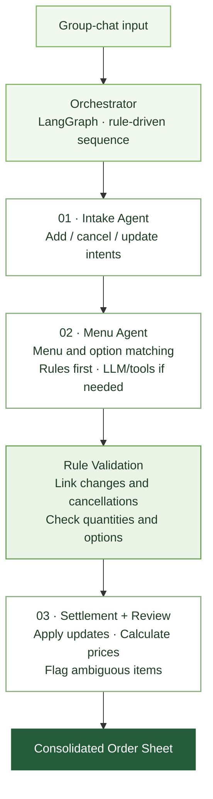

<div align="center">


# MOA — Multi-Agent Order Assistant
**Turning group-chat coffee requests into one consolidated order, with resilient service recovery.**

`FastAPI` · `LangGraph` · `Multi-Agent` · `Auto Healing` · `HAProxy` · `PostgreSQL` · `Docker Compose`

[**Project Page (English)**](https://931njhthe-star.github.io/en/moa/) · [**한국어 프로젝트 페이지**](https://931njhthe-star.github.io/moa/) · [**Technical Documentation**](docs/README.md)

</div>

---

## Project Overview

MOA is a **five-person team project** that transforms natural-language coffee orders from group chats into one consolidated order sheet. It interprets **menu items, options, quantities, updates, and cancellations**.

For example, if someone orders "two tall iced Americanos, one with an extra shot" and later cancels the extra-shot drink, MOA links the cancellation to the earlier request and updates the totals. The LLM interprets messages and proposes candidates, while **explicit rules govern menu confirmation, pricing, and validation**.

A separate **Auto-Healing system** detects and helps recover from service failures without depending on the availability of the ordering application itself.

## Multi-Agent Order Processing



**Design principle: separate LLM interpretation from deterministic decisions.** LLMs handle natural-language understanding and candidate suggestions; menu confirmation, price calculation, and validation are controlled by rules. Checkpoints preserve processing state so interrupted tasks can resume.

## System Architecture


| Component | Responsibilities |
| --- | --- |
| **Order processing** | Intake, Menu, and Review agents; rule validation, settlement, and order-sheet generation |
| **Availability** | HAProxy gateway, App A/B replicas, and primary/backup interpreters |
| **Recovery** | Independent Healing Service: Monitor → Diagnosis → Recovery Worker → Verification |
| **Delivery & quality** | Docker Compose, GitHub Actions, automated tests, and deployment support |

> **System boundaries:** LLMs propose interpretations, but explicit rules govern order confirmation and permitted recovery actions. Request-level fallback and service-level recovery are separate mechanisms.

## My Contribution — Auto Healing

**Role: Auto-Healing system development (Jihun Rho).**  
MOA was built collaboratively by five team members. I do not claim sole ownership of the ordering service, multi-agent implementation, QA, or CI/CD.

- **Detection & diagnosis:** Monitor health checks, logs, and failed requests; classify incidents and track their state.
- **Recovery workflows:** Coordinate limited retries, alternate interpreters, restarts, circuit breakers, and cache fallback under predefined action policies.
- **Independent verification:** Check functionality and health after recovery; preserve incident state or escalate when recovery does not succeed.
- **Fault injection & observability:** Support simulated failures, incident records, operational dashboards, and recovery metrics.

One critical design decision was to **separate recovery and test controls from the ordering application**. If these controls were embedded in a failing app, operators might lose access to them precisely when they were needed.

### Failure Scenarios

| ID | Failure | Recovery strategy |
| --- | --- | --- |
| F-1 | HTTP 5xx | Limited retry, then switch to an alternate order interpreter |
| F-2 | Response timeout | Apply timeout handling and alternate interpretation path |
| F-3 | App process or replica outage | Redirect traffic → restart → resume from checkpoint |
| F-4 | Repeated failures | Open circuit → single probe → await operator approval as required |
| F-5 | Invalid AI output | Regenerate → validate format and business rules |
| F-6 | Menu database failure | Reconnect → cached-data fallback |

For implementation details and limitations, see the [Recovery Report](docs/배포_및_장애_복구_보고서.md).

## Reported Validation Results

| Metric | Reported result |
| --- | --- |
| Failure scenarios | **6** (F-1 through F-6) |
| Test attempts | **150** (25 per scenario) |
| Successful attempts | **148 / 150 (98.67%)** |
| Failed attempts | **2 in F-4** (related to primary-to-backup transition) |

**Evidence boundary:** These figures were **reported by the tester**. Per-attempt raw logs and recovery durations were not provided, so they are not presented as independently reproduced results or production availability metrics. Measured MTTD/MTTR values are not claimed. The exact cause of the two failed attempts requires further verification.

## Tech Stack & Local Setup

- **AI / Application:** Python, FastAPI, LangGraph, Streamlit
- **Recovery / Infrastructure:** HAProxy, Docker Compose, PostgreSQL, separate Healing Worker
- **Quality / Delivery:** GitHub Actions, automated testing, and fault-injection workflows

Running locally requires Docker Desktop and environment variables. Do not commit secrets; use `.env.example` and `backend/.env.example` as configuration references.

```bash
sh scripts/init-networks.sh
docker compose -f docker-compose.core.yml -p moa-core up -d --build
docker compose -f docker-compose.app.yml -p moa-a run --rm backend python sql/run_sql.py
docker compose -f docker-compose.app.yml -p moa-a up -d
docker compose -f docker-compose.app.yml -p moa-b up -d
docker compose -f docker-compose.app.yml -f docker-compose.ops.yml -p moa-ops up -d
```

- Application: `http://localhost:8501`
- Operations dashboard: `http://localhost:8502`
- For development configuration, local execution, EC2 deployment, and test procedures, see the [Documentation Index](docs/README.md) and the original `dev` branch.
- Avoid `docker compose down -v`, which deletes database volumes and can cause data loss.

## Documentation & Source

- [Technical Documentation Index](docs/README.md)
- [Auto-Healing Recovery Report](docs/배포_및_장애_복구_보고서.md)
- [Multi-Agent Architecture Design](docs/멀티에이전트%20아키텍처%20설계서.md)
- [Original Development Branch](https://github.com/931njhthe-star/moa/tree/dev)

> The `main` branch prioritizes a **portfolio-oriented overview and curated documentation**; `dev` preserves the team's development history. Team contributions and my individual responsibilities are distinguished throughout.
