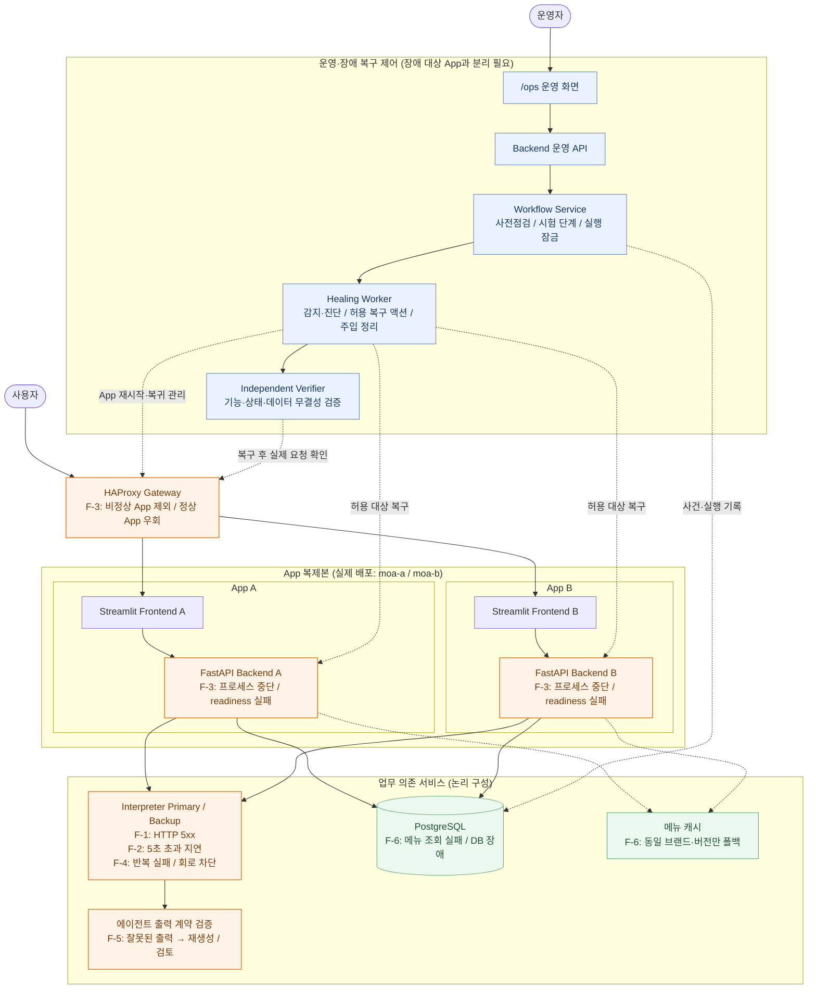
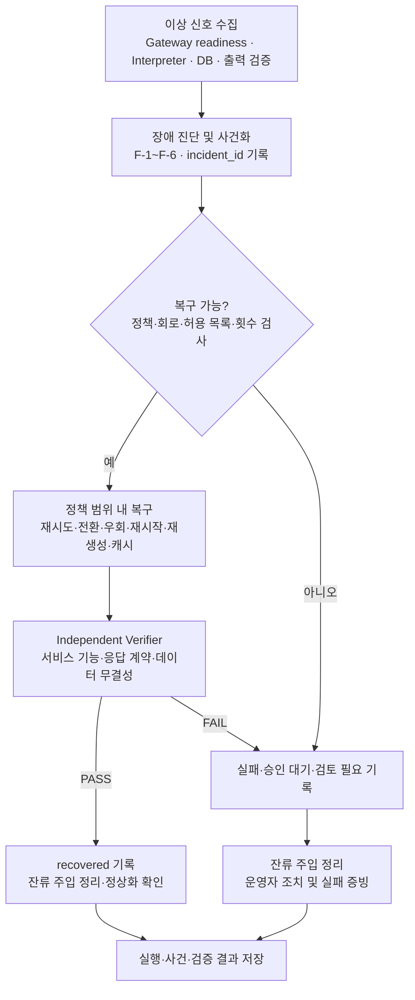

# 배포 및 장애 복구 보고서

> **문서 상태:** 장애 복구 시나리오 150회 결과 반영  
> **대상:** Gateway(HAProxy), App A/B, Interpreter Primary/Backup, PostgreSQL, 운영 API, Workflow Service, Healing Worker, Independent Verifier  
> **기준 브랜치:** `dev`
>
> **시험 결과 요약:** F-1~F-6 각각 25회(총 150회)를 수행했다는 시험자 보고를 반영했다. F-4에서 전환 실패 2회, 나머지 148회 시나리오 성공으로 보고되었다. 회차별 로그와 시간 측정값은 제공되지 않았으므로 결과는 시험자 보고 기준으로 정리했다.

## 1. 목적 및 범위

MOA 서비스의 배포 구성을 정리하고, 고의 장애 발생 시 감지·우회·재시작·폴백·독립 기능 검증이 의도대로 동작하는지 확인한다. 장애 시험은 고객 데이터와 분리된 **lab 환경**에서만 수행한다.

- 대상: F-1~F-6, Gateway의 App A/B 전환, 별도 Healing Service, 독립 운영 화면.
- 시험 흐름: 사전 점검 → 장애 주입 → 감지 → 복구 → 독립 검증 → 주입 해제 → 결과 기록.
- `completed`(시험 단계 종료), `recovered`(복구 성공), 기능 검증 `PASS`를 서로 구분한다.
- 수행 결과는 **시험자 보고**와 **로그로 확인된 검증 결과**를 구분한다. 확인되지 않은 기능은 **확인 필요**로 표시한다.

## 2. 시스템 구조

이 장은 **기존 GitHub 보고서 4장의 구성요소 책임과 논리 데이터 흐름을 우선**한다. 참고 그림은 이해를 돕는 자료이며, 그림에 없는 구성요소를 임의로 삭제하거나 그림의 연결 방식으로 구현을 확정하지 않는다.

### 2.1 구성요소와 책임

| 구성요소 | 보고서 기준 역할 | 구분해야 하는 사항 |
| --- | --- | --- |
| Gateway / HAProxy | App A/B의 `/ready` 상태 확인, 비정상 복제본 제외 및 정상 복제본으로 트래픽 전달 | Gateway 자체는 복구 성공이나 업무 데이터 정합성을 판정하지 않음 |
| App A/B | 각 복제본의 Streamlit Frontend·FastAPI Backend, 실제 요청 처리 및 `/health`, `/ready`, 체크포인트 처리 | 서비스 처리와 장애 시험 제어 기능은 분리 |
| Interpreter Primary/Backup | 업무 요청의 해석기 경로. 장애 시 정책 범위 내 제한된 대체 경로 사용 | F-1·F-2·F-4 대상. 두 계통 모두 불가하면 성공 처리하지 않음 |
| PostgreSQL | 앱 업무 데이터 및 `healing` 영역의 장애·시험·감사 기록 관리 | 실제 스키마·연결 방식은 배포 시 확인 |
| `/ops` Frontend | 운영자의 템플릿 선택·사전 점검·실행·중지·진행·결과 확인 | 복구 액션을 화면에서 직접 실행하지 않음 |
| Backend 운영 API | 인증·입력 검증, 사전 점검 집계, run 생성·조회·중지, 결과 내보내기 | 긴 복구 작업을 요청 스레드에서 동기 실행하지 않음 |
| Workflow Service | 순차 단계·반복·상한·단일 실행 잠금·상태 전이 관리 | 임의 정책·임의 장애 액션을 생성하지 않음 |
| Healing Worker | lease/heartbeat 기반 실행권 확보, 장애 감시·진단·허용 복구 액션·주입 해제 | 허용목록 밖 컨테이너 제어 금지 |
| Docker Socket Proxy | worker에 필요한 범위의 제한된 Docker 제어만 제공 | Docker socket 전체 권한 노출 금지 |
| Synthetic Traffic Runner | `run_id`가 붙은 가짜 주문·세션 요청을 실제 처리 경로로 전송 | 실제 고객 주문·세션 수정 금지 |
| Independent Verifier | 복구 액션과 분리해 서비스 기능·상태·데이터 무결성 판정 | 컨테이너 재시작 성공만으로 PASS를 주지 않음 |

> **실제 배포와 논리 역할은 다르다.** 위 항목은 책임 분리이며 각 항목이 모두 독립 컨테이너임을 의미하지 않는다. 기존 참고 배포 그림의 `moa-core`, `moa-a`, `moa-b` 경계 및 운영 UI의 물리적 위치는 테스트에 사용한 Compose 설정과 `docker compose ps`로 확인한다.

### 2.2 실제 배포 경계 확인용 표

| 배포 단위(참고 그림) | 표시된 구성 | 테스트 시 확인할 사항 |
| --- | --- | --- |
| `moa-core` | HAProxy, Healing Service, PostgreSQL, Interpreter 계통 | 실제 컨테이너 이름, 서비스별 네트워크, socket proxy·worker 구성 |
| `moa-a` | Streamlit Frontend A, FastAPI Backend A | 실제 포트, `/health`, `/ready`, Gateway에서의 대상 |
| `moa-b` | Streamlit Frontend B, FastAPI Backend B | 실제 포트, `/health`, `/ready`, Gateway에서의 대상 |
| 운영/시험 제어 | `/ops` UI·Backend API·Workflow Service | 어느 컨테이너에서 제공되는지, App A/B 장애에도 접근 가능한지 |
| 검증/합성 트래픽 | 독립 검증·합성 요청 | 배포 위치 및 실제 사용자 요청 경로 사용 여부 |

### 2.3 멀티 컨테이너 배포 및 관리 요약

| 항목 | 적용 내용 |
| --- | --- |
| 배포 | Docker Compose 기반 `moa-core`, `moa-a`, `moa-b` 구성 |
| 서비스 디스커버리 | Docker 네트워크의 서비스명 기반 통신 여부는 설정 확인 필요 |
| 로드밸런싱 | HAProxy를 통한 App A/B 요청 분산 및 장애 우회 구조 |
| 시크릿 관리 | API 키·DB 비밀번호의 환경변수/시크릿 관리 방식 확인 필요 |

### 2.4 시스템 구성 및 F-1~F-6 장애 발생 위치도

아래는 **현재 보고서의 구성요소·책임을 기준으로** 각 장애가 발생하거나 감지되는 위치를 표시한 논리 구조도다. F-3은 App Backend 장애와 Gateway의 우회 동작을 함께 표시하고, F-5는 Interpreter 자체 장애가 아닌 **에이전트 출력 검증 단계**에 배치했다.

> **그림 읽는 방법:** 주황색은 장애가 발생하거나 장애 대응이 필요한 위치, 파란색은 시험·복구 제어, 초록색은 DB/캐시다. 점선은 주 요청 흐름이 아닌 제어·검증·폴백 경로다. 실제 Docker 컨테이너 배치는 2.2절에 따라 확인한다. **Interpreter, 출력 validator, 캐시, 운영 구성요소가 각각 별도 컨테이너라는 뜻은 아니다.**

### 2.5 자동 장애 복구 및 검증 흐름도

1. **관측·감지:** Gateway readiness, Interpreter 요청 결과, DB/출력 검증 등의 신호를 정책에 따라 수집한다.
2. **진단·사건화:** 장애 유형·대상·근거를 기록하고 `incident_id`를 생성하거나 기존 사건과 연결한다.
3. **복구 실행:** 회로 상태·허용 액션·시도 횟수·시간 상한을 확인하고 정의된 조치만 실행한다.
4. **독립 검증:** 복구 액션과 별도로 사용자 경로의 기능 응답·데이터 무결성·서비스 상태를 검사한다.
5. **종료·기록:** 독립 검증 PASS일 때만 복구 성공으로 기록하고, 실패·승인 필요·검토 필요 상태는 구분한다.

운영 중 실제 장애 복구와 lab의 고의 장애 시험은 **복구 정책·액션·검증 로직을 공유**하되, 고의 장애 주입 권한은 lab 환경으로 제한한다.

### 2.6 설계 개선: 장애 대상과 시험 제어의 분리

초기 설계처럼 시험 화면을 장애 대상 Streamlit 안에만 두면 서비스 중단 때 접근할 수 없을 수 있다. 기존 보고서는 `/ops` 운영 화면과 Backend 운영 API, Workflow Service, Healing Worker를 **논리적으로 분리**한다. 단, 논리적 분리가 물리적 장애 격리를 보장하지는 않으므로 App A 또는 B 종료 시 운영 화면에서 주입·진행 조회·중지·정리를 실제 수행할 수 있는지 확인한다.

## 3. 장애 유형별 복구 정책과 검증 기준

**아래 내용은 현재 GitHub 보고서의 정책 계약을 기준으로 정리했다.** 세부 구현과 정책 일치 여부는 이 문서에서 추가 확인되지 않았다.

| 유형 | 감지·장애 조건 | 복구 동작 | 독립 검증·실패 처리 |
| --- | --- | --- | --- |
| **F-1 HTTP 5xx** | 실제 interpreter 요청의 5xx를 기록하고 실패·회로 상태를 갱신 | 회로 상태 확인 후 허용된 반대 interpreter로 **최대 1회 전환**. 추가 재시도/backoff는 확정 정책에 따름 | 정상 기능·출력 계약 확인. 전환·검증 실패를 성공으로 숨기지 않음 |
| **F-2 응답 지연** | interpreter 요청이 **5초 초과** | F-1과 같은 bounded 전환 계약, 재시도·전환 포함 **총 15초 상한** | 15초 내 정상 응답 및 결과 계약 확인. 상한 초과 시 작업 중단·incident 기록 |
| **F-3 Backend 중단** | Gateway가 `/ready`를 **2초 간격** 확인, **2회 연속 실패** 시 해당 stack 제외 | B가 정상일 때 **15초 내 우회**. Healing Worker가 allowlist backend를 **10분 이내 최대 2회** 재시작 | 재시작 후 **30초 안에** `/health`·`/ready`·frontend 연결 확인, `/ready` **2회 연속 정상** 후 재등록 및 기능 검증 |
| **F-4 반복 장애** | interpreter별 실제 요청 **3회 연속 실패** | 회로 **60초 차단** 후 **단일 probe**, 한쪽/양쪽 차단 상태 처리 | probe 동시 실행 방지·상태 전이 검증. probe 실패 시 `awaiting_approval`, 자동 반복 probe 금지 |
| **F-5 잘못된 에이전트 출력** | 출력 계약 검증 실패 | 검증 오류·기대 형식을 반영해 **최대 2회 재생성**(최초 포함 총 3회) | 매번 재검증, 마지막 실패 시 `NEEDS_REVIEW`로 이동하고 자동 완료·공유 금지 |
| **F-6 메뉴 조회 실패** | 단건 메뉴 조회 실패와 DB 전체 장애를 분리 | readiness 전 `(brand_id, menu_version)` 캐시 준비, 세션 버전 pinning, 동일 키·checksum 일치 시에만 stale-cache 사용 | 브랜드·버전·checksum·pinning 검증. 안전한 캐시 부재 또는 전체 DB 장애 시 임의 성공 처리 금지 |

### 3.1 장애 유형별 감지 메트릭 요약

| 구분 | 감지 신호 및 기준 |
| --- | --- |
| 네트워크·API | Gateway `/ready` 2초 간격 확인, 2회 연속 실패 시 App 제외 |
| LLM / Interpreter | HTTP 5xx, 5초 초과 응답 지연, interpreter별 3회 연속 실패 시 회로 차단 |
| DB | 메뉴 조회 오류와 DB 연결 장애 구분 |
| 프롬프트·출력 | 에이전트 출력 형식 및 계약 검증 실패 |

> 위 표는 **보고서에 정의된 감지 조건의 요약**이다. 실제 메트릭 수집·집계 방식이 구현됐다는 증거는 아니며, 코드 및 운영 설정과의 일치 여부는 별도 확인이 필요하다.

### 3.2 정책 및 복구 책임의 주의 사항

- **F-3 복귀 횟수:** 참고 흐름도에서 3회 정상 확인으로 표현됐다면, **현재 보고서의 `/ready` 2회 연속 정상**을 우선 기준으로 한다. 코드가 다른 경우 정책 충돌로 기록하고 확정 후 반영한다.
- **Gateway와 Healing의 역할:** Gateway는 부하 분산·제외·재등록을 담당하며, Healing Worker는 허용된 재시작과 검증 요청을 담당한다. 두 동작을 하나의 컨테이너 기능으로 단정하지 않는다.
- **F-4 회로 차단 위치:** 회로 상태는 interpreter 호출 경로의 실제 성공/실패와 연결되어야 하며, 모니터링만으로 회로가 동작한다고 설명하지 않는다.
- **F-6 전체 DB 장애:** 메뉴 캐시 폴백과 전체 DB 쓰기/연결 불능은 구분한다. 전체 DB 장애에서 전체 서비스가 정상화됐다고 판단하지 않는다.
- 정책 파일에 명확한 값이 없거나 코드·설정이 충돌하면 **미확정/정책 불일치**로 표기한다. 개인 PC 절대 경로나 대화 내용을 배포 정책 정본으로 삼지 않는다.

## 4. 장애 주입 및 시험 결과

### 4.1 공통 시험 절차

1. **사전 점검:** lab 환경, Gateway·App·DB·worker 상태, 주입·중지 가능 여부를 확인한다.
2. **기준 상태:** 정상 요청과 결과·응답 시간을 기록한다.
3. **주입:** 유형·대상·시각·`run_id`/`injection_id`를 기록한다.
4. **감지·복구:** 사건 발생 시각, 시도 횟수, 우회·재시작·폴백 로그를 기록한다.
5. **독립 검증:** 실제 요청 경로를 통한 정상 기능과 데이터 무결성을 확인한다.
6. **정리:** 주입 해제, 서비스 정상화, 합성 데이터 격리·정리를 확인한다.
7. **기록:** 장애 유형별 성공·실패 횟수와 확인된 문제를 정리한다.

### 4.2 테스트 수행 결과 (시험자 보고 기준)

**기존 계획 변경:** 당초 계획은 F-1·F-2·F-3·F-5·F-6 각 5회(총 25회), F-4 별도였으나, 실제 보고된 실행은 **F-1~F-6 각각 25회, 총 150회**다. 아래 성공은 시험자가 보고한 시나리오 결과다.

| 테스트 ID | 시나리오 | 수행 | 성공 | 실패 | 시나리오 성공률 |
| --- | --- | ---: | ---: | ---: | ---: |
| T-F1 | HTTP 5xx 및 대체 경로 | 25 | 25 | 0 | 100% |
| T-F2 | 5초 초과 지연 및 15초 상한 | 25 | 25 | 0 | 100% |
| T-F3 | App A/B 우회·재시작 | 25 | 25 | 0 | 100% |
| T-F4 | 반복 장애·회로 차단·전환 | 25 | 23 | **2** | **92%** |
| T-F5 | 출력 오류 재생성·검증 | 25 | 25 | 0 | 100% |
| T-F6 | 메뉴/DB 장애·캐시 폴백 | 25 | 25 | 0 | 100% |
| **합계** | **6개 유형** | **150** | **148** | **2** | **98.67%** |

- **F-4 테스트 특이사항:** 반복 장애 복구 테스트 25회 중 2회에서 Interpreter 전환이 정상적으로 수행되지 않았다. 정확한 실패 원인은 확인되지 않았으며, 전환 로직과 Circuit Breaker 상태 처리를 추가 점검할 필요가 있다.
- **성공률 산식:** 148 ÷ 150 × 100 = **98.67%**. F-4 성공률은 23 ÷ 25 × 100 = **92%**.
- **집계 기준:** 보고된 150회를 모두 시험 회차로 집계했다. 별도의 무효 회차 정보는 제공되지 않았다.
- **T-OPS 별도 시험:** App 장애 중 운영 화면 접근·중지·잔류 주입 정리 결과는 아직 제공되지 않아 미확인.

### 4.3 운영 시험 workflow와 결과 추적

운영자는 `/ops`에서 템플릿·대상·반복을 선택하고 사전 점검을 통과한 경우에만 실행한다. 운영 API가 `run_id`를 생성하면 worker가 lease를 취득해 장애를 주입·해제한다. 장애·복구·검증은 `injection_id`와 `incident_id`로 연결한다.

- **실행 제한:** 기본은 순차 실행, 동시에 활성 workflow 하나. 단계 **1~20개**, 반복 **1~10회**, 주입 **1~120초**는 기존 문서에 기재된 검증 범위이며 실제 validator 적용 여부를 시험한다.
- **중지·예외:** 합성 요청 중지 → 주입 해제 → 잔류 여부 재확인. 기존 설계에서는 중지 후 **10초 내 정리 실패** 시 성공 대신 운영자 조치가 필요한 상태를 남긴다.
- **worker 재시작:** 중복 실행 방지, lease 재인수, TTL 기반 잔류 주입 정리를 확인한다.
- **상태 구분:** workflow `completed`는 실행·정리 종료를 의미하며, incident의 `recovered` 및 verification `PASS`와 같지 않다.
- **사전 점검:** lab, DB·schema, Gateway·App A/B, worker heartbeat, proxy·allowlist, 포트, interpreter, 정책 버전/hash 확인. 미준비 시 주입 횟수는 **0**이어야 한다.

## 5. 안전·보안·중지 검증

- 고의 장애 주입은 `ENVIRONMENT=lab`과 서버 측 allowlist를 통과한 경우에만 허용한다.
- 고객 주문·세션 대신 `run_id`로 식별하는 합성 요청을 사용한다.
- 동시에 활성 workflow 하나만 허용하며, 작업 중단·worker 재시작 후 남은 주입을 해제한다.
- 운영 API와 화면은 인증·권한 검사를 적용하고 토큰·DB 자격 증명·비밀값을 노출하지 않는다.
- 장애 처리 결과는 독립 기능 검증 전 성공으로 선언하지 않는다.
- 운영 화면은 장애 대상 App과 분리되어야 하며 실제 장애 중에도 접근 가능한지 확인한다.
- 캐시 폴백은 동일 브랜드·버전·checksum 등 일치 조건을 확인하고, 안전한 캐시가 없으면 실패/검토로 처리한다.

## 6. 시험 결과 요약 및 결론

| 항목 | 결과 |
| --- | --- |
| 시험 규모 | **F-1~F-6 각 25회, 총 150회** |
| 시나리오 성공 / 실패 | **148회 / 2회** |
| 전체 시나리오 성공률 | **98.67%** (148/150) |
| F-4 시나리오 성공률 | **92%** (23/25, 전환 실패 2회) |
| F-1·F-2·F-3·F-5·F-6 | 각각 **25/25 성공(100%)** |
| F-4 실패 원인 | 확인되지 않음 |
| 감지·복구 소요 시간 | 측정 정보 없음 |
| 운영 화면 독립성 별도 시험 | 결과 확인되지 않음 |

**결론:** F-1~F-6 장애 시나리오를 각각 25회, 총 150회 실행한 결과, 보고된 성공은 148회(98.67%)였다. F-4의 2회 전환 실패를 제외한 나머지 시나리오는 모두 성공한 것으로 보고됐다. 향후 F-4 전환 실패 원인을 확인하고 재시험하는 것이 주요 개선 과제다. 회차별 실행 로그·시간 측정 정보가 없어 본문은 시험자 보고 기준의 결과를 제시하며, 운영 환경에서의 가용성이나 복구 시간을 별도로 입증한 것은 아니다.
