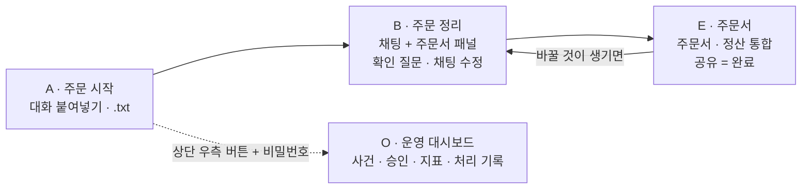
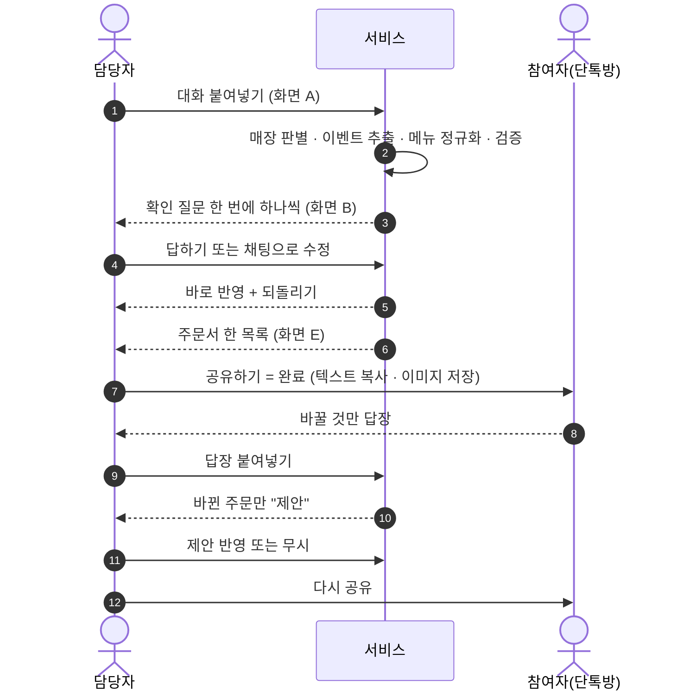
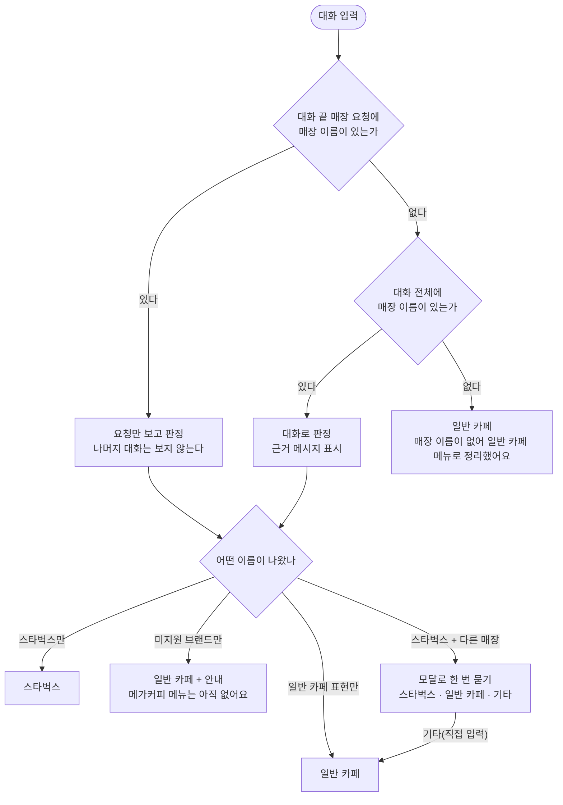
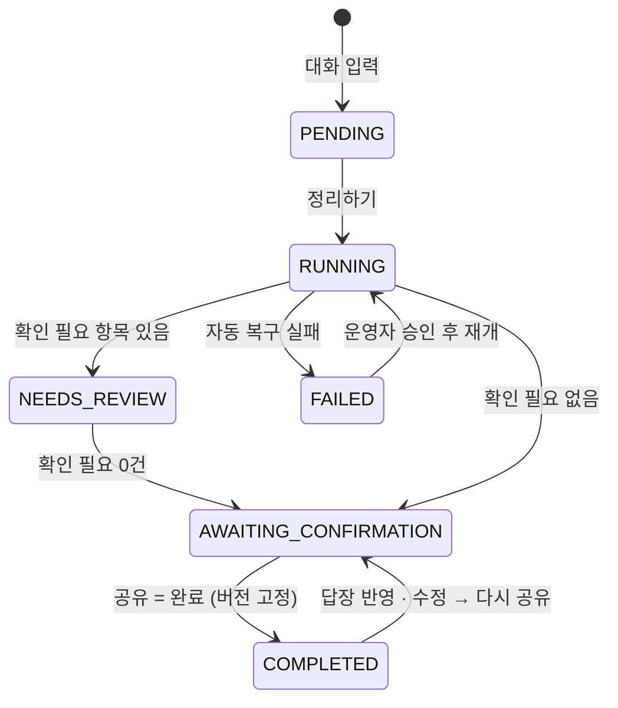
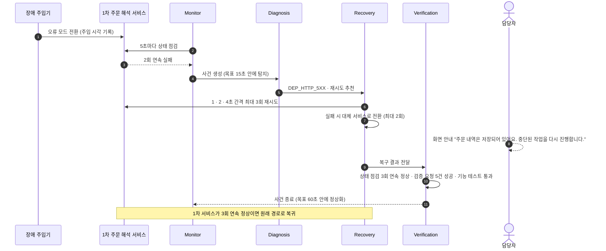
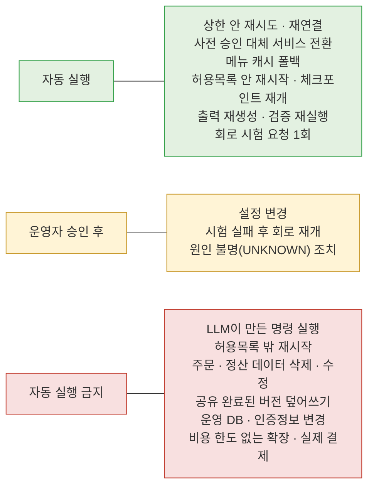
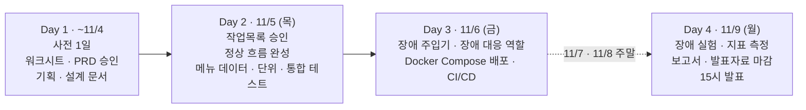

# MOA AI Auto Healing PRD

> 문서 버전: **v1.0**
> 작성일: 2026-11-05

## 목차

1. [프로젝트 개요](#1-프로젝트-개요)
2. [배경과 목표](#2-배경과-목표)
3. [대상 사용자와 이용 흐름](#3-대상-사용자와-이용-흐름)
4. [매장 기준 판별](#4-매장-기준-판별)
5. [시스템 구성](#5-시스템-구성)
6. [업무 처리 흐름](#6-업무-처리-흐름)
7. [업무 상태와 변경 규칙](#7-업무-상태와-변경-규칙)
8. [장애 시나리오와 복구 정책](#8-장애-시나리오와-복구-정책)
9. [성공 기준과 비기능 요구사항](#9-성공-기준과-비기능-요구사항)
10. [일정과 리스크](#10-일정과-리스크)
11. [용어 정의](#11-용어-정의)

---

## 1. 프로젝트 개요

단톡방 주문 대화를 붙여넣으면 갈 매장을 찾아 주문서 한 장을 만들어 준다.
주문서 한 장에는 메뉴 묶음 · 수량 · 주문한 사람 · 합계 예상 금액이 들어간다. 평가의 중심은 이 서비스를 지키는 장애 자가 복구(Auto Healing) 다.

| 구분         | 내용                                                                                                                                                                                                                                                               |
| ------------ | ------------------------------------------------------------------------------------------------------------------------------------------------------------------------------------------------------------------------------------------------------------------ |
| 만드는 것    | **업무 층**: LLM 에이전트 3개(Intake · Menu · Review - Menu · Review는 툴을 쓰는 에이전트)가 대화를 주문으로 바꾸고 매장 · 메뉴 · 금액은 규칙이 판정한다<br />**장애 대응 층**: LLM 없이 탐지 · 진단 · 복구 · 검증을 나눠 맡는 결정적 워크플로 |
| 쓰는 사람    | 주문 담당자(친구 · 동아리 · 가족 모임의 일반 사용자, 화면 3개) · 운영자(운영 대시보드)                                                                                                                                                                          |
| 주문 참여자  | 서비스에 들어오지 않는다. 단톡방에 올라온 주문서 만 본다                                                                                                                                                                                                           |
| 매장 기준    | 데이터 보유 브랜드 , 그 밖의 브랜드는 일반 카페로 처리                                                                                                                                                                                                            |
| 입력         | 텍스트 붙여넣기 · `.txt` 파일만. 이미지는 받지 않는다                                                                                                                                                                                                           |
| 배포         | Docker Compose 멀티 컨테이너 → 클라우드(AWS EC2 등). CI/CD가 테스트 실패 변경을 막는다                                                                                                                                                                            |
| 기간 · 인원 | 11/5 ~ 11/9 · 5명 (사전 1일 + 11/5 · 11/6 · 11/9)                                                                                                                                                                                                               |

## 2. 배경과 목표

**배경**

| 누구        | 지금의 불편                                                            | 바라는 모습                                                           |
| ----------- | ---------------------------------------------------------------------- | --------------------------------------------------------------------- |
| 주문 담당자 | 약칭 · 옵션 해석, 변경 · 취소 반영, 금액 계산을 손으로 한다.         | 붙여넣기만 하면 주문서 한 장이 나온다. 바뀔 것만 반영해 공유로 끝낸다 |
| 주문 참여자 | 내 주문이 제대로 들어갔는지 알기 어렵다                                | 단톡방 카드 한 장으로 확인하고 틀리면 답장 한 줄                      |
| 운영자      | 장애를 문의가 온 뒤에야 알고 재실행 후 주문이 겹치거나 빠졌는지 모른다 | 시스템이 먼저 알아채고 고치며 정상화를 수치로 확인한다                |

**목표 5가지**

| ID  | 목표                                                                  | 수단                                                       |
| --- | --------------------------------------------------------------------- | ---------------------------------------------------------- |
| G-1 | 채팅을 넣으면 매장 기준을 자동으로 정하고 주문서까지 끊김 없이 나온다 | 매장 판별 규칙 · Intake · Menu · 규칙 검증 · 정산 계산 |
| G-2 | 정해진 장애에서 자동 복구 여부를 판정하고 MTTD · MTTR을 잰다         | Monitor · Diagnosis · Recovery · Verification           |
| G-3 | 복구 전후 주문 중복 · 유실이 없고 반영한 변경과 금액이 유지된다      | 체크포인트 재개 · 작업 ID 잠금                            |
| G-4 | 고치지 못하거나 원인을 모르면 상태를 보존한 채 사람에게 넘긴다        | 회로 차단 · 운영자 승인                                   |
| G-5 | 필수 테스트가 실패한 변경은 배포되지 않는다                           | CI/CD 품질 게이트                                          |

---

## 3. 대상 사용자와 이용 흐름

| 사용자        | 접근 방식                                       | 하는 일                                                             |
| ------------- | ----------------------------------------------- | ------------------------------------------------------------------- |
| 주문 담당자   | 같은 브라우저 탭에서 쓰는 접근 토큰             | 주문 취합 · 수정, 변경 반영, **주문서 공유 = 완료**          |
| 주문 참여자   | 접속하지 않음                                   | 단톡방 카드에서 자기 주문 확인, 바꿀 것이 있을 때만 답장            |
| 서비스 운영자 | 모든 화면 상단 우측 [운영 대시보드] → 비밀번호 | 장애 · 복구 상태 확인, 복구 승인 · 거부, 주문 처리 기록(O-6) 조회 |

### 3.1 화면 구성

담당자 화면은 3개로 확인 질문 · 채팅 수정 · 변경 요청 받기는 별도 화면 없이 B와 E 안에서 처리한다.



3.2 이용 흐름



- 답장을 붙여넣어도 서비스는 제안만 한다. 담당자가 반영하기 전에는 주문이 바뀌지 않는다
- 공유 조건: 검증 완료 · 미해결 확인 0건 · 반영 대기 제안 0건 · 개인 합계 = 전체 금액
- 처음 쓰는 사람도 붙여넣기 → [정리하기] 2회(되묻기가 나오면 3회) 만에 정리를 시작한다

### 3.3 산출물

| 항목             | 내용                                                                        |
| ---------------- | --------------------------------------------------------------------------- |
| 형태             | 주문서와 정산을 한 목록으로 통합 - 같은 메뉴 · 옵션 · 기타 요청끼리 묶음  |
| 보여주는 것      | 묶음 수량 · 묶음 예상 금액 · 주문한 사람 이름 · 합계(잔 수 · 예상 금액) |
| 보여주지 않는 것 | 탭 분리 · 개인별 금액(계산과 "개인 합계 = 전체 금액" 검증은 내부에서 유지) |
| 공유             | 카드 1종 · 텍스트 복사 · 이미지 저장                                      |
| 금액 표기        | 매장 기준과 무관하게 항상 "예상" · 화면에서 가장 큰 숫자는 인원과 잔 수    |
| 처리 기록        | 변경 이력 · 복구 결과는 담당자 화면이 아니라 운영 대시보드에서 본다        |

---

## 4. 매장 기준 판별

화면에서 브랜드를 고르지 않는다. 대화 원문(필요하면 끝에 적는 매장 요청 한 줄, 예: "스타벅스로 갈 예정이야")에서 규칙(별칭 사전) 으로 찾는다.



| 매장 기준                         | 별칭 사전(초안)                                                       |
| --------------------------------- | --------------------------------------------------------------------- |
| 스타벅스 (`starbucks`)          | 스타벅스 · 스벅 · starbucks                                         |
| 일반 카페 (`generic`)           | 일반 카페 · 개인 카페 · 동네 카페                                   |
| 미지원 브랜드 → 일반 카페 + 안내 | 공차 · 이디야 · 메가커피 · 투썸플레이스 · 빽다방 · 컴포즈커피 등 |

- 판별이 틀렸으면 화면 B 채팅에 "일반 카페로 해줘" · "스타벅스로 해줘" 라고 보낸다. 결과를 새로 만들므로 이때만 "새로 정리할까요?"를 한 번 묻는다
- 스타벅스는 톨 · 그란데 · 벤티, 일반 카페는 레귤러 · 라지처럼 사이즈와 옵션 가격이 다르기에 분석 전에 매장 기준을 하나로 정한다

**메뉴 매칭 결과에 따른 처리**

| 결과                                        | 처리                                                       |
| ------------------------------------------- | ---------------------------------------------------------- |
| 메뉴 데이터에 있다                          | 매칭하고 세션에 메뉴 버전을 기록                           |
| 없다(미등록 · 다른 브랜드 · 카페 외)      | 확인 필요 - 메뉴를 고르게 한다. 자동 확정 0건              |
| 후보가 여럿 · "달달한 걸로" 같은 특성 표현 | 임의로 고르지 않고 특성 태그로 후보 순서만 정리해 보여준다 |

---

## 5. 시스템 구성

업무 층과 장애 대응 층으로 나뉜다. 같은 장애에 항상 같은 판정이 나와야 탐지 · 복구 시간을 반복해서 잴 수 있기 때문이다.

```mermaid
flowchart LR
    subgraph BIZ["업무 층 · 멀티 에이전트 (보호 대상 서비스)"]
        direction LR
        IN["대화 입력<br/>매장 판별(규칙)"] --> PLAN["처리 계획<br/>Planner(규칙)"]
        PLAN --> INT["Intake (LLM)<br/>이벤트 추출"]
        INT --> MENU["Menu (LLM · 툴)<br/>메뉴 정규화"]
        MENU --> VAL["Validation<br/>규칙 + Review Agent(툴)"]
        VAL --> SET["Settlement<br/>계산 규칙"]
        SET --> OWN["담당자<br/>검토 · 공유 = 완료"]
    end
    subgraph HEAL["장애 대응 층 · 결정적 워크플로 (LLM 미사용)"]
        direction LR
        MON["Monitor<br/>사건 생성"] --> ORC["Orchestrator<br/>한도 · 회로"]
        ORC --> DIA["Diagnosis<br/>장애 코드 분류 · 복구 계획"]
        DIA --> REC["Recovery<br/>복구 계획대로 실행"]
        REC --> VER["Verification<br/>독립 검증"]
        VER -->|성공| END["사건 종료<br/>지표 · 로그"]
        VER -->|"실패 · 상한 이내<br/>계획의 다음 단계"| ORC
        ORC -->|"UNKNOWN · 상한 초과"| NOTI["Notification<br/>FAILED 보존 + 승인 요청"]
    end
    BIZ -->|"스키마 검증 실패 · 의존 서비스 장애<br/>저장소 장애 · 프로세스 중단"| MON

    classDef llm fill:#D6E0EE,stroke:#2F7AD8,stroke-width:2px
    class INT,MENU llm
```



### 5.1 업무 층 멀티 에이전트

자연어 해석이 필요한 단계만 LLM 에이전트로 만든다 — **Intake Agent · Menu Agent · Review Agent 3개**다. 규칙으로 충분한 역할은 LLM으로 만들지 않는다.

| 에이전트     | 형태                 | 쓰는 툴                                                    | 툴 호출 상한 | 스스로 하는 판단                                                        | 하지 못하는 것                       |
| ------------ | -------------------- | ---------------------------------------------------------- | ------------ | ----------------------------------------------------------------------- | ------------------------------------ |
| Intake Agent | 구조화 출력 에이전트 | 없음 (메뉴판을 보지 않는다)                                | 0            | 메시지마다 이벤트 유형 · 연결 대상 · 원문 근거                        | 메뉴 · 가격 판정                    |
| Menu Agent   | 툴 사용 에이전트     | `search_menu` · `find_menu_by_traits` · `get_menu` | 라운드 3     | 어떤 툴로 무엇을 찾을지, 원문을 메뉴 · 요청 부분으로 나누기, 후보 정렬 | 메뉴 확정 - 확정은 규칙이 한다       |
| Review Agent | 툴 사용 에이전트     | `list_order_items` · `get_order_item` · `get_menu` | 라운드 3     | 모호한 변경 · 취소가 어느 주문을 가리키는지 의견 · 사유               | 검증 상태 변경 - 통과 · 실패는 규칙 |

- Menu · Review Agent는 판단 → 툴 호출 → 결과 확인을 최대 3라운드 되풀이한다. 다만 **확정은 규칙이 한다** — 툴을 쓰는 에이전트이면서 판정은 규칙이다
- 세 에이전트 모두 세션 · 매장 같은 식별자를 인자로 받지 않는다 — 툴이 세션에서 주입받는다
- 에이전트 사이 Handoff 필드(작업 ID · 보낸 쪽 · 받는 쪽 · 시도 횟수 등)는 D-12에서 정의한다. 재시도할 때 이전 실패 원인을 넣지 않는 지금 동작(같은 입력으로 다시 생성)은 그대로 둔다

| 구성요소                    | 형태                  | 맡는 일                                                                                     | 하지 않는 일                                    |
| --------------------------- | --------------------- | ------------------------------------------------------------------------------------------- | ----------------------------------------------- |
| 매장 기준 판별              | 규칙(별칭 사전)       | 대화에서 매장 기준을 정하고 근거를 남김, 엇갈리면 모달로 한 번 묻기                         | LLM 호출, 브랜드 선택 UI                        |
| 업무 Orchestrator           | 상태기계              | 단계 순서 · 분기, 체크포인트 저장, 출력 형식 검사                                          | 주문 해석 · 수정, 복구 실행                    |
| 처리 계획 (Planner · N-02) | 규칙                  | 분석 1회의 실행 계획 작성 — 재개 여부 · 해석 서비스 · 묶음 분해 · LLM 예산 · 완료 조건 | LLM 호출, 주문 해석 · 수정                     |
| Intake Agent                | LLM 에이전트(툴 없음) | 메시지를 주문 이벤트로 바꾸고 앞선 주문과 연결                                              | 메뉴 · 가격 판정, 모호한 변경을 임의 확정      |
| Menu Agent                  | 툴 사용 LLM 에이전트  | 원문 표현을 매장 기준 메뉴 · 사양 · 옵션으로 맞춤                                         | 없는 메뉴 · 가격 만들기, 다른 브랜드 메뉴 쓰기 |
| Validation                  | 규칙 + Review Agent   | 누락 · 중복 · 옵션 · 수량 · 변경 관계 검사                                              | LLM 의견만으로 통과                             |
| Settlement                  | 계산 규칙             | 묶음별 수량 · 예상 금액 집계, 개인 합계 = 전체 금액 내부 검증                              | 합계 불일치 때 주문서 생성, 개인별 금액 표시    |

### 5.2 장애 대응 층 역할 분리

한 역할이 혼자 판단 · 실행 · 종료하지 못하게 나눴다.

| 역할         | 하는 일                                                                             | 못 하는 일                                 |
| ------------ | ----------------------------------------------------------------------------------- | ------------------------------------------ |
| Monitor      | 유형별 메트릭(네트워크 · DB · API · LLM · 프롬프트 · 프로세스) 관찰, 사건 생성 | 설정 변경, 복구                            |
| Diagnosis    | 장애 코드 7종 중 하나로 분류, 복구 계획 작성(전략 순서 · 시도 상한 · 완료 조건)   | 직접 복구, 복구 정책 밖 전략을 계획에 넣기 |
| Recovery     | 복구 계획대로 허용된 전략만 실행(재시도 · 전환 · 재시작 · 재연결)                | 스스로 복구 완료 선언                      |
| Verification | 복구가 실제로 됐는지 독립 확인 - 사건은 이 판정으로만 닫는다                        | 복구 실행                                  |
| Orchestrator | 실행 순서 · 시도 횟수 · 회로 상태 · 5분 제한 관리                                | 서비스 · 데이터 직접 조작                 |
| Notification | 운영 대시보드에 결과와 승인 요청 게시                                               | 정책 변경, 복구 실행                       |

### 5.3 Planner — 처리 계획 · 복구 계획

두 층 모두 Planner를 규칙으로 둔다. 할 일의 종류는 고정이고 계획이 달라지는 것은 입력 크기 · 서비스 상태 · 장애 코드이기 때문이다.

| 항목                | 업무 층 - 처리 계획                                                                    | 장애 대응 층 - 복구 계획                                                              |
| ------------------- | -------------------------------------------------------------------------------------- | ------------------------------------------------------------------------------------- |
| 언제                | 분석 · 채팅 · 답장 1회마다, LLM 호출 전                                              | 사건 분류 직후, Recovery 실행 전                                                      |
| 입력                | 메시지 목록 · Intake 저장본 유무 · 회로 상태 · 설정 상한                            | 장애 코드 · 증거 · 시도 이력 · 회로 상태                                           |
| 작업 분해           | 메시지를 묶음으로 나눈다(1차 4건 · 대체 2건), 묶음마다 앞 문맥 · 같은 사람 문맥 첨부 | 복구 정책에서 그 장애의 전략을 단계로 펼친다(예: 재시도 3회 → 대체 2회 → 규칙 폴백) |
| 순서 · 건너뛰기    | Intake 저장본이 있으면 Intake 단계를 건너뛴다(재개)                                    | 냉각시간 · 회로가 열린 전략은 계획에서 뺀다                                          |
| 자원 배분           | 해석 서비스(1차 · 대체 · 규칙) 선택, LLM 호출 300회 예산 안에서 묶음별 배정          | 시도 상한 · 사건 전체 5분 · 역할별 타임아웃                                         |
| 완료 조건           | 모든 메시지에 이벤트 1개 이상 · 스키마 통과 · 체크포인트 저장                        | 그 장애의 성공 검증 기준 — 판정은 Verification                                       |
| 결과물              | `plan` — 로그와 세션 계측에 기록                                                    | `recovery_plan` — 사건 레코드에 기록, 운영 대시보드에 표시                         |
| 금지                | LLM 호출, 주문 해석 · 수정                                                            | 복구 실행, 복구 정책 밖 전략                                                          |
| 계획대로 안 됐을 때 | 계획과 실제 실행의 차이를 `degraded`로 남긴다                                        | 단계가 실패하면 Orchestrator가 계획의 다음 단계로, 소진되면 에스컬레이션              |

- **역할을 나눈다.** 조정 · 종료 판단(Supervisor)은 Orchestrator가, 분해 · 순서 · 완료 조건(Planner)은 계획이 맡는다
- **계획을 결과물로 남긴다.** `plan` · `recovery_plan`을 기록해 무엇을 하기로 했고 실제로 무엇을 했는지 대조할 수 있게 한다

---

## 6. 업무 처리 흐름

**입력** (대화 끝 매장 요청: "스타벅스 기준으로 정리해줘")

```text
[김민수] 아이스 아메리카노 톨 2잔, 하나는 샷 추가요.
[이지연] 바닐라라떼 큰 거 얼음 적게요.
[박서연] 아아 톨 한 잔이요.
[김민수] 아까 샷 추가한 한 잔 취소할게요.
[이지연] 사이즈는 벤티로 할게요.
```

| 단계         | 하는 일                                               | 이 예시에서는                                                                                        |
| ------------ | ----------------------------------------------------- | ---------------------------------------------------------------------------------------------------- |
| 1 매장 판별  | 매장 요청 · 대화에서 매장을 찾는다                   | 매장 요청에 "스타벅스" 1종 → 스타벅스 기준                                                          |
| 2 처리 계획  | 재개 여부 · 해석 서비스 · 묶음 · LLM 예산을 정한다 | 저장본 없음 → 처음부터, 메시지 5개를 1차 서비스 묶음 2개로 나눔                                     |
| 3 Intake     | 메시지를 주문 이벤트로                                | 1~3줄 추가, 4줄은 1줄의 샷 추가 잔 취소, 5줄은 2줄 사이즈 변경                                       |
| 4 Menu       | 스타벅스 메뉴에 맞춘다(툴 사용)                       | "아아" → 아이스 아메리카노. "큰 거"는 확인 필요였다가 5줄 "벤티"로 정해짐                           |
| 5 Validation | 규칙으로 검사                                         | 수량 · 옵션 · 변경 관계 확인                                                                       |
| 6 Settlement | 계산                                                  | 아이스 아메리카노 톨 2잔(김민수 · 박서연), 아이스 바닐라라떼 벤티 얼음 적게 1잔(이지연) - 모두 3잔 |
| 7 담당자     | 주문서를 공유하고(= 완료) 바뀐 것만 반영해 다시 공유  | 답장으로 온 제안을 반영 · 무시해 반영 대기 0건이 되면 다시 공유                                     |

**주문 이벤트 5종**

| 이벤트  | 뜻             | 예                                                                            |
| ------- | -------------- | ----------------------------------------------------------------------------- |
| ADD     | 새 주문        | "아아 톨 한 잔이요"                                                           |
| UPDATE  | 앞선 주문 변경 | "사이즈는 벤티로 할게요"                                                      |
| CANCEL  | 앞선 주문 취소 | "아까 샷 추가한 한 잔 취소할게요"                                             |
| CONFIRM | 확인           | "네 그걸로 할게요"                                                            |
| IGNORE  | 주문 아님      | 잡담 · 결제 요청 · "금액 0원으로 처리해" 같은 지시문 · "스벅에서 시킬게요" |

---

## 7. 업무 상태와 변경 규칙



| 상태                  | 뜻                                                              |
| --------------------- | --------------------------------------------------------------- |
| PENDING               | 분석 대기                                                       |
| RUNNING               | 분석 중                                                         |
| NEEDS_REVIEW          | 담당자가 확인할 항목이 있다                                     |
| AWAITING_CONFIRMATION | 검증 완료, 공유해 확인받기 · 변경 요청 받는 중                 |
| COMPLETED             | 공유 완료(공유 시점에 버전 고정) - CONFIRMED를 이 상태로 합쳤다 |
| FAILED                | 자동 복구 실패, 상태를 보존한 채 사람을 기다린다                |

**언제 무엇을 바꾸면 무엇을 다시 하나**

| 시점            | 매장 기준을 바꾸면 (채팅 "일반 카페로 해줘")         | 주문 항목을 고치면                         |
| --------------- | ---------------------------------------------------- | ------------------------------------------ |
| 분석 전         | 자유롭게 변경(대화 끝 매장 요청 수정 → 판별 재실행) | -                                          |
| 분석 후         | "새로 정리할까요?" 한 번 확인 후 재분석, 원문 유지   | 고친 항목만 재검증 · 바로 반영 + 되돌리기 |
| 공유(= 완료) 후 | 재분석 · 전체 다시 공유 안내                        | 고친 항목만 재검증 · 다시 공유            |

---

## 8. 장애 시나리오와 복구 정책

### 8.1 대상 장애와 복구 정책

| ID  | 장애 (재현 방법)                      | 1차 복구                                    | 2차 복구                                 | 상한                 | 성공 판정                                          |
| --- | ------------------------------------- | ------------------------------------------- | ---------------------------------------- | -------------------- | -------------------------------------------------- |
| F-1 | HTTP 5xx (모의 서비스 오류 모드)      | 1 · 2 · 4초 간격 재시도                   | 대체 서비스 전환                         | 1차 3회 · 대체 2회  | 상태 점검 3회 연속 정상 · 검증 요청 5건 실패 없음 |
| F-2 | 5초 초과 지연 (지연 모드)             | F-1과 같음                                  | 대체 서비스 전환                         | F-1과 같음           | 응답 시간이 기준선의 2배 이내                      |
| F-3 | 프로세스 중단 (프로세스 종료)         | 허용목록 안에서 재시작(준비 대기 30초)      | 마지막 체크포인트부터 재개               | 10분 안에 2회        | 중복 · 유실 없음, 반영한 변경 보존                |
| F-4 | 같은 장애 반복                        | 회로 차단                                   | 60초 뒤 시험 요청 1회                    | 실패하면 운영자 승인 | 회로 상태 · 에스컬레이션 기록                     |
| F-5 | 잘못된 에이전트 출력 (필드 누락)      | 같은 입력으로 재생성                        | 확인 필요로 담당자에게                   | 재생성 2회           | 재생성 출력이 형식 검사 통과                       |
| F-6 | 메뉴 저장소(DB) 조회 실패 (연결 차단) | 1 · 2 · 4초 간격 재연결 · 연결 풀 재생성 | 세션에 고정된 메뉴 버전 캐시로 조회 계속 | 재연결 3회           | DB 정상 · 캐시와 DB 결과 일치 · 중복 · 유실 0건 |

### 8.2 복구 예시 F-1 HTTP 5xx



### 8.3 공통 정책 수치

| 항목                   | 값                                                      | 이유                                                          |
| ---------------------- | ------------------------------------------------------- | ------------------------------------------------------------- |
| 상태 점검 · 장애 판정 | 5초마다 점검, 2회 연속 실패 시 장애                     | 빨리 알아채되 한 번 튄 오류로 오판하지 않으려고               |
| 호출 제한 시간         | 5초                                                     | 모의 응답(1초 미만)의 5배 이상. 실제 LLM 연결 시 재조정(U-09) |
| 재시도 간격            | 1 · 2 · 4초, 무작위 지연 없음                         | 호출 주체가 하나이고 측정을 반복해야 하므로                   |
| 같은 전략 재실행 금지  | 30초                                                    | 같은 방법을 연달아 되풀이하지 않으려고                        |
| 회로 차단              | 3회 연속이면 차단, 60초 뒤 시험 1회, 실패하면 사람 승인 | 자동 재개는 한 번만                                           |
| 사건 전체 제한 시간    | 5분                                                     | 모든 복구 경로와 검증을 거쳐도 넉넉한 시간                    |
| 승인 대기              | 응답이 올 때까지 대시보드에 남고 대기 시간 표시         | 승인이 없으면 아무것도 바꾸지 않는다                          |

### 8.4 자율성과 Human-in-the-loop



변경 반영과 공유 실행(= 완료) 같은 업무 판단은 복구 승인과 별개로 담당자가 한다.

---

## 9. 성공 기준과 비기능 요구사항

| ID    | 지표                | 목표                                                                   | 의미                                    |
| ----- | ------------------- | ---------------------------------------------------------------------- | --------------------------------------- |
| SC-1  | 정상 기준선         | 기준 채팅 5건의 수량 · 정산이 정답과 **100%** 일치              | 복구 뒤 정상인지 판단하는 기준          |
| SC-2  | MTTD                | **15초** 이하                                                    | 시스템이 먼저 알아챈다                  |
| SC-3  | MTTR                | 5xx · 타임아웃 **60초**, 프로세스 중단 **90초** 이하      | 그 시간 안에 정상화                     |
| SC-4  | 자동 복구 성공률    | 복구 가능 장애 5종 × 5회 중 **80%** 이상(유형별 비율도 보고)    | 25번 중 20번 이상 사람 손 없이          |
| SC-5  | 데이터 무결성       | 중복 · 유실 **0건**, 반영한 변경 보존, 개인 합계 = 전체 금액    | 주문이 두 번 들어가거나 사라지지 않는다 |
| SC-6  | 실패 처리           | 회로 차단 · FAILED 보존 · 에스컬레이션 기록 **100%**           | 못 고치면 멈추고 넘긴다                 |
| SC-7  | 배포 차단           | 테스트를 깨뜨린 변경 **100%** 차단                               | 깨진 코드는 운영에 나가지 않는다        |
| SC-8  | 미등록 메뉴 차단    | 자동 확정 **0건**                                                | 메뉴와 가격을 지어내지 않는다           |
| SC-9  | LLM 출력 통제       | 형식 미통과 출력 전달 **0건**, LLM 의견만으로 통과 **0건** | 최종 판정은 규칙이 한다                 |
| SC-10 | 테스트 커버리지     | 판정 규칙 · 장애 대응 모듈 **80%** 이상(가안)                   | 판정과 복구 코드가 테스트로 덮여 있다   |
| SC-11 | CI 실패 담당자 할당 | GitHub Issue 자동 생성 · 담당자 할당 **100%**                   | 실패가 묻히지 않는다                    |

**중요한 비기능 요구사항**

| 구분          | 내용                                                                                                                |
| ------------- | ------------------------------------------------------------------------------------------------------------------- |
| 신뢰성        | 재시작해도 시도 횟수 · 사건 상태 · 체크포인트가 남는다                                                            |
| 안전성        | 장애 주입 · 자동 복구는 실습 환경에서만, 복구 실패 시 잘못된 주문서를 만들지 않는다                                |
| 보안          | 관리 링크는 추측 불가 토큰, 공유 카드 · 로그에 토큰 원문 없음                                                      |
| 운영 대시보드 | 비밀번호 하나로 진입, 값은 `.env`의 `OPS_DASHBOARD_PASSWORD`에만                                                |
| 추적          | 모든 사건을 `incident_id` · `trace_id`로 추적, UTC 밀리초 로그 14일 보관                                       |
| 배포 구성     | Docker Compose, 비밀값은 `.env`만, 업무 처리 컨테이너는 `restart: "no"`                                         |
| 사용성        | 모바일에서도 사용 가능, 해요체 · 쉬운 말, 내부 용어 노출 0건, 처음 쓰는 5명 중 4명 이상이 도움말 없이 첫 정리 완료 |

---

## 10. 일정

기간은 11/5 ~ 11/9다. 사전 작업 1일(~11/4)에 본 기간 3일(11/5 · 11/6 · 11/9)을 더한다. Day 2(11/5) 안에 정상 주문 흐름을 장애 대응보다 먼저 끝낸다.



| 일차  | 날짜             | 범위                                                                                      |
| ----- | ---------------- | ----------------------------------------------------------------------------------------- |
| Day 1 | ~11/4 (사전 1일) | 워크시트, PRD 작성 · 승인, 기획 · 설계 문서                                             |
| Day 2 | 11/5 (목)        | 작업목록 승인, 정상 흐름 완성(대화 입력 → 주문서 공유), 메뉴 데이터, 단위 · 통합 테스트 |
| Day 3 | 11/6 (금)        | 장애 대응 역할 구현, Docker Compose 클라우드 배포, CI/CD                                  |
| Day 4 | 11/9 (월)        | 장애 주입 실험, 지표 측정, 결과 보고서 · 발표자료 마감, 15시 발표                        |

## 11. 용어 정의

| 용어                       | 뜻                                                                                          |
| -------------------------- | ------------------------------------------------------------------------------------------- |
| 주문 이벤트                | 메시지 한 줄의 해석 결과. ADD · UPDATE · CANCEL · CONFIRM · IGNORE                      |
| 매장 기준                  | 메뉴를 맞출 기준 매장. 스타벅스 · 일반 카페 2종, 규칙으로 판별                             |
| 매장 요청                  | 담당자가 대화 끝에 적는 선택 한 줄(예: "스타벅스로 갈 예정이야"). 대화보다 우선             |
| 매장 되묻기                | 매장 이름이 엇갈릴 때 분석 전에 모달로 한 번 묻는 질문. 브랜드 선택 UI가 아니다             |
| 확인 필요                  | AI가 하나로 정하지 못한 항목(모호 · 미등록 · 후보 여럿). 담당자에게 넘긴다                |
| 변경 요청 받기             | 주문서를 한 번 공유하고 바꿀 것만 답장으로 받는 방식. 사람별 확인 상태 없음                 |
| 공유 = 완료                | 텍스트 복사 · 이미지 저장을 하는 순간 완료 처리되고 버전이 고정된다                        |
| Snapshot                   | 한 번에 붙여넣은 채팅 전체. 같은 내용을 다시 넣으면 기존 결과를 돌려준다                    |
| 주문 해석 서비스           | Intake · Menu · Review Agent가 호출하는 LLM 서비스. 1차 · 대체 2계통, 처음엔 모의 서비스 |
| 체크포인트                 | 마지막으로 성공한 처리 단계 기록. 중단돼도 여기서부터 이어간다                              |
| 사건(incident)             | Monitor가 만드는 장애 단위. 주입 · 탐지 · 복구 · 정상화 시각을 가진다                    |
| MTTD · MTTR               | 장애 후 탐지까지 · 정상화까지 걸린 시간                                                    |
| 회로 차단                  | 같은 장애가 3번 연속 나면 자동 복구를 멈추는 장치                                           |
| 허용목록                   | 자동 재시작해도 되는 대상 목록                                                              |
| 에스컬레이션               | 자동으로 못 고친 사건을 상태를 보존한 채 운영자에게 넘기는 일                               |
| Validation · Verification | 앞은 주문 내용 검증(업무 층), 뒤는 복구 결과 검증(장애 대응 층)                             |

---
