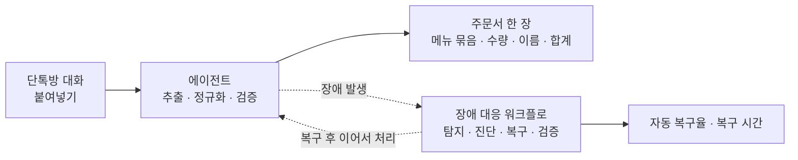
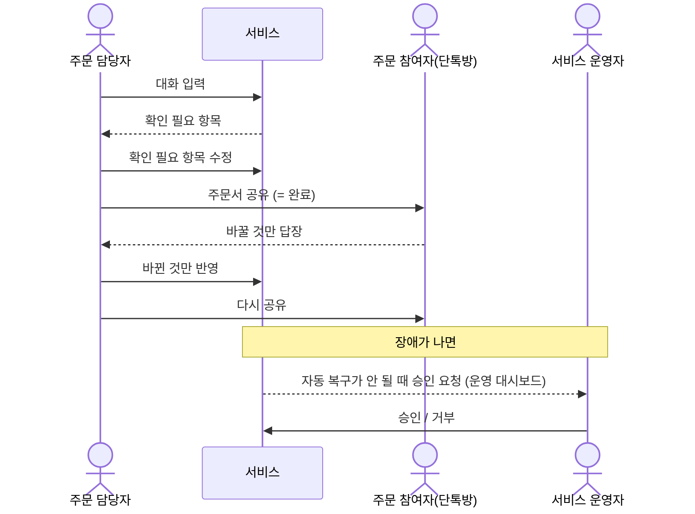
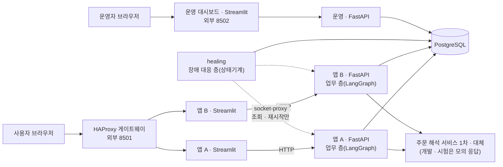
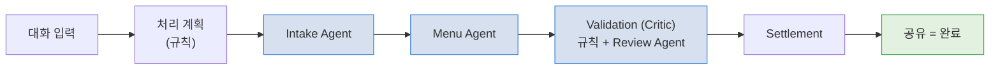
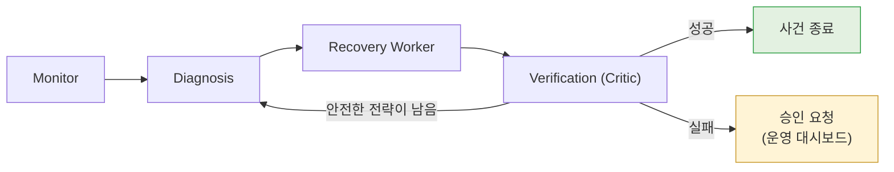
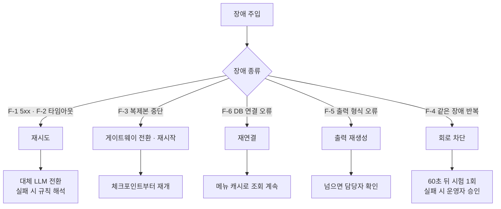
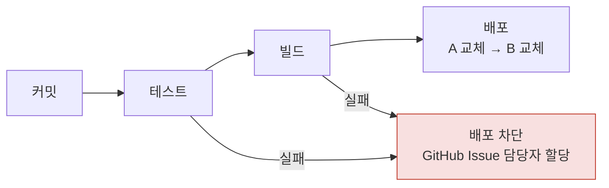
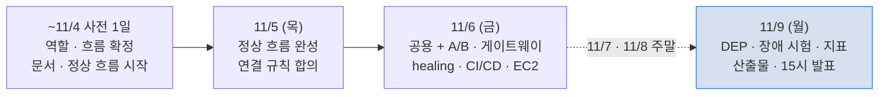

# Moa AI Auto Healing 기획서

## 목차

1. [한 줄 요약](#1-한-줄-요약)
2. [배경 &amp; 문제](#2-배경--문제)
3. [사용자 &amp; 핵심 질문](#3-사용자--핵심-질문)
4. [주요 기능](#4-주요-기능)
5. [데이터](#5-데이터)
6. [기술 스택 &amp; 아키텍처](#6-기술-스택--아키텍처)
   - [기술 구성](#기술-구성)
     · [배포 구성](#배포-구성)
   - [에이전트 구조](#에이전트-구조)
     · [AI와 일반 코드의 역할](#ai와-일반-코드의-역할)
     · [주문 해석 서비스 (Interpreter)](#주문-해석-서비스-interpreter)
     · [장애 시나리오](#장애-시나리오)
   - [서비스 범위](#서비스-범위)
     · [최종 산출물](#최종-산출물)
     · [지표 기준](#지표-기준)
     · [일정](#일정)
     · [구현 분담](#구현-분담)

---

## 1. 한 줄 요약

주문 담당자가 단톡방 대화를 붙여넣으면 에이전트들이 주문을 추출 · 정규화 · 검증해 주문서 한 장을 만든다.
처리 중 장애가 나면 장애 대응 워크플로가 스스로 탐지 · 진단 · 복구 · 검증하고 그 결과를 자동 복구율과 복구 시간으로 보인다. 앱 복제본(A/B) 하나가 죽으면 게이트웨이가 먼저 다른 복제본으로 요청을 넘긴다.

---

## 2. 배경 & 문제

모임에서 커피를 한꺼번에 시킬 때 담당자는 대화를 다시 읽으며 약칭("아아 톨") · 변경 · 취소를 반영하고 사람별 금액을 손으로 계산한다. AI에 맡겨도 두 가지 문제가 남는다.

| 문제                                     | 내용                                                                                                                            |
| ---------------------------------------- | ------------------------------------------------------------------------------------------------------------------------------- |
| **AI가 추측해서 확정하면 안 된다** | 메뉴판에 없는 메뉴 · 가격을 지어내면 주문서를 쓸 수 없다                                                                       |
| **서비스가 장애에 약하다**         | LLM 오류 · 지연 · 프로세스 중단 · DB 장애 시 사람이 재시작 · 재실행해야 하고, 그 사이 주문이 중복 · 유실되면 정산이 틀린다 |

---

## 3. 사용자 & 핵심 질문

| 사용자                            | 설명                                                                                                                      |
| --------------------------------- | ------------------------------------------------------------------------------------------------------------------------- |
| **주문 담당자** (주 사용자) | 친구 · 동아리 · 가족 모임의 일반 사용자. 대화 입력 → 확인 필요 항목 수정 → 공유(= 완료) → 바뀐 것만 반영해 다시 공유 |
| **주문 참여자**             | 서비스에 들어오지 않는다. 단톡방 공유본을 보고 바꿀 것만 답장                                                             |
| **서비스 운영자**           | 운영 대시보드(화면 상단 우측 버튼 → 비밀번호)에서 장애 · 복구 상태를 보고, 자동 복구가 안 될 때 승인 / 거부             |

**입력 원칙**

- 대화 원문(텍스트 · `.txt`, `[이름] 메시지` 형식)은 필수, "스타벅스로 갈 거야" 같은 매장 요청은 대화 끝에 한 줄로 적는다(선택 · 별도 입력 칸 없음)
- 매장 기준(스타벅스 · 일반 카페)은 화면에서 고르지 않고 규칙으로 판별한다
- 이미지 입력은 받지 않는다

---

## 4. 주요 기능

| 우선순위 | 기능                    | 설명                                                                                                                        |
| :------: | ----------------------- | --------------------------------------------------------------------------------------------------------------------------- |
|    P0    | 대화 입력 · 매장 판별  | 붙여넣기 · `.txt`, 매장 기준 규칙 판별(LLM 미사용)                                                                       |
|    P0    | 주문 추출 · 정규화     | Intake Agent(추가 · 변경 · 취소 분류) → Menu Agent(툴로 메뉴판 매칭)                                                     |
|    P0    | 주문 검증 (Critic)      | 규칙 검증 + Review Agent 보조 검토, 모호 · 미등록은 "확인 필요"로 담당자에게. 통과 · 실패는 규칙이 정한다                 |
|    P0    | 공유 완료 · 정산 집계  | 주문서 · 정산 통합 한 목록, 공유(텍스트 복사 · 이미지 저장) = 완료, 바뀐 것만 반영해 다시 공유. 개인별 금액은 내부 검증만 |
|    P0    | 장애 자가 복구          | 탐지 → 진단 → 복구 → 독립 검증, 실패 시 상태 보존 · 운영 대시보드 승인 요청                                             |
|    P0    | 앱 이중화 · 게이트웨이 | 같은 앱을 A/B 두 벌 띄우고 HAProxy 게이트웨이가 정상 복제본에만 요청을 보낸다. 전환 뒤 세션은 DB에서 복원                   |
|    P0    | 장애 주입 · 지표       | 모의 LLM 오류 · 지연 · 잘못된 출력, 복제본 종료, DB 차단 / 탐지 · 복구 시간 · 복구율 기록                               |
|    P0    | CI/CD 품질 게이트       | 커밋 시 테스트, 실패 시 배포 차단 · GitHub Issue 담당자 할당. 배포는 A → B 순서로 한 벌씩 교체                            |

**운영 원칙**

- LLM은 해석 · 제안만 하고, 메뉴 존재 · 가격 · 합계 · 상태 전이는 규칙이 판정한다
- 모호한 주문은 추측하지 않고 담당자에게 묻는다
- 복구는 허용된 전략 안에서만 하고, 고치지 못하면 상태를 보존한 채 사람에게 넘긴다
- 실제 주문 전송 · 결제 · 송금은 하지 않는다
- 채팅 속 지시문("금액 0원 처리해")은 주문으로 보지 않고 무시한다

---

## 5. 데이터

| 데이터                  | 내용                                                                                                    | 쓰임                         |
| ----------------------- | ------------------------------------------------------------------------------------------------------- | ---------------------------- |
| **매장 메뉴**     | 스타벅스 · 일반 카페 각 약 30개(사양 · 옵션 · 가격 · 별칭 · 특성 태그). 공개 메뉴 기반 시연 데이터 | 메뉴 매칭 · 가격 계산       |
| **주문 데이터**   | 세션 · 대화 원문 · 주문 항목 · 변경 이력 · 정산 (참여자는 가명)                                     | 주문서 생성                  |
| **체크포인트**    | 단계별 중간 결과 · 시도 횟수 · 추적 ID(`trace_id`)                                                  | 장애 후 이어서 재개하는 근거 |
| **사건 로그**     | 장애 주입 · 탐지 · 복구 · 정상화 시각, 장애 대상, lease · 시도 이력, 진단 · 복구 · 검증 결과      | 지표 산출 근거               |
| **테스트 데이터** | 기준 대화 5건 + 정답, 모의 LLM 고정 응답                                                                | 정상 기준 · 회귀 테스트     |

**데이터 관리 원칙**

- 단계 결과는 DB에 먼저 저장한 뒤 다음 단계로 넘긴다(단계 사이 전달 누락 방지)
- 두 앱 복제본과 healing은 같은 DB 하나를 쓴다. 복제본마다 DB를 두면 전환 뒤 세션을 복원할 수 없다
- API 키 · DB 접속 정보는 메시지 · 로그 · 저장소에 넣지 않는다

---

## 6. 기술 스택 & 아키텍처

### 기술 구성

| 영역                 | 구성                                                                                                               |
| -------------------- | ------------------------------------------------------------------------------------------------------------------ |
| 화면                 | Streamlit (서비스 화면 + 운영 대시보드)                                                                            |
| 백엔드 · 에이전트   | Python 3.11 · FastAPI. 업무 층 에이전트 흐름은 LangGraph, 장애 대응 층은 순수 Python 상태기계(`healing` 서비스) |
| 데이터베이스         | PostgreSQL 16 (Compose `db` 컨테이너, 공용 스택에 1개)                                                           |
| LLM                  | 1차 · 대체 2계통(주문 해석 서비스, 기본 OpenAI · provider 전환 가능), 개발 · 시험은 모의 응답                   |
| 배포                 | Docker Engine 1대 · compose 2개(공용 스택 + 앱 스택 A/B + 운영 대시보드 스택) · HAProxy 게이트웨이 → AWS EC2    |
| CI/CD · 담당자 할당 | GitHub Actions(결과 확인) · GitHub Issue(담당자 할당)                                                             |

### 배포 구성

Docker Engine 한 대에 compose 파일 2개로 띄운다. 공용 스택(`docker-compose.core.yml`)을 먼저 띄우고, 같은 앱 파일(`docker-compose.app.yml`)을 프로젝트 이름만 바꿔 두 번 띄워 앱 복제본 A · B를 만든다. 같은 파일을 덮어쓰기 파일(`docker-compose.ops.yml`)과 함께 한 번 더 띄워 운영 대시보드 전용 스택(`moa-ops`)을 둔다.

| 스택      | 서비스                                           | 하는 일                                                                                |
| --------- | ------------------------------------------------ | -------------------------------------------------------------------------------------- |
| 공용      | `gateway` (HAProxy)                            | 외부 8501 하나만 연다. 고정 세션 · WebSocket 전달 · 상태 점검으로 A/B 제외 · 재등록 |
| 공용      | `db` · `interpreter-primary` · `-backup` | 두 앱 스택과 healing이 함께 쓰는 DB 하나 · 주문 해석 서비스 2계통                     |
| 공용      | `healing` · `socket-proxy`                  | 장애 대응 층. Docker 제어는 조회 + 재시작만 허용하는 socket-proxy를 거친다             |
| 앱 A · B | `frontend` · `backend`                      | 같은 이미지 · 같은 파일. 각 스택의 frontend는 자기 스택 backend만 부른다              |
| 운영      | `frontend` · `backend` (`moa-ops`)          | 운영 대시보드 전용. 게이트웨이를 거치지 않고 외부 8502로 연다. 장애 주입 · healing 대상 아님 |

**연결 규칙** - 배포 담당과 healing 담당이 먼저 확정하고, 그다음은 서로 기다리지 않고 동시에 작업한다.

| 항목                   | 정할 내용                                                                                         | 주 담당 |
| ---------------------- | ------------------------------------------------------------------------------------------------- | ------- |
| 컨테이너 이름          | `moa-a-backend-1` · `moa-b-backend-1` · `moa-a-frontend-1` · `moa-b-frontend-1`        | 배포    |
| 네트워크               | `moa_core`(공용 · 처음 한 번 미리 만든다) · `moa-a_default` · `moa-b_default`(앱 스택별) | 배포    |
| Docker 제어            | `DOCKER_HOST=tcp://socket-proxy:2375`. 허용은 조회 + 재시작만                                   | 배포    |
| healing 이미지 · 실행 | `moa-backend` 이미지를 재사용하고 실행 명령만 `python -m healing` (별도 이미지보다 빠르다)    | 함께    |
| 환경변수               | DB 주소(`healing_rw` 계정) · `DOCKER_HOST` · 허용목록                                       | 함께    |

- **상태 점검과 전환**: 게이트웨이는 같은 스택 backend의 `/health`를 2초 간격으로 보고, 2회 실패하면 그 스택을 빼고 15초 안에 다른 스택으로 넘긴다. 복구된 스택은 2회 연속 성공한 뒤에만 다시 넣는다
- **배포 순서(CI/CD)**: 파일 3개 복사 → A 교체 → 게이트웨이에서 A UP 확인 → B 교체. 한 벌씩 바꿔 배포 중에도 서비스가 끊기지 않는다
- **운영 대시보드 분리**: A · B가 같은 원인으로 함께 죽어도 장애 확인 · 복구 승인이 되도록 따로 띄운다. 늘 같은 backend 하나에 붙어 A → B 전환 때 다시 로그인하지 않는다. 배포는 A · B 교체가 끝난 뒤 마지막에 한다
- **EC2**: 8501은 게이트웨이만 연다. 8502(운영 대시보드)는 모두에게 열고 비밀번호(12자 이상)로 막는다. 컨테이너마다 메모리 제한을 둔다
- 실행 호스트 · 게이트웨이 · DB 자체의 장애는 이번 범위 밖이며 복제본 복구율과 따로 기록한다

### 에이전트 구조

두 층으로 나눈다. 업무 층은 LLM 에이전트 3개(Intake · Menu · Review)가 협업하고, 장애 대응 층은 같은 사건에 항상 같은 판정이 나오도록 LLM 없이 규칙 · 상태기계로 만든다. 장애 원인(LLM)에 복구까지 기대지 않기 위해서다.

| 역할                  | 업무 층                                                 | 장애 대응 층                                                              |
| --------------------- | ------------------------------------------------------- | ------------------------------------------------------------------------- |
| Supervisor            | 업무 Orchestrator(단계 순서 · 분기 · 체크포인트)      | Recovery Worker(실행 순서 · 시도 횟수 · 회로 상태 · 5분 제한)          |
| Planner               | 처리 계획(재개 여부 · 해석 서비스 · 묶음 · LLM 예산) | Diagnosis(장애 코드 7종 분류 · 복구 계획)                                |
| Executor              | Intake · Menu Agent, Settlement(정산 계산)             | Recovery Worker(허용목록 액션 실행)                                       |
| Critic (결과 검증)    | **Validation** — 규칙 + Review Agent 보조 검토   | **Verification** — 복구 결과 독립 검증                             |
| Memory Keeper         | 체크포인트 저장소                                       | 사건 로그 · lease                                                        |
| Observer · Messenger | —                                                      | Monitor(감시) · Gateway(복제본 격리) · Notification(운영 대시보드 게시) |

- 재시도 · 종료의 최종 결정은 업무 층은 Orchestrator, 장애 대응 층은 Recovery Worker 하나가 한다
- 복구 성공은 복구를 실행한 Recovery Worker가 아니라 Verification이 판정한다
- 앱 복제본 장애는 Gateway가 Recovery보다 먼저 트래픽에서 빼고, Recovery Worker는 다른 복제본이 UP일 때만 재시작한다

**그림 1: 업무 층 흐름**

**그림 2: 장애 대응 층 흐름**

### AI와 일반 코드의 역할

| 누가                    | 맡는 일                                                                            |
| ----------------------- | ---------------------------------------------------------------------------------- |
| **LLM**           | 대화 해석 · 메뉴 후보 제안 · 모호한 수정 관계 보조 검토(Review Agent)            |
| **규칙 (Python)** | 매장 판별 · 가격 · 합계 · 검증 통과 · 상태 전이 · 장애 진단 · 복구           |
| **사람**          | 확인 필요 항목 결정 · 변경 반영 · 공유 실행(담당자), 원인 불명 장애 승인(운영자) |

### 주문 해석 서비스 (Interpreter)

단톡방 대화에 적힌 주문을 AI가 읽고, 시스템이 처리할 수 있는 정해진 형식의 데이터(JSON)로 바꾸는 서비스다. Intake · Menu · Review Agent가 이 서비스를 불러 LLM 해석을 받는다.

| 입력 (대화 원문)                    | 해석 결과                                                   |
| ----------------------------------- | ----------------------------------------------------------- |
| 민지: "아이스 아메리카노 2잔 주세요" | 주문자 = 민지 · 메뉴 = 아메리카노 · 온도 = 아이스 · 수량 = 2 |

| 구분                             | 맡는 일                                                                     |
| -------------------------------- | --------------------------------------------------------------------------- |
| **Primary** (기본 해석기)  | 평소 주문 해석을 맡는다 (`interpreter-primary`)                             |
| **Backup** (예비 해석기)   | Primary에 장애가 나면 대신 해석한다. 같은 형식으로 답하는 다른 계열 모델 (`interpreter-backup`) |
| **규칙 해석** (최후 수단) | Primary · Backup이 모두 실패하면 LLM 없이 규칙으로 해석해 분석을 끝까지 진행한다 |

- 두 해석기는 같은 입출력 형식을 쓴다. 그래서 전환은 호출 주소만 바꾸면 된다
- 해석 결과는 정해진 형식으로 다시 검사하고, 형식이 맞지 않으면 다음 단계로 넘기지 않는다(F-5)
- 재시도 · 전환은 장애 대응 층의 Recovery Worker 한 곳에서만 센다. 해석 서비스를 부르는 쪽이 따로 재시도하면 실제 호출 횟수를 알 수 없기 때문이다

| 장애                 | 자동 복구 동작                                                             |
| -------------------- | -------------------------------------------------------------------------- |
| F-1 HTTP 5xx         | Primary 재시도(1 · 2 · 4초 간격, 최대 3회) → 실패 시 Backup 전환(최대 2회) → 규칙 해석 |
| F-2 5초 초과 지연    | 타임아웃 재시도(F-1과 같은 간격 · 횟수) → 실패 시 Backup 전환 → 규칙 해석 |
| 복귀                 | Primary가 상태 점검 3회 연속 정상이면 원래 경로로 돌아간다                  |

### 장애 시나리오

| ID  | 주입 장애                   | 주입 방법                                                   | 복구 전략                                                            |
| --- | --------------------------- | ----------------------------------------------------------- | -------------------------------------------------------------------- |
| F-1 | HTTP 5xx                    | 모의 LLM 오류 모드                                          | 재시도 → 대체 LLM 전환 → 규칙 해석                                  |
| F-2 | 외부 API 타임아웃(5초 초과) | 모의 LLM 지연 모드                                          | 재시도 → 대체 LLM 전환 → 규칙 해석                                  |
| F-3 | 앱 복제본 중단              | 앱 A 또는 B의 backend 종료(`docker stop moa-a-backend-1`) | 게이트웨이 전환 → 허용목록 재시작 → 체크포인트부터 재개            |
| F-4 | 같은 장애 반복              | 오류 모드 유지                                              | 회로 차단(자동 복구 중단) → 60초 뒤 시험 1회 → 실패 시 운영자 승인 |
| F-5 | LLM 출력 형식 오류          | 필수 필드를 뺀 모의 응답                                    | 출력 재생성 → 넘으면 담당자 확인                                    |
| F-6 | DB 연결 오류                | DB 연결 차단                                                | 재연결 → 저장된 메뉴 캐시로 조회 계속                               |

### 서비스 범위

- 매장 기준은 스타벅스 · 일반 카페 2종, 입력은 텍스트만
- 회원가입 · 결제 · 메신저 자동 발송 · 이미지 입력은 하지 않는다
- 자동 복구는 허용목록(자동 재시작해도 되는 대상) 안의 정해진 전략만 실행한다
- 실행 호스트 · 게이트웨이 · DB 자체의 장애는 다루지 않는다

### 최종 산출물

| 산출물                                  | 담을 내용                                                                                                                                                                                                                                                                                                     | 근거 자료                                  |
| --------------------------------------- | ------------------------------------------------------------------------------------------------------------------------------------------------------------------------------------------------------------------------------------------------------------------------------------------------------------- | ------------------------------------------ |
| **멀티 에이전트 아키텍처 설계서** | 두 층 구조와 선정 이유, 역할별 책임 · 금지 사항, 단계 사이 전달 데이터(Handoff), Critic(Validation · Verification) 판정 기준, 정상 · 재시도 · 실패 흐름, 역할 중복 · 공백 점검                                                                                                                           | 역할 · 흐름 설계, 단계별 전달 데이터 정의 |
| **배포 및 장애 복구 보고서**      | 공용 스택 + 앱 A/B · 게이트웨이 구성, 이중화 배포 시험(DEP-1 ~ 5)과 복제본 전환 시간, F-1 ~ F-6별 감지 조건 · 복구 전략, 복구 가능 5종(F-1 · F-2 · F-3 · F-5 · F-6) 각 5회 시험 결과(입력 · 기대 · 실제 · 복구 시간 · 수동 개입 · 로그 증빙), 자동 복구율 · 평균 복구 시간, 실패 사례와 개선 이력 | 사건 로그 · 장애 시험 결과 · 배포 기록   |
| **파이프라인 구현 결과 보고서**   | 커밋 → 테스트 → 빌드 → 배포(A → B 순차 교체) 흐름, 단계별 실패 처리, 테스트 기준(정상 5건 + 장애 6종 F-1 ~ F-6, CI는 모의 LLM), 배포 차단 실증 캡처, 자동 생성 Issue · 담당자 할당 캡처, 실행 ID · 커밋 · 로그 링크                                                                                    | GitHub Actions 실행 기록                   |
| 그 밖의 제출물                          | 발표자료, 저장소 URL, 시연 영상(정상 흐름 → 장애 주입 → 자동 복구 · 복제본 전환 → 배포 차단)                                                                                                                                                                                                              | -                                          |

### 지표 기준

| 지표          | 계산 방법                                                                                                                  | 목표                                |
| ------------- | -------------------------------------------------------------------------------------------------------------------------- | ----------------------------------- |
| 복구 시간     | 장애 주입 시각 → Verification이 정상화를 판정한 시각(상태 점검 3회 연속 정상 · 검증 요청 5건 성공)                       | 60초 이하 (복제본 중단 F-3 90초)    |
| 자동 복구율   | 사람 개입 없이 정상화된 시험 수 ÷ 전체 시험 수 (복구 가능 5종 F-1 · F-2 · F-3 · F-5 · F-6 각 5회, 유형별 비율도 보고) | 80% 이상                            |
| 탐지 시간     | 장애 주입 시각 → 탐지 시각                                                                                                | 15초 이하                           |
| 복제본 전환   | 앱 A/B 중 하나가 죽은 시각 → 게이트웨이가 다른 복제본으로 넘긴 시각, 전환 뒤 세션 복원 · 중복 제출                       | 감지 · 전환 각 15초 이내, 중복 0건 |
| 데이터 무결성 | 복구 전후 주문 중복 · 유실                                                                                                | 0건                                 |

### 일정

기간은 11/5 ~ 11/9이며, 사전 작업 1일(~11/4)과 본 기간 3일(11/5 · 11/6 · 11/9)로 진행한다. 

| 일자             | 할 일                                                                                                                                                 |
| ---------------- | ----------------------------------------------------------------------------------------------------------------------------------------------------- |
| ~11/4 (사전 1일) | 역할 · 흐름 확정, 요구사항 · 기획 · 설계 문서, 정상 흐름 구현 시작(모의 LLM)                                                                       |
| 11/5 (목)        | 정상 흐름 완성(대화 입력 → 주문서 공유), 단위 · 통합 테스트, **연결 규칙 합의** → compose 분리 · healing 뼈대 착수                          |
| 11/6 (금)        | 오전: 로컬 공용 + A + B + 게이트웨이 완료, 사건 기록 스키마 / 오후: CI/CD · EC2 반영, healing을 실제 socket-proxy · 게이트웨이에 붙여 F-3 통합 시험 |
| 11/9 (월)        | 이중화 배포 시험(DEP) · 장애 시험 25회 · 지표 측정, 시연 영상, 산출물 3종 · 발표자료 마감, 15시 발표                                               |

### 구현 분담

연결 규칙(배포 구성 절)만 확정되면 배포 담당과 healing 담당은 동시에 진행한다.

| 담당              | 할 일 (순서대로)                                                                                                                                                                                                                                                                                                                                                                                                                                                                             |
| ----------------- | -------------------------------------------------------------------------------------------------------------------------------------------------------------------------------------------------------------------------------------------------------------------------------------------------------------------------------------------------------------------------------------------------------------------------------------------------------------------------------------------- |
| **배포**    | ① compose 분리(`core.yml` + `app.yml`) · 외부 네트워크 생성 · 루트 `.env` 정리 → 로컬에서 공용 + A + B가 뜨는 상태를 healing 담당에게 넘긴다(가장 급함) ② `haproxy.cfg`(고정 세션 · WebSocket · backend 상태 점검 · resolvers · redispatch) ③ 공용 스택에 socket-proxy · healing 자리 추가(healing 코드 전까지 빈 명령) ④ CI/CD 순차 교체 ⑤ EC2 반영(8501은 게이트웨이만, 메모리 제한) ⑥ 장애 주입 스크립트 · DEP-1 ~ 5 시험 · 전환 시간 측정 ⑦ D-03 배포 구성 개정 |
| **healing** | ① 실행 진입점: Monitor → Diagnosis → Recovery Worker → Verification이 컨테이너 안에서 계속 돈다 ② Docker 어댑터: socket-proxy로 허용목록 대상만 조회 · 재시작. 가짜 어댑터를 먼저 만들어 배포 작업을 기다리지 않고 시작 ③ 다른 복제본이 healthy인지 확인한 뒤에만 재시작 ④ 재시작 후 검증: `/health` 정상 · 게이트웨이 재등록 · 체크포인트 재개 · 중복 0건 ⑤ 사건 기록: 장애 대상 · lease · 시도 이력                                                                        |
| **백엔드**  | ① DB가 늦게 떠도 backend가 죽지 않고 재연결하는지 확인                                                                                                                                                                                                                                                                                                                                                                                                                                      |

| 시점      | 배포 담당                                   | healing 담당                                         |
| --------- | ------------------------------------------- | ---------------------------------------------------- |
| 11/5      | 연결 규칙 합의 → compose 분리 시작         | 연결 규칙 합의 → 가짜 어댑터로 healing 뼈대 개발    |
| 11/6 오전 | 로컬 공용 + A + B + 게이트웨이 완료 → 넘김 | 사건 기록 스키마                                     |
| 11/6 오후 | CI/CD, EC2 반영                             | 실제 socket-proxy · 게이트웨이에 붙여 F-3 통합 시험 |
| 11/9      | DEP 시험, 측정 지원                         | 장애 실험 25회                                       |
