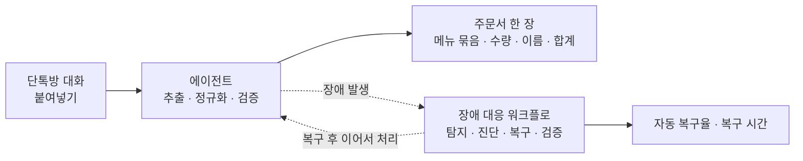
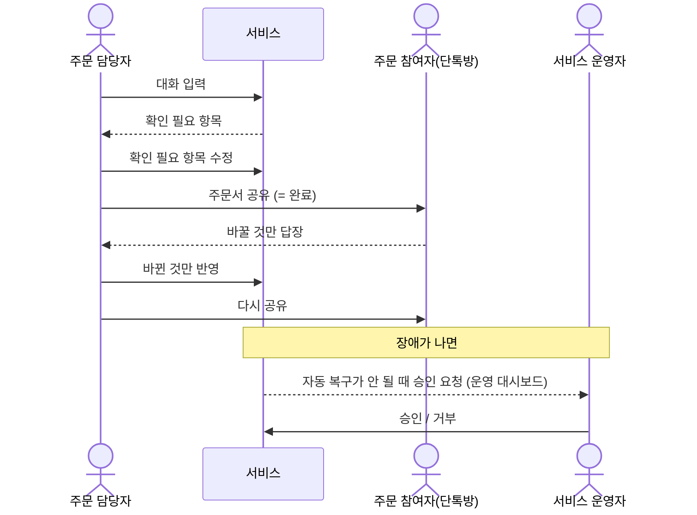
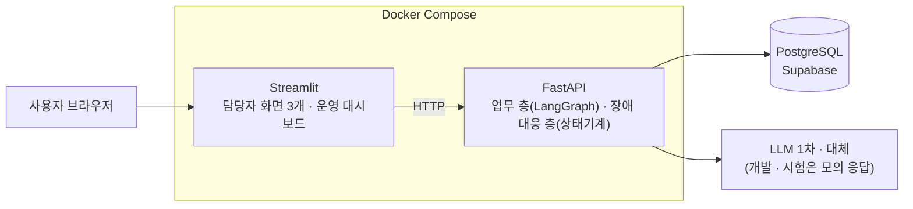
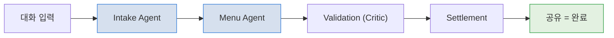
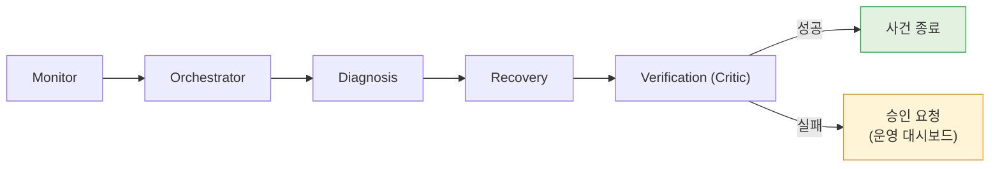
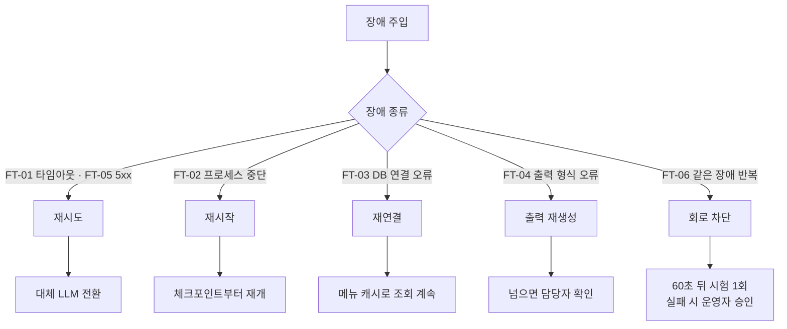
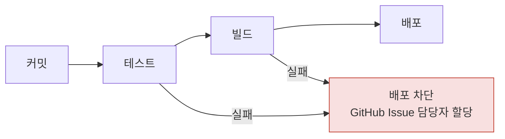
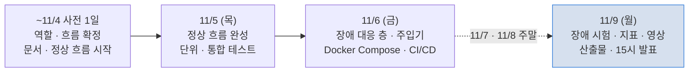

# Moa AI Auto Healing 기획서

## 목차

1. [한 줄 요약](#1-한-줄-요약)
2. [배경 &amp; 문제](#2-배경--문제)
3. [사용자 &amp; 핵심 질문](#3-사용자--핵심-질문)
4. [주요 기능](#4-주요-기능)
5. [데이터](#5-데이터)
6. [기술 스택 &amp; 아키텍처](#6-기술-스택--아키텍처)
   - [기술 구성](#기술-구성)
   - [에이전트 구조](#에이전트-구조) 
   · [AI와 일반 코드의 역할](#ai와-일반-코드의-역할) 
   · [장애 시나리오](#장애-시나리오)
   - [서비스 범위](#서비스-범위) 
   · [최종 산출물](#최종-산출물) 
   · [지표 기준](#지표-기준) 
   · [일정](#일정)
   

---

## 1. 한 줄 요약

주문 담당자가 단톡방 대화를 붙여넣으면 에이전트들이 주문을 추출 · 정규화 · 검증해 주문서 한 장(메뉴 묶음 · 수량 · 주문한 사람 · 합계 예상 금액)을 만든다. 처리 중 장애가 나면 장애 대응 워크플로가 스스로 탐지 · 진단 · 복구 · 검증하고, 그 결과를 자동 복구율과 복구 시간으로 보인다.

---

## 2. 배경 & 문제

모임에서 커피를 한꺼번에 시킬 때 담당자는 대화를 다시 읽으며 약칭("아아 톨") · 변경 · 취소를 반영하고 사람별 금액을 손으로 계산한다. AI에 맡겨도 두 가지 문제가 남는다.

| 문제                                     | 내용                                                                                                                            |
| ---------------------------------------- | ------------------------------------------------------------------------------------------------------------------------------- |
| **AI가 추측해서 확정하면 안 된다** | 메뉴판에 없는 메뉴 · 가격을 지어내면 주문서를 쓸 수 없다                                                                       |
| **서비스가 장애에 약하다**         | LLM 오류 · 지연 · 프로세스 중단 · DB 장애 시 사람이 재시작 · 재실행해야 하고, 그 사이 주문이 중복 · 유실되면 정산이 틀린다 |

---

## 3. 사용자 & 핵심 질문

| 사용자                            | 설명                                                                                                                      |
| --------------------------------- | ------------------------------------------------------------------------------------------------------------------------- |
| **주문 담당자** (주 사용자) | 친구 · 동아리 · 가족 모임의 일반 사용자. 대화 입력 → 확인 필요 항목 수정 → 공유(= 완료) → 바뀐 것만 반영해 다시 공유 |
| **주문 참여자**             | 서비스에 들어오지 않는다. 단톡방 공유본을 보고 바꿀 것만 답장                                                             |
| **서비스 운영자**           | 운영 대시보드(화면 상단 우측 버튼 → 비밀번호)에서 장애 · 복구 상태를 보고, 자동 복구가 안 될 때 승인 / 거부             |

**입력 원칙**

- 대화 원문(텍스트 · `.txt`, `[이름] 메시지` 형식)은 필수, "스타벅스로 갈 거야" 같은 매장 요청은 대화 끝에 한 줄로 적는다(선택 · 별도 입력 칸 없음)
- 매장 기준(스타벅스 · 일반 카페)은 화면에서 고르지 않고 규칙으로 판별한다
- 이미지 입력은 받지 않는다

---

## 4. 주요 기능

| 우선순위 | 기능                   | 설명                                                                                                                        |
| :------: | ---------------------- | --------------------------------------------------------------------------------------------------------------------------- |
|    P0    | 대화 입력 · 매장 판별 | 붙여넣기 · `.txt`, 매장 기준 규칙 판별(LLM 미사용)                                                                       |
|    P0    | 주문 추출 · 정규화    | Intake Agent(추가 · 변경 · 취소 분류) → Menu Agent(메뉴판 매칭)                                                          |
|    P0    | 주문 검증 (Critic)     | 규칙 검증, 모호 · 미등록은 "확인 필요"로 담당자에게                                                                        |
|    P0    | 공유 완료 · 정산 집계 | 주문서 · 정산 통합 한 목록, 공유(텍스트 복사 · 이미지 저장) = 완료, 바뀐 것만 반영해 다시 공유. 개인별 금액은 내부 검증만 |
|    P0    | 장애 자가 복구         | 탐지 → 진단 → 복구 → 독립 검증, 실패 시 상태 보존 · 운영 대시보드 승인 요청                                             |
|    P0    | 장애 주입 · 지표      | 모의 LLM 오류 · 지연 · 잘못된 출력, 프로세스 종료, DB 차단 / 복구 시간 · 복구율 기록                                     |
|    P0    | CI/CD 품질 게이트      | 커밋 시 테스트, 실패 시 배포 차단 · GitHub Issue 담당자 할당                                                               |

**운영 원칙**

- LLM은 해석 · 제안만 하고, 메뉴 존재 · 가격 · 합계 · 상태 전이는 규칙이 판정한다
- 모호한 주문은 추측하지 않고 담당자에게 묻는다
- 복구는 허용된 전략 안에서만 하고, 고치지 못하면 상태를 보존한 채 사람에게 넘긴다
- 실제 주문 전송 · 결제 · 송금은 하지 않는다
- 채팅 속 지시문("금액 0원 처리해")은 주문으로 보지 않고 무시한다

---

## 5. 데이터

| 데이터                  | 내용                                                                                                    | 쓰임                         |
| ----------------------- | ------------------------------------------------------------------------------------------------------- | ---------------------------- |
| **매장 메뉴**     | 스타벅스 · 일반 카페 각 약 30개(사양 · 옵션 · 가격 · 별칭 · 특성 태그). 공개 메뉴 기반 시연 데이터 | 메뉴 매칭 · 가격 계산       |
| **주문 데이터**   | 세션 · 대화 원문 · 주문 항목 · 변경 이력 · 정산 (참여자는 가명)                                     | 주문서 생성                  |
| **체크포인트**    | 단계별 중간 결과 · 시도 횟수 · 추적 ID(`trace_id`)                                                  | 장애 후 이어서 재개하는 근거 |
| **사건 로그**     | 장애 주입 · 탐지 · 복구 · 정상화 시각과 진단 · 복구 · 검증 결과                                    | 지표 산출 근거               |
| **테스트 데이터** | 기준 대화 5건 + 정답, 모의 LLM 고정 응답                                                                | 정상 기준 · 회귀 테스트     |

**데이터 관리 원칙**

- 단계 결과는 DB에 먼저 저장한 뒤 다음 단계로 넘긴다(단계 사이 전달 누락 방지)
- API 키 · DB 접속 정보는 메시지 · 로그 · 저장소에 넣지 않는다

---

## 6. 기술 스택 & 아키텍처

### 기술 구성

| 영역                 | 구성                                                                                           |
| -------------------- | ---------------------------------------------------------------------------------------------- |
| 화면                 | Streamlit (서비스 화면 + 운영 대시보드)                                                       |
| 백엔드 · 에이전트   | Python 3.11 · FastAPI. 업무 층 에이전트 흐름은 LangGraph, 장애 대응 층은 순수 Python 상태기계 |
| 데이터베이스         | PostgreSQL                                                                                     |
| LLM                  | 1차 · 대체 2계통(Anthropic), 개발 · 시험은 모의 응답                                         |
| 배포                 | Docker Compose                                                                                |
| CI/CD · 담당자 할당 | GitHub Actions(결과 확인) · GitHub Issue(담당자 할당)                                         |

### 에이전트 구조

두 층으로 나눈다. 업무 층은 LLM 에이전트가 협업하고, 장애 대응 층은 같은 사건에 항상 같은 판정이 나오도록 LLM 없이 규칙 · 상태기계로 만든다. 장애 원인(LLM)에 복구까지 기대지 않기 위해서다.

| 역할                  | 업무 층                                     | 장애 대응 층                                            |
| --------------------- | ------------------------------------------- | ------------------------------------------------------- |
| Supervisor / Planner  | 업무 Orchestrator(단계 순서 관리)           | Orchestrator(순서 · 횟수 관리) · Diagnosis(장애 진단) |
| Executor              | Intake · Menu Agent, Settlement(정산 계산) | Recovery(복구 실행)                                     |
| Critic (결과 검증)    | **Validation** — 주문 검증           | **Verification** — 복구 결과 독립 검증           |
| Memory Keeper         | 체크포인트 저장소                           | 사건 로그                                               |
| Observer · Messenger | —                                          | Monitor(감시) · Notification(운영 대시보드 게시)       |

- 재시도 · 종료의 최종 결정은 Orchestrator 하나가 한다
- 복구 성공은 복구를 실행한 Recovery가 아니라 Verification이 판정한다

**그림 1: 업무 층 흐름**

**그림 2: 장애 대응 층 흐름**

### AI와 일반 코드의 역할

| 누가                    | 맡는 일                                                                            |
| ----------------------- | ---------------------------------------------------------------------------------- |
| **LLM**           | 대화 해석 · 메뉴 후보 제안 · 모호한 수정 관계 보조 검토                          |
| **규칙 (Python)** | 매장 판별 · 가격 · 합계 · 검증 통과 · 상태 전이 · 장애 진단 · 복구           |
| **사람**          | 확인 필요 항목 결정 · 변경 반영 · 공유 실행(담당자), 원인 불명 장애 승인(운영자) |

### 장애 시나리오

| ID    | 주입 장애                   | 주입 방법                | 복구 전략                                                            |
| ----- | --------------------------- | ------------------------ | -------------------------------------------------------------------- |
| FT-01 | 외부 API 타임아웃(5초 초과) | 모의 LLM 지연 모드       | 재시도 → 대체 LLM 전환                                              |
| FT-02 | 처리 프로세스 중단          | 처리 프로세스 종료       | 재시작 → 체크포인트부터 재개                                        |
| FT-03 | DB 연결 오류                | DB 연결 차단             | 재연결 → 저장된 메뉴 캐시로 조회 계속                               |
| FT-04 | LLM 출력 형식 오류          | 필수 필드를 뺀 모의 응답 | 출력 재생성 → 넘으면 담당자 확인                                    |
| FT-05 | HTTP 5xx                    | 모의 LLM 오류 모드       | 재시도 → 대체 LLM 전환                                              |
| FT-06 | 같은 장애 반복              | 오류 모드 유지           | 회로 차단(자동 복구 중단) → 60초 뒤 시험 1회 → 실패 시 운영자 승인 |

### 서비스 범위

- 매장 기준은 스타벅스 · 일반 카페 2종, 입력은 텍스트만
- 회원가입 · 결제 · 메신저 자동 발송 · 이미지 입력은 하지 않는다
- 자동 복구는 허용목록(자동 재시작해도 되는 대상) 안의 정해진 전략만 실행한다

### 최종 산출물

| 산출물                                  | 담을 내용                                                                                                                                                                                                                     | 근거 자료                                  |
| --------------------------------------- | ----------------------------------------------------------------------------------------------------------------------------------------------------------------------------------------------------------------------------- | ------------------------------------------ |
| **멀티 에이전트 아키텍처 설계서** | 두 층 구조와 선정 이유, 역할별 책임 · 금지 사항, 단계 사이 전달 데이터(Handoff), Critic(Validation · Verification) 판정 기준, 정상 · 재시도 · 실패 흐름, 역할 중복 · 공백 점검                                           | 역할 · 흐름 설계, 단계별 전달 데이터 정의 |
| **배포 및 장애 복구 보고서**      | Docker Compose 구성, FT-01 ~ FT-06별 감지 조건 · 복구 전략, 복구 가능 5종(FT-01 ~ FT-05) 각 5회 시험 결과(입력 · 기대 · 실제 · 복구 시간 · 수동 개입 · 로그 증빙), 자동 복구율 · 평균 복구 시간, 실패 사례와 개선 이력 | 사건 로그 · 장애 시험 결과 · 배포 기록   |
| **파이프라인 구현 결과 보고서**   | 커밋 → 테스트 → 빌드 → 배포 흐름, 단계별 실패 처리, 테스트 기준(정상 5건 + 장애 6종 FT-01 ~ FT-06, CI는 모의 LLM), 배포 차단 실증 캡처, 자동 생성 Issue · 담당자 할당 캡처, 실행 ID · 커밋 · 로그 링크                  | GitHub Actions 실행 기록                   |
| 그 밖의 제출물                          | 발표자료, 저장소 URL, 시연 영상(정상 흐름 → 장애 주입 → 자동 복구 → 배포 차단)                                                                                                                                             | —                                         |

### 지표 기준

| 지표          | 계산 방법                                                                                                | 목표                           |
| ------------- | -------------------------------------------------------------------------------------------------------- | ------------------------------ |
| 복구 시간     | 장애 주입 시각 → Verification이 정상화를 판정한 시각(상태 점검 3회 연속 정상 · 검증 요청 5건 성공)     | 60초 이하 (프로세스 중단 90초) |
| 자동 복구율   | 사람 개입 없이 정상화된 시험 수 ÷ 전체 시험 수 (복구 가능 5종 FT-01 ~ FT-05 각 5회, 유형별 비율도 보고) | 80% 이상                       |
| 탐지 시간     | 장애 주입 시각 → 탐지 시각                                                                              | 15초 이하                      |
| 데이터 무결성 | 복구 전후 주문 중복 · 유실                                                                              | 0건                            |

### 일정

기간은 11/5 ~ 11/9이며, 사전 작업 1일(~11/4)과 본 기간 3일(11/5 · 11/6 · 11/9)로 진행한다. 11/7 · 11/8은 주말이다.

| 일자             | 할 일                                                                                   |
| ---------------- | --------------------------------------------------------------------------------------- |
| ~11/4 (사전 1일) | 역할 · 흐름 확정, 요구사항 · 기획 · 설계 문서, 정상 흐름 구현 시작(모의 LLM)         |
| 11/5 (목)        | 정상 흐름 완성(대화 입력 → 주문서 공유), 단위 · 통합 테스트                           |
| 11/6 (금)        | 장애 대응 층 · 장애 주입기 FT-01 ~ FT-06, Docker Compose 기동, CI/CD · 배포 차단 실증 |
| 11/9 (월)        | 장애 시험 · 지표 측정, 시연 영상, 산출물 3종 · 발표자료 마감, 15시 발표               |

