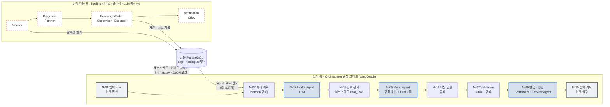
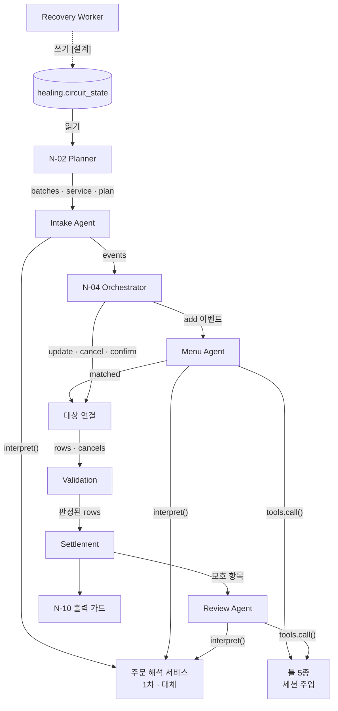
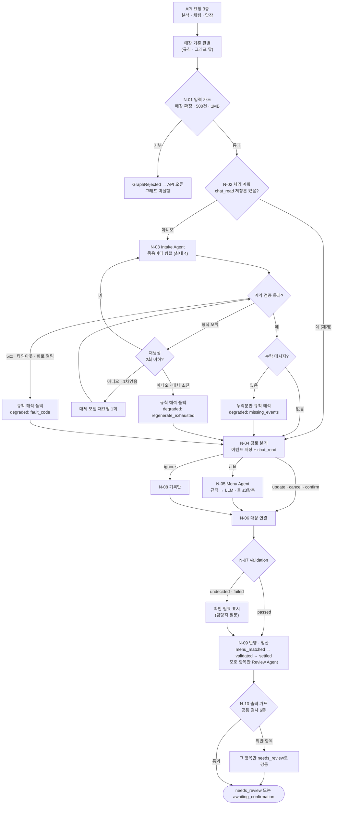
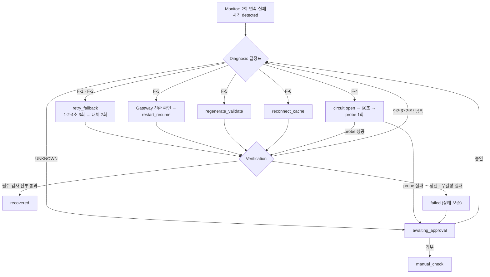
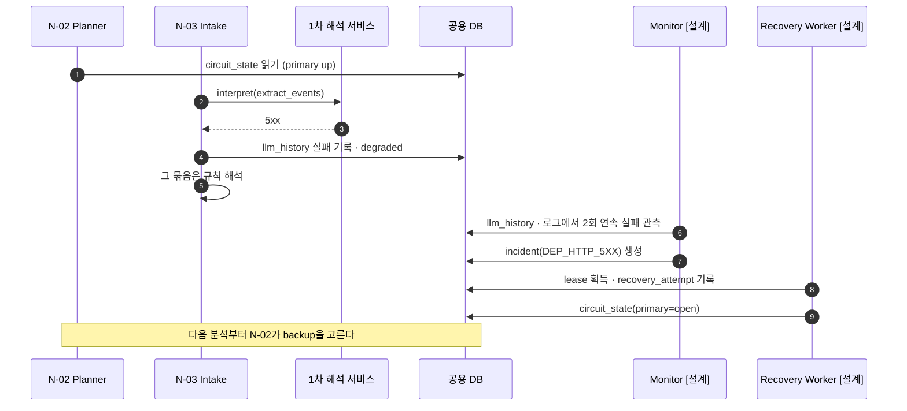
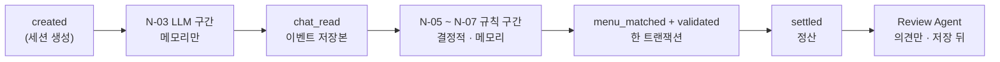

# MOA 멀티 에이전트 아키텍처 설계서

> 문서 버전: **v1.0**
> 작성일: 2026-11-05

## 목차

1. [프로젝트 목적](#1-프로젝트-목적)
2. [대표 사용자 시나리오](#2-대표-사용자-시나리오)
3. [아키텍처 선택](#3-아키텍처-선택)
4. [에이전트별 역할 · 책임 · 입력 · 출력](#4-에이전트별-역할--책임--입력--출력)
5. [협업 흐름](#5-협업-흐름)
6. [Handoff 조건과 전달 데이터](#6-handoff-조건과-전달-데이터)
7. [공유 상태 · 메모리 · 중간 결과 관리](#7-공유-상태--메모리--중간-결과-관리)
8. [정상 · 재시도 · 실패 · 종료 흐름](#8-정상--재시도--실패--종료-흐름)
9. [역할 중복 및 책임 공백 점검 결과](#9-역할-중복-및-책임-공백-점검-결과)

---

## 1. 프로젝트 목적

### 1.1 목적

단톡방 주문 대화를 붙여넣으면 에이전트들이 주문을 추출 · 정규화 · 검증해 주문서 한 장을 만든다.
처리 중 장애가 나면 장애 대응 워크플로가 탐지 · 진단 · 복구 · 검증하고 MTTD · MTTR · 무인 복구율로 보인다.

| 목표                                           | 이 설계서에서 다루는 방식                  |
| ---------------------------------------------- | ------------------------------------------ |
| G-1 대화 → 주문서가 끊김 없이 나온다          | 업무 층 멀티 에이전트(4절 · 5.1절)        |
| G-2 정해진 장애를 사전 허용된 조치로 자동 복구 | 장애 대응 층 역할 분리(4.2절 · 5.2절)     |
| G-3 복구 전후 중복 · 유실 0                   | Handoff 저장 경계와 체크포인트(6절 · 7절) |
| G-4 못 고치면 상태를 보존하고 사람에게         | 실패 · 종료 조건(8절)                     |

### 1.2 사용자

| 사용자                  | 시스템과의 접점                                                                |
| ----------------------- | ------------------------------------------------------------------------------ |
| 주문 담당자 (주 사용자) | 대화 입력 → 확인 필요 항목 결정 → 공유(= 완료) → 바뀐 것만 반영해 다시 공유 |
| 주문 참여자             | 서비스에 들어오지 않는다. 단톡방 공유본을 보고 답장만                          |
| 서비스 운영자           | 운영 대시보드에서 사건 · 복구 상태 확인, 자동 복구가 안 될 때 승인 · 거부    |

## 2. 대표 사용자 시나리오

주문 담당자가 정상적으로 주문서를 만드는 흐름과, 처리 중 장애가 났을 때 두 층이 각각 무엇을 하는지를 하나씩 보인다.

### 2.1 정상 처리

입력 (대화 끝 매장 요청: "스타벅스 기준으로 정리해줘")

```text
[김민수] 아이스 아메리카노 톨 2잔, 하나는 샷 추가요.
[이지연] 바닐라라떼 큰 거 얼음 적게요.
[박서연] 아아 톨 한 잔이요.
[김민수] 아까 샷 추가한 한 잔 취소할게요.
[이지연] 사이즈는 벤티로 할게요.
```

| 단계              | 담당                                    | 결과                                                                           |
| ----------------- | --------------------------------------- | ------------------------------------------------------------------------------ |
| 매장 판별         | 규칙(그래프 앞)                         | 매장 요청에 "스타벅스" 1종 → `starbucks`                                    |
| N-01 입력 가드    | Orchestrator                            | 세션 고정, 메시지 5건 · 1MB 이하 확인                                         |
| N-02 처리 계획    | Planner(규칙)                           | 저장본 없음 → 처음부터, 1차 서비스, 묶음 2개(4건 + 1건), `plan` 기록        |
| N-03 의도분류     | Intake Agent (LLM)                      | 1~3줄 `add`, 4줄 `cancel`(1줄 샷 추가 잔), 5줄 `update`(2줄 사이즈)      |
| N-04 경로 분기    | Orchestrator                            | 이벤트 저장 + 체크포인트 `chat_read`                                         |
| N-05 메뉴 매칭    | 규칙 → 필요 시 Menu Agent (LLM + 툴)   | "아아" → 아이스 아메리카노. "큰 거"는 모호                                    |
| N-06 대상 연결    | 규칙                                    | 취소 대상 = 김민수 샷 추가 잔 1개, 변경 대상 = 이지연 바닐라라떼 → 벤티       |
| N-07 규칙 검증    | Validation (Critic)                     | 수량 · 옵션 · 변경 관계 통과                                                 |
| N-09 반영 · 정산 | Settlement + (모호 항목만) Review Agent | 아이스 아메리카노 톨 2잔 · 아이스 바닐라라떼 벤티 1잔, 체크포인트 `settled` |
| N-10 출력 가드    | Orchestrator                            | 공통 검사 6종 통과 → `awaiting_confirmation`                                |

### 2.2 장애

| 시점                | 업무 층                                                                                                        | 장애 대응 층                                                                                                                          |
| ------------------- | -------------------------------------------------------------------------------------------------------------- | ------------------------------------------------------------------------------------------------------------------------------------- |
| 1차 해석 서비스 5xx | N-03이 `InterpreterError(DEP_HTTP_5XX)`를 받고 그 묶음을 규칙 해석으로 이어서 정리(`degraded` 기록) [구현] | Monitor가 2회 연속 실패로 사건 생성 → Diagnosis `DEP_HTTP_5XX` · `retry_fallback` → Recovery Worker 재시도 · 대체 전환 [설계] |
| 복구 중             | 다음 분석의 N-02가 `healing.circuit_state`를 읽어 대체 서비스를 고른다 [구현]                                | Recovery Worker가 회로 상태를 바꾼다 [설계]                                                                                           |
| 종료                | 담당자 화면에는 장애 코드 대신 "규칙 해석으로 이어서 정리"가 운영 처리 기록에 남는다 [구현]                    | Verification이 상태 점검 3회 · 검증 요청 5건 통과 시 `recovered` [설계]                                                            |

---

## 3. 아키텍처 선택

### 3.1 결론

| 층           | 구조                                                                                                         | 실행 형태                                                                 |
| ------------ | ------------------------------------------------------------------------------------------------------------ | ------------------------------------------------------------------------- |
| 업무 층      | Orchestrator 중심 고정 순서 그래프 + 전문 에이전트 3개(Supervisor형의 변형 - 조정자가 LLM이 아니라 상태기계) | LangGraph 노드 10개(N-01 ~ N-10), 단일 진입 N-01 · 단일 출구 N-10 [구현] |
| 장애 대응 층 | 역할 분리형 결정적 파이프라인(Monitor → Diagnosis → Recovery Worker → Verification), LLM 미사용           | 업무 처리와 분리된 `healing` 서비스, 순수 Python 상태기계 [설계]        |

업무 층은 `healing.circuit_state`를 읽기만 하고, 장애 대응 층은 업무 데이터를 고치지 않는다.



* 점선 테두리는 [설계] 상태(코드 없음)다.

### 3.2 선정 이유 — 비즈니스 요구사항별

| 요구사항    | 근거 수치                                                      | 업무 층 결정                                                                                                                                 | 장애 대응 층 결정                                                                                                                                                              |
| ----------- | -------------------------------------------------------------- | -------------------------------------------------------------------------------------------------------------------------------------------- | ------------------------------------------------------------------------------------------------------------------------------------------------------------------------------ |
| 응답 속도   | 해석 호출 제한 5초, 첫 정리까지 [정리하기] 2회                 | 조정자를 LLM으로 두지 않는다 - LLM 호출은 Intake(묶음당 1회)와 규칙이 못 정한 항목뿐. 묶음 4건 병렬(최대 4) · 대체 서비스는 2건 묶음        | 상태 점검 5초 · 2회 연속 실패 판정 → MTTD 15초 이하 목표. 판단에 LLM 왕복이 없으므로 진단 지연이 결정적이다                                                                  |
| 결정 일관성 | 미등록 메뉴 자동 확정 0건(SC-8), LLM 의견만으로 통과 0건(SC-9) | LLM은 해석 · 후보 · 의견만. 메뉴 확정 · 가격 · 검증 통과 · 상태 전이는 규칙. 노드 순서가 고정이라 같은 입력이면 같은 단계를 지난다      | 같은 사건에 항상 같은 판정 - 고정 결정표(장애 코드 7종)와 허용목록 액션만. 장애 원인(LLM)에 복구 판단을 기대지 않는다                                                          |
| 장애 격리   | 앱 복제본 전환 15초(SC-12), 중복 · 유실 0건(SC-5)             | 해석 서비스 장애는 묶음 단위로 규칙 해석 폴백 — 한 묶음 실패가 분석 전체를 멈추지 않는다. LLM 경계(N-04)에서 저장 → 재개 시 LLM 재호출 0회 | `healing`을 업무 프로세스와 다른 컨테이너로 둬서 함께 죽지 않는다. Docker 제어는 조회 · 재시작만 허용하는 socket-proxy 경유. 복제본 장애는 Gateway가 Recovery보다 먼저 격리 |

### 3.3 검토한 대안

| 대안                                                              | 장점                               | 채택하지 않은 이유                                                                                                                            |
| ----------------------------------------------------------------- | ---------------------------------- | --------------------------------------------------------------------------------------------------------------------------------------------- |
| A. LLM Supervisor가 다음 담당을 고르는 구조                       | 유연한 분기                        | 조정 단계마다 LLM 왕복이 늘어 5초 제한과 충돌. 같은 입력에 다른 경로를 탈 수 있어 SC-9 · 반복 측정(25회)을 보장하지 못한다                   |
| B. 에이전트끼리 직접 메시지를 주고받는 분산형                     | 노드 추가가 쉽다                   | 공통 검사(입력 보정 · 출력 검사)를 경로마다 넣어야 해 한 곳을 빠뜨리면 그 경로만 조용히 깨진다(G-A4). 재시도 횟수를 한 곳에서 셀 수 없다     |
| C. 장애 대응도 LLM 에이전트로                                     | 미등록 장애에 대한 설명력          | 장애 원인과 복구 수단이 같은 계통(LLM)에 묶인다. 판정이 매번 달라 MTTR을 반복 측정할 수 없다. LLM이 만든 명령 실행은 PRD 8.5 "자동 실행 금지" |
| D. 채택안 — 업무 층 고정 그래프 + 장애 대응 층 결정적 파이프라인 | 위 세 요구를 모두 수치로 검증 가능 | -                                                                                                                                             |

### 3.4 고려사항과 대응

| 위험                                                           | 대응                                                                                                   |
| -------------------------------------------------------------- | ------------------------------------------------------------------------------------------------------ |
| Orchestrator(그래프 프로세스) 자체가 죽으면 업무 전체가 멈춘다 | 앱 복제본 A/B + HAProxy 게이트웨이가 정상 복제본으로 전환, 재시작 뒤 체크포인트 `chat_read`부터 재개 |
| Recovery Worker가 둘 이상이면 같은 사건을 중복 실행            | 사건 lease(행 잠금) + 액션 멱등성 키                                                                   |
| 실 LLM 연결 시 5초가 맞지 않아 F-2 오탐                        | 측정은 모의 해석 서비스로, 실 LLM 적용 전 재조정(PRD U-09)                                             |
| 게이트웨이 · DB · 실행 호스트 단일 장애점                    | 범위 밖으로 명시, 복구율과 분리 보고                                                                   |

---

## 4. 에이전트별 역할 · 책임 · 입력 · 출력

### 4.1 업무 층

LLM 에이전트는 **3개**(Intake · Menu · Review)다. 나머지는 규칙이며, 규칙으로 충분한 역할은 LLM으로 만들지 않는다.

| 에이전트 · 구성요소                 | 노드                 | 형태                                     | 주요 역할                                                                                                          | 입력                                                                                  | 출력                                                                        | 하지 못하는 것                                     |
| ------------------------------------ | -------------------- | ---------------------------------------- | ------------------------------------------------------------------------------------------------------------------ | ------------------------------------------------------------------------------------- | --------------------------------------------------------------------------- | -------------------------------------------------- |
| **Orchestrator** (Supervisor)  | N-01 · N-04 · N-10 | 상태기계                                 | 진입 · 경로 분기 · 출구, 체크포인트 저장, 공통 검사 6종, 상한 관리                                               | `session` · `source`(snapshot · chat · reply) · 원문                          | `messages` · `existing` · 경로별 Send · `result` · `guard`      | 주문 해석 · 수정, 복구 실행                       |
| **처리 계획** (Planner)        | N-02                 | 규칙                                     | 재개 여부 · 해석 서비스(1차 · 대체 · 규칙) 선택 · 묶음 분해 · LLM 예산 배정 · 완료 조건 기록                 | `messages` · 체크포인트 · `circuit_state` · 설정 상한                          | `batches` · `service` · `resumed` · `plan`                       | LLM 호출, 주문 해석 · 수정                        |
| **Intake Agent** (Executor)    | N-03                 | LLM, 툴 0개                              | 메시지마다 이벤트 유형 5종 · 주문자 · 근거 메시지 · 가리키는 앞 주문 추출. 메뉴 · 사이즈 · 요청은 원문 그대로 | `BatchState`(묶음 4건 + 앞 문맥 4건 + 같은 사람 문맥 ≤12건 + 기존 주문)            | `events: OrderEvent[]`                                                    | 메뉴 · 가격 판정, 모호한 변경 임의 확정           |
| **Menu Agent** (Executor)      | N-05                 | 규칙 우선 → 못 정한 항목만 LLM + 툴 3종 | 규칙(별칭 · 엄격 매칭) 먼저. 못 정하면 툴로 메뉴판 검색 → 후보 · 정렬 · 사유, 원문을 메뉴 / 요청으로 나누기    | `EventState`(이벤트 1개 · 메시지 순서 · 앞 4건 창 · `service` · `agent_ok`) | `matched[]`(후보 · `agent_tools` · `agent_reason` · `llm_split`) | `menu_id` 확정 — 확정은 규칙 재매칭 또는 담당자 |
| 대상 연결                            | N-06                 | 규칙                                     | update · cancel · confirm이 가리키는 항목 찾기, 옵션으로 좁히기, 모호하면 표시만                                 | 정렬된 이벤트 · `matched`                                                          | `rows` · `cancels` · `targets`                                      | 대상이 둘 이상일 때 임의 선택                      |
| **Validation** (Critic)        | N-07                 | 규칙                                     | 메뉴별 옵션 허용 · 수량 · 사양 판정, 대상 모호 시 `needs_review`, 단가 · 예상 금액 부착                       | `rows` · 세션 메뉴판                                                               | `rule_verdict` · `validation_status` · `review_reason`              | LLM 의견만으로 통과                                |
| **Review Agent** (Critic 보조) | N-09 저장 직후       | LLM + 툴 3종                             | 대상이 모호한 항목만, 툴로 기존 주문을 보고 의견 · 사유                                                           | 모호 항목(≤10건) · 해당 메시지 창                                                   | `llm_review_verdict`(agree · disagree) · `review_reason_text`         | `validation_status` 변경                         |
| **Settlement** (Executor)      | N-09                 | 계산 규칙                                | 기준가 + 옵션 추가금, 묶음별 수량 · 금액, 개인 합계 = 전체 금액 내부 검증, 확인 질문 생성                         | 저장된 항목                                                                           | `settlement_line` · `review_question`                                  | 합계 불일치 때 주문서 생성, 개인별 금액 표시       |
| ignore 기록                          | N-08                 | 규칙                                     | 주문 아님 이벤트를 기록만                                                                                          | 이벤트 1개                                                                            | 없음                                                                        | 항목 생성 · 변경, LLM · 툴 호출                  |

**툴 5종**과 사용 권한

| 툴                      | Intake | Menu | Review |
| ----------------------- | :----: | :--: | :----: |
| `search_menu`         |   -   |  O  |   -   |
| `find_menu_by_traits` |   -   |  O  |   -   |
| `get_menu`            |   -   |  O  |   O   |
| `list_order_items`    |   -   |  -  |   O   |
| `get_order_item`      |   -   |  -  |   O   |

매장 · 세션 식별자는 LLM 인자로 받지 않는다. 툴은 `ToolContext`에서 주입받는다.

### 4.2 장애 대응 층

한 역할이 혼자 판단 · 실행 · 종료하지 못하게 나눴다. 판단은 Diagnosis, 실행은 Recovery Worker, 종료(`recovered`)는 Verification만 한다.

| 역할                                   | 템플릿 역할           | 주요 역할                                                                                                                          | 입력                                                                | 출력                                                |
| -------------------------------------- | --------------------- | ---------------------------------------------------------------------------------------------------------------------------------- | ------------------------------------------------------------------- | --------------------------------------------------- |
| **Gateway** (HAProxy)            | Messenger             | 앱 스택 A/B `/health` 2초 간격 확인, 2회 실패 시 제외, 2회 연속 성공 시 재등록                                                   | 상태 점검 응답                                                      | 라우팅 풀                                           |
| **Monitor**                      | Observer              | 메트릭(컨테이너 · 네트워크 · DB · API · LLM · 프롬프트) 5초 점검, 임계값 초과 시 사건 생성, 같은 대상 · 원인이면 증거만 추가 | JSON 로그 · `llm_history` · `runtime_metric` · 컨테이너 상태 | `healing.incident`(detected)                      |
| **Diagnosis**                    | Planner               | 고정 결정표로 장애 코드 7종 분류, `recovery_plan`(전략 순서 · 시도 상한 · 완료 조건) 작성, `UNKNOWN`은 승인 대기로           | 사건 · 증거 · 시도 이력 · 회로 상태                              | `fault_code` · `strategy` · `recovery_plan` |
| **Recovery Worker**              | Supervisor + Executor | lease 획득 → 계획대로 허용목록 액션 실행, 시도 횟수 · 회로 상태 · 30초 재실행 금지 · 5분 제한 관리                             | `recovery_plan` · lease                                          | `recovery_attempt` · `circuit_state` 갱신      |
| 허용목록 액션 어댑터                   | Executor 도구         | 고정 컨테이너 이름에 대한 재시작 · 상태 확인만 노출                                                                               | 액션 이름 · 대상 ID                                                | 액션 결과                                           |
| **Verification**                 | Critic                | 조치와 독립된 모듈에서 연속 정상 3회 · 기능 샘플(F-1 검증 요청 5건) · 데이터 무결성 확인                                         | 사건 · 대상 · 기준 주문 · 체크포인트                             | `verification_result`, `recovered` 전이         |
| **Notification** (운영 대시보드) | Messenger             | 사건 목록 · 상세 · 지표 표시, 승인 · 거부 기록(상태만 전환)                                                                     | 운영자 입력                                                         | `healing.approval` · 사건 상태                   |
| 장애 주입기                            | (시험 도구)           | lab 환경에서 해석 서비스 오류 · 지연 · 잘못된 출력 모드, 예외(`/boom`)                                                         | 장애 코드                                                           | `healing.fault_injection`                         |

### 4.3 템플릿 역할과의 대응

| 템플릿 역할                                         | 업무 층                                                        | 장애 대응 층                       |
| --------------------------------------------------- | -------------------------------------------------------------- | ---------------------------------- |
| Supervisor (할당 · Handoff · 재시도 · 종료 판단) | Orchestrator (N-01 · N-04 · N-10 + 그래프 엣지)              | Recovery Worker                    |
| Planner (분해 · 순서 · 완료 조건)                 | 처리 계획 N-02 → `plan`                                     | Diagnosis → `recovery_plan`     |
| Executor (도구 실행 · 원본 결과)                   | Intake · Menu Agent, 대상 연결, Settlement                    | Recovery Worker의 허용목록 액션    |
| Critic (검증, PASS · RETRY · FAIL)                | Validation(N-07, 규칙) + Review Agent(의견만) + 출력 가드 N-10 | Verification                       |
| Memory Keeper (상태 · 중간 결과 · 실패 이력)      | 체크포인트 · `order_event.payload` · `llm_history` (7절) | `healing.*` 테이블 · lease      |
| Observer · Messenger                               | —                                                             | Monitor · Gateway · Notification |

### 4.4 의존 관계



---

## 5. 협업 흐름

### 5.1 업무 층 — 정상 · 재시도 · 폴백 · 종료



### 5.2 장애 대응 층 — 사건 처리



### 5.3 두 층의 접점 (시퀀스)



---

## 6. Handoff 조건과 전달 데이터

### 6.1 업무 층 Handoff 목록

| #    | 보낸 쪽 → 받는 쪽            | Handoff 조건                                                                        | 전달 데이터 (State 키)                                                                                                                                 | 코드 위치                                                    |
| ---- | ----------------------------- | ----------------------------------------------------------------------------------- | ------------------------------------------------------------------------------------------------------------------------------------------------------ | ------------------------------------------------------------ |
| H-1  | API → N-01                   | `source`가 snapshot · chat · reply 중 하나                                      | `session` · `source` · `trace_id` · `text` · `messages` · `expected_version`                                                          | `graph/build.py` `run()`                                 |
| H-2  | N-01 → N-02                  | 매장 확정(`status ≠ awaiting_brand_answer`) · 500건 · 1MB 이하                 | `messages` · `existing`(기존 주문, chat · reply)                                                                                                 | `nodes.input_guard_node`                                   |
| H-3  | N-02 → N-03 (Send × 묶음)   | 재개가 아니다                                                                       | `BatchState` = `session` · `trace_id` · `batch{batch_no, prev, targets, use_llm, service, person_prev}` · `existing`                      | `nodes.dispatch_batches_edge`                              |
| H-3' | N-02 → N-04 (건너뜀)         | `checkpoint = chat_read` 이고 최신 Snapshot 이벤트 저장본이 전부 있음             | `events`(저장본) · `resumed = True`                                                                                                               | `nodes.batch_node` · `_saved_events`                    |
| H-4  | N-03 → N-04                  | 묶음 처리 끝(LLM 성공 · 규칙 폴백 모두)                                            | `events`(reducer 합침) · `llm_calls` · `degraded`                                                                                              | `nodes.intake_node`                                        |
| H-5  | N-04 → N-05 (Send × add)    | 분석(snapshot) 이고 `route = add`                                                 | `EventState` = `session` · `event` · `index` · `events`(읽기 전용) · `route` · `service` · `agent_ok`(20건 이내) · `trace_id` | `nodes.route_edge`                                         |
| H-6  | N-04 → N-08 (Send × ignore) | `route = ignore`                                                                  | `session` · `event` · `index` · `events` · `route`                                                                                       | `nodes.route_edge`                                         |
| H-7  | N-04 → N-06                  | add · ignore 가 없거나, chat · reply                                              | `targets.ordered`(정렬된 이벤트)                                                                                                                     | `nodes.route_edge`                                         |
| H-8  | N-05 · N-08 → N-06          | 고정 엣지                                                                           | `matched[]{index, k, row}`                                                                                                                           | `graph/build.py`                                           |
| H-9  | N-06 → N-07                  | 고정 엣지                                                                           | `rows`(항목 번호 부여) · `cancels` · `targets`                                                                                                 | `nodes.target_node`                                        |
| H-10 | N-07 → N-09                  | 고정 엣지                                                                           | 판정이 붙은 `rows`(`rule_verdict` · `validation_status` · `unit_price`)                                                                      | `nodes.validation_node`                                    |
| H-11 | N-09 → Review Agent          | 서비스 있음 · 항목에 `_target_unclear_text` 또는 `person_unclear` · 10건 이내 | 항목 요약 · 해당 메시지 창(앞 4건 포함) · `route` · `service` · `trace_id`                                                                   | `nodes._review_unclear`                                    |
| H-12 | N-09 → N-10                  | 고정 엣지                                                                           | `result` · `llm_calls`                                                                                                                            | `nodes.apply_node`                                         |
| H-13 | N-05 · Review → 해석 서비스 | 규칙이 메뉴를 못 정함 / 대상 모호                                                   | `task` · 마스킹된 `messages` · `context{brand_id, menu_version, agent{items, tools, transcript, remaining}}` · `schema` · `trace_id`     | `graph/agents._run` · `interpreter_client.interpret`    |
| H-14 | 에이전트 → 툴                | 에이전트 권한 + 경로 허용 횟수 안                                                   | 툴 이름 · 인자(식별자 제외), 실행 맥락은 `ToolContext`가 주입                                                                                       | `tools/loop.run_specialist` · `tools/budget.ToolBudget` |

### 6.2 Handoff 필드 — 템플릿 필드와 구현의 대응

업무 층은 노드 사이에 별도 Handoff 봉투 객체를 두지 않는다. 템플릿 필드가 담는 정보는 아래 State 키와 기록으로 전달된다.

| 템플릿 필드                   | 업무 층 구현                                                                                                                                       | 장애 대응 층                                                   | 예시                        |
| ----------------------------- | -------------------------------------------------------------------------------------------------------------------------------------------------- | -------------------------------------------------------------- | --------------------------- |
| `task_id`                   | `trace_id`(요청 1건) + `plan.plan_id`(분석 1회) + `batch_no`(묶음) / `item_id`(항목)                                                       | `incident_id` + `trace_id`                                 | `pl_3fa1c9e2b0` · 묶음 2 |
| `from_agent` / `to_agent` | 그래프 엣지가 고정(`build.py`) — 값으로 싣지 않는다. 실행 기록은 `llm_history.agent`(intake · menu · validation) · 로그 `route_decision` | `incident.status` 전이 (detected → recovering → verifying) | `intake` → `route`     |
| `objective`                 | 해석 서비스 `task`(`extract_events` · `normalize_menu` · `review`)                                                                       | `fault_code` · `strategy`                                 | `normalize_menu`          |
| `inputs`                    | `BatchState.batch` · `EventState.event` · `context`                                                                                        | `detection_evidence` · 대상 replica · dependency           | 묶음 4건 + 앞 4건           |
| `constraints`               | `ToolBudget(agent, route)` 툴 허용 · `ToolContext` 세션 주입 · `MENU_AS_OF` · `agent_ok` · 프롬프트 금지 규칙                          | 허용목록 · 시도 상한 · 30초 재실행 금지 · 5분 제한          | add 경로 툴 합계 3회        |
| `expected_output`           | `TASK_CONTRACTS`의 Pydantic 스키마를 요청에 `schema`로 싣고, 응답을 우리 쪽에서 다시 검증                                                      | 전략별 성공 검증 기준                                          | `OrderEvents`             |
| `attempt`                   | Intake 재생성 `attempts`(0 ~ 2, 노드 지역 변수) · 툴 왕복 `remaining` · 호출 수 `llm_calls`(State reducer)                                 | `incident.attempt_count` · `recovery_attempt.attempt_no`  | `remaining: 2`            |
| `memory_refs`               | `session_id` · `checkpoint` · `order_event.payload`(저장본) · `existing`(기존 주문)                                                     | `incident.session_id` · `checkpoint` · `menu_version`  | `chat_read`               |

### 6.3 Handoff 점검 원칙 적용 결과

| 원칙                                                          | 적용                                                                                                                                                                                                      | 근거                                                                        |
| ------------------------------------------------------------- | --------------------------------------------------------------------------------------------------------------------------------------------------------------------------------------------------------- | --------------------------------------------------------------------------- |
| 모든 전달에 작업 ID와 시도 횟수 포함                          | 부분 - `trace_id`는 모든 Send · 해석 호출 · 로그에 실린다. 시도 횟수는 재생성 루프 안 지역 변수와 `llm_calls` 합계로만 남고 시도별 번호가 State에 없다(시도별 기록은 `llm_history` 행으로 셈)   | `nodes.dispatch_batches_edge` · `route_edge` · `interpreter_client` |
| 중간 결과에 작성자 · 검증 상태 기록                          | 적용 — 항목에 `matched_by`(rule · rule_after_llm_split) · `candidates_by=menu_agent` · `rule_verdict` · `validation_status` · `llm_review_verdict`                                        | `nodes._retry_with_split` · `agents.menu_agent` · `validation_node` |
| RETRY 시 이전 실패 원인 · 수정 지시 포함                     | 의도적으로 다르게 적용 — Intake 재생성은 같은 입력 · 같은 prompt version으로 다시 생성한다(PRD 5.1 · 8.1 F-5 결정). 툴 루프에서는 거부된 툴 결과(`거부됨: 사유`)를 다음 왕복 `transcript`에 넣는다 | PRD 5.1 · `agents._short`                                                |
| 원본 대신 참조값을 넘길 때 접근 경로 명시                     | 적용 — 재개 시 `order_event.payload`를 `session_id` + 최신 `snapshot_id`로 읽는다. Review Agent는 원본 대신 `item_id`를 받고 `get_order_item` 툴로 읽는다                                      | `nodes._saved_events` · `tools/order_tools.py`                         |
| API 키 · 비밀번호 · 개인정보를 메시지 · 로그에 남기지 않음 | 적용 — 해석 서비스로 나가는 유일한 경계에서 요청 본문 전체 PII 마스킹, 로그에는 마스킹 종류만. 출력 가드가 바깥 문구의 금액 · PII 패턴 제거                                                             | `interpreter_client.interpret`(`mask_payload`) · `nodes.clean_text`  |

---

## 7. 공유 상태 · 메모리 · 중간 결과 관리

### 7.1 저장 위치와 수명

| 계층             | 무엇                                                                                                               | 저장소                                                                             | 수명                                             | 쓰는 쪽                        | 읽는 쪽                                |
| ---------------- | ------------------------------------------------------------------------------------------------------------------ | ---------------------------------------------------------------------------------- | ------------------------------------------------ | ------------------------------ | -------------------------------------- |
| 작업 메모리      | `RunState` · `BatchState` · `EventState`                                                                   | 프로세스 메모리 (LangGraph State)                                                  | 요청 1건(턴). 끝나면 버린다 — 체크포인터 미사용 | 각 노드(갱신분만 반환)         | 다음 노드                              |
| 병렬 결과 합치기 | `events` · `matched` · `llm_calls` · `degraded`                                                         | State reducer(`operator.add`)                                                    | 요청 1건                                         | N-03 · N-05 병렬 실행         | N-04 · N-06 · N-10                   |
| 체크포인트       | `order_session.checkpoint` 5종: `created` → `chat_read` → `menu_matched` → `validated` → `settled` | `app.order_session`                                                              | 세션                                             | Orchestrator(N-04 · N-09)     | N-02(재개 판단) · Monitor · Recovery |
| LLM 경계 저장본  | Intake 결과 이벤트 전체                                                                                            | `app.order_event.payload`                                                        | 세션                                             | N-04 (snapshot · 비재개)      | N-02 재개                              |
| 턴 사이 기억     | 주문 항목 · 확인 질문 · 변경 이력 · 정산                                                                        | `app.order_item` · `review_question` · `change_log` · `settlement_line` | 세션                                             | N-09 · 편집 API               | 다음 턴 N-01(`existing`) · 툴       |
| 실행 계획        | `plan` (plan_id · 서비스 · 묶음 · LLM 예산 · 완료 조건)                                                      | JSON 로그 `route_decision(stage=plan)`                                           | 로그 14일                                        | N-02                           | N-10(계획 대비 실행 대조) · 운영      |
| 실패 이력        | LLM 호출별 agent · task · service · 성공 여부 · prompt version                                                 | `app.llm_history`                                                                | 운영 정책                                        | `interpreter_client`         | Monitor · 운영 대시보드               |
| 장애 대응 상태   | 사건 · 시도 · 검증 · 승인 · 주입 · 회로 · 런타임 메트릭                                                      | `healing.*` 7개 테이블                                                           | incident 연결 14일 · 샘플 24시간                | healing (+ 승인 API · 주입기) | 업무 층은 `circuit_state`만 읽음     |

### 7.2 중간 결과 확정 시점



- **LLM 결과는 나오자마자 저장한다**(N-04). 재개 때 LLM을 다시 부르지 않으므로 비결정 재해석으로 결과가 달라지지 않는다
- **규칙 단계는 한 묶음으로 저장한다**. 1초 안에 끝나는 결정적 계산이라 나눠 저장해도 얻는 것이 없고, 검증 전 항목이 보이는 반쪽 상태만 생긴다
- **체크포인트 없이 LLM을 기다리는 구간을 두지 않는다** - Review Agent를 `settled` 뒤로 옮긴 이유다

### 7.3 메모리 관리 규칙

| 규칙                                                                                                              |
| ----------------------------------------------------------------------------------------------------------------- |
| 툴 예산은 **항**목 하나 · 에이전트 호출 한 번마다 새로 만든다 — 이전 항목 사용량이 새지 않게              |
| Menu Agent는 이번 왕복에서 툴이 돌려준 `menu_id`만 받는다 — 기억 속 메뉴 · 다른 매장 메뉴 버림                |
| 원문 대화 · 프롬프트 전문 · 비밀값은 로그에 남기지 않는다. `incident_id`(사건) · `trace_id`(요청)로만 상관 |
| 두 앱 복제본 · healing은 같은 DB 하나를 쓴다. 복제본마다 DB를 두면 전환 뒤 세션 복원이 깨진다                    |
| 화면 상태는 Streamlit 메모리로 복구하지 않는다 — 세션 토큰으로 DB에서 다시 읽는다                                |

---

## 8. 정상 · 재시도 · 실패 · 종료 흐름

### 8.1 업무 층 조건표 (코드 상수 = 문서 값)

| 구분               | 조건                                                     | 동작                                                                                                                   | 상한 · 수치                                                                | 코드                                       |
| ------------------ | -------------------------------------------------------- | ---------------------------------------------------------------------------------------------------------------------- | --------------------------------------------------------------------------- | ------------------------------------------ |
| 정상               | 모든 묶음이 계약 통과                                    | 다음 단계로                                                                                                            | —                                                                          | —                                         |
| 재시도 (재생성)    | Intake 출력이 계약 위반(`AGENT_OUTPUT_INVALID`)        | 같은 입력 재생성                                                                                                       | **2회**(최초 포함 3회)                                                | `MAX_REGENERATE = 2`                     |
| 재시도 (대체 모델) | 1차 재생성 소진 · 대체 서비스 사용 가능                 | 대체 모델로 1회 재요청                                                                                                 | **1회**                                                               | `nodes.intake_node`                      |
| 부분 폴백          | LLM이 일부 메시지의 이벤트를 빠뜨림                      | 빠진 메시지만 규칙 해석                                                                                                | 묶음 재생성 없음                                                            | `degraded: missing_events`               |
| 폴백               | 5xx · 타임아웃 · 회로 열림 · 재생성 소진 · 호출 상한 | 그 묶음을 규칙 해석, 운영 처리 기록에 남김                                                                             | 호출 제한 **5초**                                                     | `ORDER_INTERPRETER_TIMEOUT_SEC = 5`      |
| 툴 루프 중단       | 왕복 상한 · 경로 허용 횟수 초과                         | 보고 없이 종료 → 규칙 결과 유지 · 확인 필요                                                                          | 왕복 **3**, add 합계 3 · update 3 · cancel 2 · confirm · ignore 0 | `MAX_TOOL_ROUNDS = 3` · `ROUTE_TOTAL` |
| 사람에게 넘김      | 미등록 · 후보 여럿 · 대상 모호 · 출력 가드 위반       | `needs_review` — 담당자 확인 질문                                                                                   | 되묻기 항목당 **3**                                                   | `MAX_REASK = 3`                          |
| 진입 거부          | 매장 미확정 · 500건 초과 · 1MB 초과                    | 그래프 실행 안 함                                                                                                      | 500건 · 1MB                                                                | `MAX_MESSAGES` · `MAX_INPUT_BYTES`    |
| 실패 (처리 중단)   | 분석 파이프라인 예외 · 다음 체크포인트 저장 실패        | 세션 `failed` · 마지막 체크포인트 보존 · `checkpoint_save_failed` 로그 [구현]. 운영자 승인 후 재개 호출은 [설계] | —                                                                          | `api/deps.py`                            |
| 종료               | N-10 통과                                                | 확인 필요 있으면 `needs_review`, 없으면 `awaiting_confirmation`                                                    | —                                                                          | `output_guard_node`                      |

**비용 · 폭주 방어 3종** - 그래프 순회 상한 `GRAPH_RECURSION_LIMIT = 25` · 되묻기 상한 `MAX_REASK = 3` · 분석 1회 LLM 호출 상한 `MAX_LLM_CALLS_PER_RUN = 300`. 여기에 Menu Agent 20건 · Review Agent 10건 · 병렬 4를 더한다. 콘솔 지출 한도는 키 관리 규칙으로 별도 설정한다.

### 8.2 장애 대응 층 조건표

| 구분              | 조건                                            | 동작                                                                      | 상한                                           |
| ----------------- | ----------------------------------------------- | ------------------------------------------------------------------------- | ---------------------------------------------- |
| 감지              | 5초 점검에서 2회 연속 실패                      | 사건 `detected`, 같은 대상 · 원인은 증거만 추가                        | MTTD 15초                                      |
| 재시도 F-1 · F-2 | 5xx · 5초 초과                                 | 1 · 2 · 4초 재시도 → 대체 서비스                                       | 1차 3회 · 대체 2회                            |
| 재시작 F-3        | 복제본 `/health` 실패 · 컨테이너 종료        | Gateway 격리 확인 → 다른 복제본 healthy일 때만 재시작 → 체크포인트 재개 | 준비 대기 30초 · 10분 내 2회                  |
| 회로 F-4          | 같은 의존성 3회 연속 실패                       | 회로 open → 60초 뒤 probe 1회                                            | probe 실패 시 승인 대기                        |
| 재생성 F-5        | 계약 위반                                       | 같은 입력 재생성 → 대체 모델 1회 → 확인 필요                            | 재생성 2회 + 대체 1회                          |
| 재연결 F-6        | DB 연결 실패 · 쿼리 2초 초과                   | 1 · 2 · 4초 재연결 · 풀 재생성 → 버전 일치 메뉴 캐시 읽기 전용        | 재연결 3회 (평가 가안)                         |
| 전략 재실행 금지  | 같은 전략 연속                                  | 대기                                                                      | 30초                                           |
| 실패              | 상한 · 사건 전체 5분 초과 · 무결성 실패       | `failed` · 상태 보존 → 승인 대기                                      | 5분                                            |
| 종료              | Verification 필수 검사 전부 통과                | `recovered` (Verification만 설정)                                       | MTTR F-1 · F-2 · F-5 · F-6 60초 · F-3 90초 |
| 사람 판단         | `UNKNOWN` · probe 실패 · 안전하지 않은 캐시 | `awaiting_approval` → 승인: recovering / 거부: `manual_check`        | 승인 전 아무것도 바꾸지 않음                   |

---
