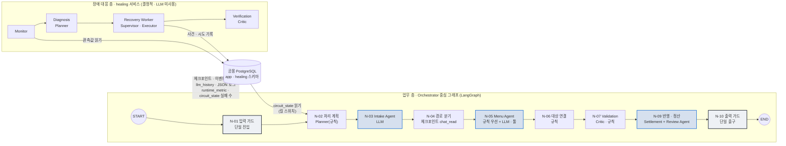
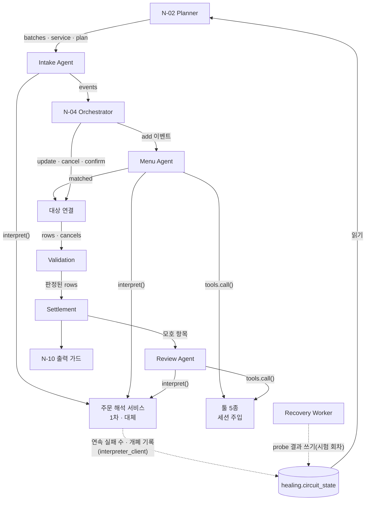
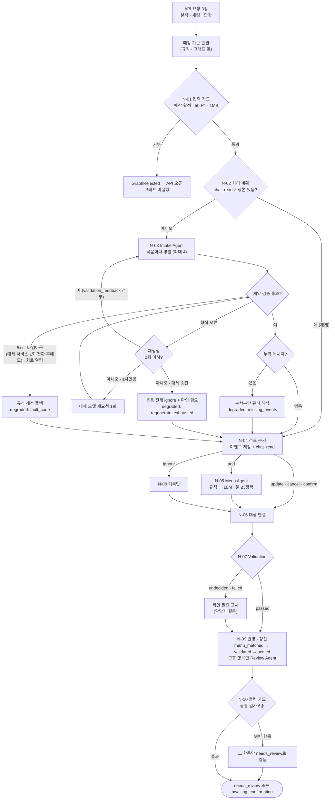
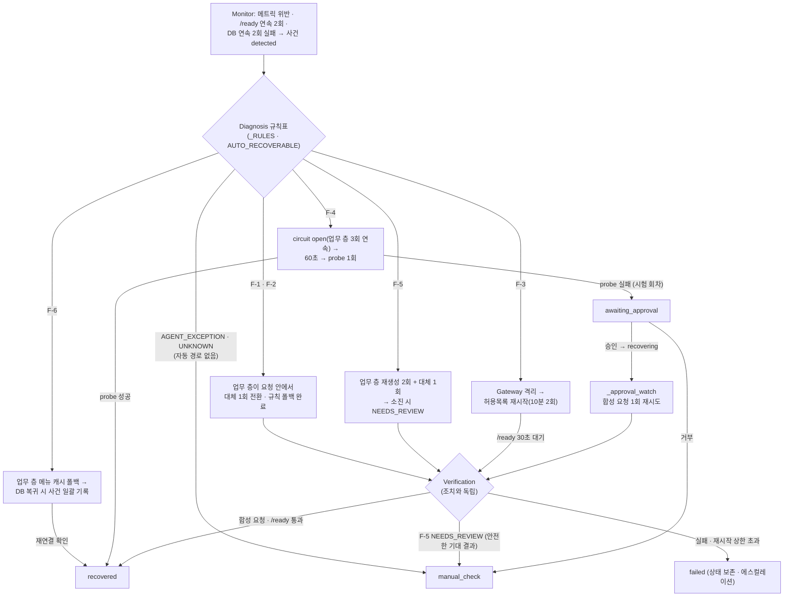
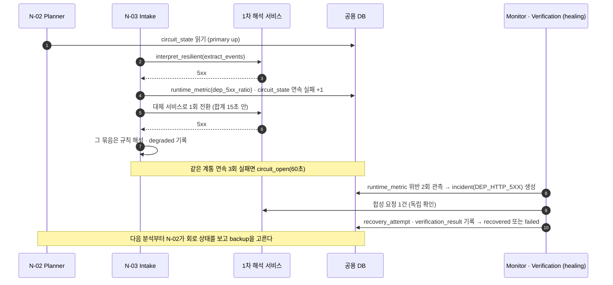
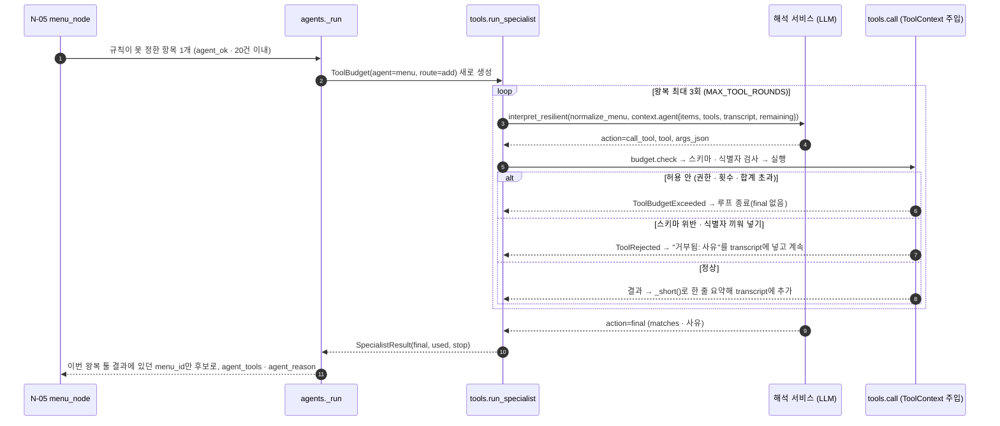
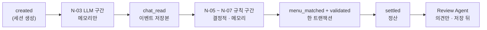

# MOA 멀티 에이전트 아키텍처 설계서

> 문서 버전: **v1.1**
> 작성일: 2026-11-05

## 목차

1. [프로젝트 목적](#1-프로젝트-목적)
2. [대표 사용자 시나리오](#2-대표-사용자-시나리오)
3. [아키텍처 선택](#3-아키텍처-선택)
4. [에이전트별 역할 · 책임 · 입력 · 출력](#4-에이전트별-역할--책임--입력--출력)
5. [협업 흐름](#5-협업-흐름)
6. [Handoff 조건과 전달 데이터](#6-handoff-조건과-전달-데이터)
7. [공유 상태 · 메모리 · 중간 결과 관리](#7-공유-상태--메모리--중간-결과-관리)
8. [정상 · 재시도 · 실패 · 종료 흐름](#8-정상--재시도--실패--종료-흐름)
9. [역할 중복 및 책임 공백 점검 결과](#9-역할-중복-및-책임-공백-점검-결과)
10. [가드레일](#10-가드레일)

---

## 1. 프로젝트 목적

### 1.1 목적

단톡방 주문 대화를 붙여넣으면 에이전트들이 주문을 추출 · 정규화 · 검증해 주문서 한 장을 만든다.
처리 중 장애가 나면 장애 대응 워크플로가 탐지 · 진단 · 복구 · 검증하고 MTTD · MTTR · 무인 복구율로 보인다.

| 목표                                           | 이 설계서에서 다루는 방식                  |
| ---------------------------------------------- | ------------------------------------------ |
| G-1 대화 → 주문서가 끊김 없이 나온다          | 업무 층 멀티 에이전트(4절 · 5.1절)        |
| G-2 정해진 장애를 사전 허용된 조치로 자동 복구 | 장애 대응 층 역할 분리(4.2절 · 5.2절)     |
| G-3 복구 전후 중복 · 유실 0                   | Handoff 저장 경계와 체크포인트(6절 · 7절) |
| G-4 못 고치면 상태를 보존하고 사람에게         | 실패 · 종료 조건(8절)                     |

### 1.2 사용자

| 사용자                  | 시스템과의 접점                                                                |
| ----------------------- | ------------------------------------------------------------------------------ |
| 주문 담당자 (주 사용자) | 대화 입력 → 확인 필요 항목 결정 → 공유(= 완료) → 바뀐 것만 반영해 다시 공유 |
| 주문 참여자             | 서비스에 들어오지 않는다. 단톡방 공유본을 보고 답장만                          |
| 서비스 운영자           | 운영 대시보드에서 사건 · 복구 상태 확인, 자동 복구가 안 될 때 승인 · 거부    |

**페르소나**

| 항목           | P-1 주문 담당자 "하은"                                                                                                                                | P-2 주문 참여자 "도윤"                                                           | P-3 서비스 운영자 "지수"                                                                      |
| -------------- | ----------------------------------------------------------------------------------------------------------------------------------------------------- | -------------------------------------------------------------------------------- | --------------------------------------------------------------------------------------------- |
| 상황           | 회사 팀 막내(입사 1년 차). 오후 회의 전 팀 단톡방에서 팀원 10명 안팎의 커피 주문을 모아 스타벅스에 한 번에 주문하고, 법인카드 결제 금액도 맞춰야 한다 | 같은 팀 선배. 팀 단톡방에 "아아 톨 하나요"처럼 줄여 말하고, 중간에 바꾸기도 한다 | MOA 서비스 담당 개발 · 운영자. 장애가 나면 원인을 찾고 복구를 승인한다                       |
| 지금 하는 방식 | 대화를 위아래로 훑으며 약칭 · 옵션을 해석하고, 변경 · 취소를 손으로 지우고, 금액을 계산한다                                                         | 총무가 정리한 목록을 보고 자기 주문이 맞는지 직접 찾아본다                       | 사용자 문의가 오고 나서 장애를 알고, 재실행 뒤 주문이 겹치거나 빠졌는지 일일이 확인한다       |
| 불편           | "아까 샷 추가한 거 취소"가 어느 잔인지 헷갈린다. 선배에게 몇 번씩 되묻기 어렵고, 정리 중 오류가 나면 처음부터 다시 한다                               | 내 주문이 제대로 들어갔는지 알기 어렵다                                          | 장애를 늦게 알고, 고쳤다는 근거(수치)가 없다                                                  |
| 바라는 것      | 붙여넣기만 하면 주문서 한 장, 애매한 것만 질문으로 받고, 바뀐 것만 반영해 다시 공유. 주문 누락 · 금액 실수 없이 빠르게 끝내기                        | 단톡방 카드 한 장으로 확인하고, 틀리면 답장 한 줄                                | 시스템이 먼저 알아채고 고치며, MTTD · MTTR · 무인 복구율로 정상화를 확인영 정상ㅇ맞아한하나 |

## 2. 대표 사용자 시나리오

주문 담당자가 정상적으로 주문서를 만드는 흐름과, 처리 중 장애가 났을 때 두 층이 각각 무엇을 하는지를 하나씩 보인다.

### 2.1 정상 처리

입력 (대화 끝 매장 요청: "스타벅스 기준으로 정리해줘")

```text
[김민수] 아이스 아메리카노 톨 2잔, 하나는 샷 추가요.
[이지연] 바닐라라떼 큰 거 얼음 적게요.
[박서연] 아아 톨 한 잔이요.
[김민수] 아까 샷 추가한 한 잔 취소할게요.
[이지연] 사이즈는 벤티로 할게요.
```

| 단계              | 담당                                    | 결과                                                                           |
| ----------------- | --------------------------------------- | ------------------------------------------------------------------------------ |
| 매장 판별         | 규칙(그래프 앞)                         | 매장 요청에 "스타벅스" 1종 → `starbucks`                                    |
| N-01 입력 가드    | Orchestrator                            | 세션 고정, 메시지 5건 · 1MB 이하 확인                                         |
| N-02 처리 계획    | Planner(규칙)                           | 저장본 없음 → 처음부터, 1차 서비스, 묶음 2개(4건 + 1건), `plan` 기록        |
| N-03 의도분류     | Intake Agent (LLM)                      | 1~3줄 `add`, 4줄 `cancel`(1줄 샷 추가 잔), 5줄 `update`(2줄 사이즈)      |
| N-04 경로 분기    | Orchestrator                            | 이벤트 저장 + 체크포인트 `chat_read`                                         |
| N-05 메뉴 매칭    | 규칙 → 필요 시 Menu Agent (LLM + 툴)   | "아아" → 아이스 아메리카노. "큰 거"는 모호                                    |
| N-06 대상 연결    | 규칙                                    | 취소 대상 = 김민수 샷 추가 잔 1개, 변경 대상 = 이지연 바닐라라떼 → 벤티       |
| N-07 규칙 검증    | Validation (Critic)                     | 수량 · 옵션 · 변경 관계 통과                                                 |
| N-09 반영 · 정산 | Settlement + (모호 항목만) Review Agent | 아이스 아메리카노 톨 2잔 · 아이스 바닐라라떼 벤티 1잔, 체크포인트 `settled` |
| N-10 출력 가드    | Orchestrator                            | 공통 검사 6종 통과 → `awaiting_confirmation`                                |

### 2.2 장애

| 시점                | 업무 층                                                                                                                                                                                                                                            | 장애 대응 층                                                                                                                                                                             |
| ------------------- | -------------------------------------------------------------------------------------------------------------------------------------------------------------------------------------------------------------------------------------------------- | ---------------------------------------------------------------------------------------------------------------------------------------------------------------------------------------- |
| 1차 해석 서비스 5xx | N-03의 `interpret_resilient`가 같은 요청을 대체 서비스로 1회 전환(호출당 5초 · 합계 15초). 그것도 실패하면 그 묶음을 규칙 해석으로 이어서 정리(`degraded` 기록). 실패는 `runtime_metric` · `circuit_state`(연속 실패 수)에 남긴다 [구현] | Monitor가 `dep_5xx_ratio` 위반 2회로 사건 `detected` 생성 → 장애 코드 `DEP_HTTP_5XX`(자동 복구 대상) → 요청 안 복구는 업무 층이 이미 했으므로 워커는 합성 요청으로 확인만 [구현] |
| 복구 중             | 같은 계통 연속 3회 실패면 `interpreter_client`가 회로를 `circuit_open`(60초)으로 기록. 다음 분석의 N-02가 `circuit_state`를 읽어 대체 서비스를 고른다 [구현]                                                                                 | 회로는 업무 층 관측으로 열리고, 60초 냉각 뒤 다음 요청 1회가 probe다. 시험 회차에서는 워커가 probe를 직접 보낸다 [구현]                                                                  |
| 종료                | 담당자 화면에는 장애 코드 대신 "규칙 해석으로 이어서 정리"가 운영 처리 기록에 남는다 [구현]                                                                                                                                                        | Verification이 합성 요청 결과를 `verification_result`에 기록, 통과면 `recovered` · 실패면 `failed`(에스컬레이션) [구현]                                                           |

---

## 3. 아키텍처 선택

### 3.1 결론

| 층           | 구조                                                                                                         | 실행 형태                                                                                                                                     |
| ------------ | ------------------------------------------------------------------------------------------------------------ | --------------------------------------------------------------------------------------------------------------------------------------------- |
| 업무 층      | Orchestrator 중심 고정 순서 그래프 + 전문 에이전트 3개(Supervisor형의 변형 - 조정자가 LLM이 아니라 상태기계) | LangGraph 노드 10개(N-01 ~ N-10), 단일 진입 N-01 · 단일 출구 N-10 [구현]                                                                     |
| 장애 대응 층 | 역할 분리형 결정적 파이프라인(Monitor → Diagnosis → Recovery Worker → Verification), LLM 미사용           | 업무 처리와 분리된 `healing` 서비스, 순수 Python 1초 순회 루프(`backend/healing/__main__.py`) — 역할은 모듈 · 함수 단위로 나눴다 [구현] |

복구 경계(PRD 5.2): 요청 안 복구(대체 1회 전환 · 재생성 · 규칙 폴백 · 메뉴 캐시)는 업무 층이 하고, 결과를 `runtime_metric` · `circuit_state`에 **관측값으로만** 쓴다.
장애 대응 층은 사건 · 프로세스 수준 조치(재시작 · probe · 에스컬레이션)만 하고 업무 데이터를 고치지 않는다.



* 장애 대응 층 4역할의 코드 위치: Monitor `services/monitor.py` · `healing._monitor` · `_health_watch` · `_db_watch`, Diagnosis `monitor._RULES` · `AUTO_RECOVERABLE`, Recovery Worker `healing._recover_worker` · `_approval_watch` · `_run`(시험 회차), Verification `healing._synthetic_interpreter_request` · `_record_verification`.

### 3.2 선정 이유 — 비즈니스 요구사항별

| 요구사항    | 근거 수치                                                      | 업무 층 결정                                                                                                                                 | 장애 대응 층 결정                                                                                                                                                              |
| ----------- | -------------------------------------------------------------- | -------------------------------------------------------------------------------------------------------------------------------------------- | ------------------------------------------------------------------------------------------------------------------------------------------------------------------------------ |
| 응답 속도   | 해석 호출 제한 5초, 첫 정리까지 [정리하기] 2회                 | 조정자를 LLM으로 두지 않는다 - LLM 호출은 Intake(묶음당 1회)와 규칙이 못 정한 항목뿐. 묶음 4건 병렬(최대 4) · 대체 서비스는 2건 묶음        | 상태 점검 5초 · 2회 연속 실패 판정 → MTTD 15초 이하 목표. 판단에 LLM 왕복이 없으므로 진단 지연이 결정적이다                                                                  |
| 결정 일관성 | 미등록 메뉴 자동 확정 0건(SC-8), LLM 의견만으로 통과 0건(SC-9) | LLM은 해석 · 후보 · 의견만. 메뉴 확정 · 가격 · 검증 통과 · 상태 전이는 규칙. 노드 순서가 고정이라 같은 입력이면 같은 단계를 지난다      | 같은 사건에 항상 같은 판정 - 고정 결정표(장애 코드 7종)와 허용목록 액션만. 장애 원인(LLM)에 복구 판단을 기대지 않는다                                                          |
| 장애 격리   | 앱 복제본 전환 15초(SC-12), 중복 · 유실 0건(SC-5)             | 해석 서비스 장애는 묶음 단위로 규칙 해석 폴백 — 한 묶음 실패가 분석 전체를 멈추지 않는다. LLM 경계(N-04)에서 저장 → 재개 시 LLM 재호출 0회 | `healing`을 업무 프로세스와 다른 컨테이너로 둬서 함께 죽지 않는다. Docker 제어는 조회 · 재시작만 허용하는 socket-proxy 경유. 복제본 장애는 Gateway가 Recovery보다 먼저 격리 |

### 3.3 검토한 대안

| 대안                                                              | 장점                               | 채택하지 않은 이유                                                                                                                            |
| ----------------------------------------------------------------- | ---------------------------------- | --------------------------------------------------------------------------------------------------------------------------------------------- |
| A. LLM Supervisor가 다음 담당을 고르는 구조                       | 유연한 분기                        | 조정 단계마다 LLM 왕복이 늘어 5초 제한과 충돌. 같은 입력에 다른 경로를 탈 수 있어 SC-9 · 반복 측정(25회)을 보장하지 못한다                   |
| B. 에이전트끼리 직접 메시지를 주고받는 분산형                     | 노드 추가가 쉽다                   | 공통 검사(입력 보정 · 출력 검사)를 경로마다 넣어야 해 한 곳을 빠뜨리면 그 경로만 조용히 깨진다(G-A4). 재시도 횟수를 한 곳에서 셀 수 없다     |
| C. 장애 대응도 LLM 에이전트로                                     | 미등록 장애에 대한 설명력          | 장애 원인과 복구 수단이 같은 계통(LLM)에 묶인다. 판정이 매번 달라 MTTR을 반복 측정할 수 없다. LLM이 만든 명령 실행은 PRD 8.5 "자동 실행 금지" |
| D. 채택안 — 업무 층 고정 그래프 + 장애 대응 층 결정적 파이프라인 | 위 세 요구를 모두 수치로 검증 가능 | -                                                                                                                                             |

### 3.4 고려사항과 대응

| 위험                                                           | 대응                                                                                                                                                                                                                                                                   |
| -------------------------------------------------------------- | ---------------------------------------------------------------------------------------------------------------------------------------------------------------------------------------------------------------------------------------------------------------------- |
| Orchestrator(그래프 프로세스) 자체가 죽으면 업무 전체가 멈춘다 | 앱 복제본 A/B + HAProxy 게이트웨이가 정상 복제본으로 전환, 재시작 뒤 체크포인트 `chat_read`부터 재개                                                                                                                                                                 |
| Recovery Worker가 둘 이상이면 같은 사건을 중복 실행            | 시험 회차는 `workflow_lease`(30초, `FOR UPDATE SKIP LOCKED`) 하나만 잡고, 만료된 lease는 재실행하지 않고 `needs_operator_action`. 상시 감시는 같은 장애 코드 · 대상의 열린 사건이 있으면 새로 만들지 않고, 쓴 관측 행에 `incident_id`를 묶어 다시 세지 않는다 |
| 업무 층과 워커가 함께 재시도해 시도 상한이 깨진다              | 복구 경계 — 요청 안 재시도 · 전환은 업무 층(`interpret_resilient` 1회 전환)만, 워커는 합성 요청 확인 · 재시작 · probe만                                                                                                                                          |
| 실 LLM 연결 시 5초가 맞지 않아 F-2 오탐                        | 측정은 모의 해석 서비스로, 실 LLM 적용 전 재조정(PRD U-09)                                                                                                                                                                                                             |
| 게이트웨이 · DB · 실행 호스트 단일 장애점                    | 범위 밖으로 명시, 복구율과 분리 보고                                                                                                                                                                                                                                   |

---

## 4. 에이전트별 역할 · 책임 · 입력 · 출력

### 4.1 업무 층

LLM 에이전트는 **3개**(Intake · Menu · Review)다. 나머지는 규칙이며, 규칙으로 충분한 역할은 LLM으로 만들지 않는다.

| 에이전트 · 구성요소                 | 노드                 | 형태                                     | 주요 역할                                                                                                          | 입력                                                                                  | 출력                                                                        | 하지 못하는 것                                     |
| ------------------------------------ | -------------------- | ---------------------------------------- | ------------------------------------------------------------------------------------------------------------------ | ------------------------------------------------------------------------------------- | --------------------------------------------------------------------------- | -------------------------------------------------- |
| **Orchestrator** (Supervisor)  | N-01 · N-04 · N-10 | 상태기계                                 | 진입 · 경로 분기 · 출구, 체크포인트 저장, 공통 검사 6종, 상한 관리                                               | `session` · `source`(snapshot · chat · reply) · 원문                          | `messages` · `existing` · 경로별 Send · `result` · `guard`      | 주문 해석 · 수정, 복구 실행                       |
| **처리 계획** (Planner)        | N-02                 | 규칙                                     | 재개 여부 · 해석 서비스(1차 · 대체 · 규칙) 선택 · 묶음 분해 · LLM 예산 배정 · 완료 조건 기록                 | `messages` · 체크포인트 · `circuit_state` · 설정 상한                          | `batches` · `service` · `resumed` · `plan`                       | LLM 호출, 주문 해석 · 수정                        |
| **Intake Agent** (Executor)    | N-03                 | LLM, 툴 0개                              | 메시지마다 이벤트 유형 5종 · 주문자 · 근거 메시지 · 가리키는 앞 주문 추출. 메뉴 · 사이즈 · 요청은 원문 그대로 | `BatchState`(묶음 4건 + 앞 문맥 4건 + 같은 사람 문맥 ≤12건 + 기존 주문)            | `events: OrderEvent[]`                                                    | 메뉴 · 가격 판정, 모호한 변경 임의 확정           |
| **Menu Agent** (Executor)      | N-05                 | 규칙 우선 → 못 정한 항목만 LLM + 툴 3종 | 규칙(별칭 · 엄격 매칭) 먼저. 못 정하면 툴로 메뉴판 검색 → 후보 · 정렬 · 사유, 원문을 메뉴 / 요청으로 나누기    | `EventState`(이벤트 1개 · 메시지 순서 · 앞 4건 창 · `service` · `agent_ok`) | `matched[]`(후보 · `agent_tools` · `agent_reason` · `llm_split`) | `menu_id` 확정 — 확정은 규칙 재매칭 또는 담당자 |
| 대상 연결                            | N-06                 | 규칙                                     | update · cancel · confirm이 가리키는 항목 찾기, 옵션으로 좁히기, 모호하면 표시만                                 | 정렬된 이벤트 · `matched`                                                          | `rows` · `cancels` · `targets`                                      | 대상이 둘 이상일 때 임의 선택                      |
| **Validation** (Critic)        | N-07                 | 규칙                                     | 메뉴별 옵션 허용 · 수량 · 사양 판정, 대상 모호 시 `needs_review`, 단가 · 예상 금액 부착                       | `rows` · 세션 메뉴판                                                               | `rule_verdict` · `validation_status` · `review_reason`              | LLM 의견만으로 통과                                |
| **Review Agent** (Critic 보조) | N-09 저장 직후       | LLM + 툴 3종                             | 대상이 모호한 항목만, 툴로 기존 주문을 보고 의견 · 사유                                                           | 모호 항목(≤10건) · 해당 메시지 창                                                   | `llm_review_verdict`(agree · disagree) · `review_reason_text`         | `validation_status` 변경                         |
| **Settlement** (Executor)      | N-09                 | 계산 규칙                                | 기준가 + 옵션 추가금, 묶음별 수량 · 금액, 개인 합계 = 전체 금액 내부 검증, 확인 질문 생성                         | 저장된 항목                                                                           | `settlement_line` · `review_question`                                  | 합계 불일치 때 주문서 생성, 개인별 금액 표시       |
| ignore 기록                          | N-08                 | 규칙                                     | 주문 아님 이벤트를 기록만                                                                                          | 이벤트 1개                                                                            | 없음                                                                        | 항목 생성 · 변경, LLM · 툴 호출                  |

**툴 5종**과 사용 권한

| 툴                      | Intake | Menu | Review |
| ----------------------- | :----: | :--: | :----: |
| `search_menu`         |   -   |  O  |   -   |
| `find_menu_by_traits` |   -   |  O  |   -   |
| `get_menu`            |   -   |  O  |   O   |
| `list_order_items`    |   -   |  -  |   O   |
| `get_order_item`      |   -   |  -  |   O   |

매장 · 세션 식별자는 LLM 인자로 받지 않는다. 툴은 `ToolContext`에서 주입받는다.

### 4.2 장애 대응 층

한 역할이 혼자 판단 · 실행 · 종료하지 못하게 나눴다. 판단은 Diagnosis, 실행은 Recovery Worker, 종료(`recovered`)는 Verification만 한다.

| 역할                                   | 템플릿 역할           | 주요 역할                                                                                                                                                                                                                                                                       | 입력                                                  | 출력                                                      | 하지 못하는 것                                                                    |
| -------------------------------------- | --------------------- | ------------------------------------------------------------------------------------------------------------------------------------------------------------------------------------------------------------------------------------------------------------------------------- | ----------------------------------------------------- | --------------------------------------------------------- | --------------------------------------------------------------------------------- |
| **Gateway** (HAProxy)            | Messenger             | 앱 스택 A/B backend `/ready` 2초 간격 확인, 2회 실패 시 제외, 2회 연속 성공 시 재등록                                                                                                                                                                                         | 상태 점검 응답                                        | 라우팅 풀                                                 | 업무 데이터 복구, 실패한 요청 재처리                                              |
| **Monitor**                      | Observer              | 1초 순회로 최근 60초 `runtime_metric` 위반을 규칙표로 판정(5xx 2회 · 5초 초과 1회 · 스키마 실패 1회 · 예외 1회 · 쿼리 2초 초과 1회), backend `/ready` 5초 주기 연속 2회 실패, DB 5초 주기 연속 2회 실패. 같은 장애 코드 · 대상의 열린 사건이 있으면 새로 만들지 않는다 | `runtime_metric` · `/ready` 응답 · DB 조회 결과 | `healing.incident`(detected)                            | 임계값 변경, 복구 조치, 사건 종료                                                 |
| **Diagnosis**                    | Planner               | 고정 규칙표로 장애 코드 부여(`monitor._RULES` 메트릭 → 장애 코드), `AUTO_RECOVERABLE` 5종이면 자동 경로, 그 밖(`AGENT_EXCEPTION` · `UNKNOWN`)은 `manual_check`. 별도 `recovery_plan` 객체 없이 장애 코드별 고정 함수가 계획이다                                   | 관측값 · 장애 코드                                   | `fault_code` · 자동 / 사람 분기                        | 직접 복구, 정책 밖 전략, LLM으로 명령 생성                                        |
| **Recovery Worker**              | Supervisor + Executor | F-3 허용목록 재시작(10분 내 2회 상한, 넘으면 에스컬레이션), 승인된 사건 재시도(`_approval_watch`), 시험 회차 실행(`workflow_lease`). 요청 안 재시도 · 전환은 하지 않는다(복구 경계). 30초 재실행 금지 · 사건 5분 제한은 [설계]                                            | 사건 · 허용목록 · lease                             | `recovery_attempt` 기록                                 | 스스로 복구 완료 선언, 요청 안 재시도 · 전환, 허용목록 밖 명령, 업무 데이터 수정 |
| 허용목록 액션 어댑터                   | Executor 도구         | `HEALING_ALLOWLIST` 고정 컨테이너 이름에 대한 재시작 · 정지(시험) · 상태 확인만, `socket-proxy` 경유                                                                                                                                                                      | 액션 이름 · 대상 ID                                  | 액션 결과                                                 | 허용목록 밖 대상 · 동작, 컨테이너 생성 · 삭제 · 이미지 변경                    |
| **Verification**                 | Critic                | 조치와 독립된 확인: 해석 장애는 합성 요청(실사건 1건 · F-1 시험 5건), F-3는 `/ready` 30초 내 응답(시험은 backend · frontend · Gateway 연속 3회), F-6는 캐시 checksum 일치                                                                                                  | 사건 · 대상                                          | `verification_result`, `recovered` · `failed` 전이 | 복구 실행                                                                         |
| **Notification** (운영 대시보드) | Messenger             | 사건 목록 · 상세 · 지표 표시, 승인 · 거부 기록(상태만 전환: 승인 `recovering` · 거부 `manual_check`, 대기 시간은 `paused_ms`로 MTTR에서 제외)                                                                                                                         | 운영자 입력                                           | `healing.approval` · 사건 상태                         | 복구 실행, 정책 변경 — 상태만 전환                                               |
| 장애 주입기                            | (시험 도구)           | lab 환경에서 해석 서비스 오류 · 지연 · 잘못된 출력 모드, 프로세스 중단(F-3), 메뉴 저장소 장애(F-6). 시험 회차는 주입 → 탐지 → 복구 → 해제 확인까지 기록                                                                                                                    | 장애 코드                                             | `healing.fault_injection` · `workflow_*`             | lab 밖 실행(403), 해제 확인 없이 회차 종료                                        |

### 4.3 템플릿 역할과의 대응

| 템플릿 역할                                         | 업무 층                                                        | 장애 대응 층                               |
| --------------------------------------------------- | -------------------------------------------------------------- | ------------------------------------------ |
| Supervisor (할당 · Handoff · 재시도 · 종료 판단) | Orchestrator (N-01 · N-04 · N-10 + 그래프 엣지)              | Recovery Worker                            |
| Planner (분해 · 순서 · 완료 조건)                 | 처리 계획 N-02 → `plan`                                     | Diagnosis 규칙표 → 장애 코드별 고정 처리  |
| Executor (도구 실행 · 원본 결과)                   | Intake · Menu Agent, 대상 연결, Settlement                    | Recovery Worker의 허용목록 액션            |
| Critic (검증, PASS · RETRY · FAIL)                | Validation(N-07, 규칙) + Review Agent(의견만) + 출력 가드 N-10 | Verification                               |
| Memory Keeper (상태 · 중간 결과 · 실패 이력)      | 체크포인트 · `order_event.payload` · `llm_history` (7절) | `healing.*` 테이블 · `workflow_lease` |
| Observer · Messenger                               | —                                                             | Monitor · Gateway · Notification         |

### 4.4 의존 관계



---

## 5. 협업 흐름

### 5.1 업무 층 — 정상 · 재시도 · 폴백 · 종료



**노드 유형 · 사고 흐름 대응** (`graph/build.py` 기준)

| 사고 단계 | 노드                                                                  | 그래프 유형                             | 다음으로 가는 기준                                                         |
| --------- | --------------------------------------------------------------------- | --------------------------------------- | -------------------------------------------------------------------------- |
| 진입      | `START` → N-01 입력 가드                                           | Start                                   | 매장 확정 · 500건 · 1MB 이하가 아니면 `GraphRejected`(그래프 미실행)   |
| 인지      | N-01 입력 가드 · N-02 처리 계획                                      | Start · Decision                       | N-02 `dispatch_batches_edge` — `resumed`면 N-04, 아니면 묶음마다 N-03 |
| 판단      | N-03 Intake Agent · N-04 경로 분기                                   | LLM · Decision                         | N-04 `route_edge` — `route` 값(add · ignore · 그 밖)                |
| 행동      | N-05 Menu Agent · N-06 대상 연결 · N-08 ignore · N-09 반영 · 정산 | Tools(N-05 · Review의 툴 루프) · 규칙 | 고정 엣지                                                                  |
| 검증      | N-07 Validation · Review Agent · N-10 출력 가드                     | Critic                                  | N-07 `validation_status` · N-10 공통 검사 6종                           |
| 종료      | N-10 → `END`                                                       | End                                     | 단일 출구 — `needs_review` 또는 `awaiting_confirmation`               |

툴 실행은 LangGraph `ToolNode`로 따로 두지 않고 N-05 · N-09(Review) 안의 전문가 루프(`tools.run_specialist`)가 한다 — 툴 예산 · 왕복 상한을 항목 단위로 세기 위해서다(6.1 툴 호출 순서).

* 조건부 엣지는 2개다 — `dispatch_batches_edge`(N-02 뒤: `resumed`면 N-04, 아니면 묶음마다 N-03 Send)와 `route_edge`(N-04 뒤: `route`가 add면 N-05, ignore면 N-08, 그 밖은 N-06). 나머지 폴백(규칙 해석 · 확인 필요 강등)은 노드 안에서 결정하고 같은 고정 엣지로 진행한다 — 예외 경로마다 노드를 늘리지 않아 단일 출구 N-10을 지킨다.

### 5.2 장애 대응 층 — 사건 처리



### 5.3 두 층의 접점 (시퀀스)



---

## 6. Handoff 조건과 전달 데이터

### 6.1 업무 층 Handoff 목록

| #    | 보낸 쪽 → 받는 쪽                    | Handoff 조건                                                                            | 전달 데이터 (State 키)                                                                                                                                                                                                                                                                             | 코드 위치                                                                                    |
| ---- | ------------------------------------- | --------------------------------------------------------------------------------------- | -------------------------------------------------------------------------------------------------------------------------------------------------------------------------------------------------------------------------------------------------------------------------------------------------- | -------------------------------------------------------------------------------------------- |
| H-1  | API → N-01                           | `source`가 snapshot · chat · reply 중 하나                                          | `session` · `source` · `trace_id` · `text` · `messages` · `expected_version`                                                                                                                                                                                                      | `graph/build.py` `run()`                                                                 |
| H-2  | N-01 → N-02                          | 매장 확정(`status ≠ awaiting_brand_answer`) · 500건 · 1MB 이하                     | `messages` · `existing`(기존 주문, chat · reply)                                                                                                                                                                                                                                             | `nodes.input_guard_node`                                                                   |
| H-3  | N-02 → N-03 (Send × 묶음)           | 재개가 아니다                                                                           | `BatchState` = `session` · `trace_id` · `batch{batch_no, prev, targets, use_llm, service, person_prev}` · `existing`                                                                                                                                                                  | `nodes.dispatch_batches_edge`                                                              |
| H-3' | N-02 → N-04 (건너뜀)                 | `checkpoint = chat_read` 이고 최신 Snapshot 이벤트 저장본이 전부 있음                 | `events`(저장본) · `resumed = True`                                                                                                                                                                                                                                                           | `nodes.batch_node` · `_saved_events`                                                    |
| H-4  | N-03 → N-04                          | 묶음 처리 끝(LLM 성공 · 규칙 폴백 모두)                                                | `events`(reducer 합침) · `llm_calls` · `degraded`                                                                                                                                                                                                                                          | `nodes.intake_node`                                                                        |
| H-5  | N-04 → N-05 (Send × add)            | 분석(snapshot) 이고 `route = add`                                                     | `EventState` = `session` · `event` · `index` · `events`(읽기 전용) · `route` · `service` · `agent_ok`(20건 이내) · `trace_id`                                                                                                                                             | `nodes.route_edge`                                                                         |
| H-6  | N-04 → N-08 (Send × ignore)         | `route = ignore`                                                                      | `session` · `event` · `index` · `events` · `route`                                                                                                                                                                                                                                   | `nodes.route_edge`                                                                         |
| H-7  | N-04 → N-06                          | add · ignore 가 없거나, chat · reply                                                  | `targets.ordered`(정렬된 이벤트)                                                                                                                                                                                                                                                                 | `nodes.route_edge`                                                                         |
| H-8  | N-05 · N-08 → N-06                  | 고정 엣지                                                                               | `matched[]{index, k, row}`                                                                                                                                                                                                                                                                       | `graph/build.py`                                                                           |
| H-9  | N-06 → N-07                          | 고정 엣지                                                                               | `rows`(항목 번호 부여) · `cancels` · `targets`                                                                                                                                                                                                                                             | `nodes.target_node`                                                                        |
| H-10 | N-07 → N-09                          | 고정 엣지                                                                               | 판정이 붙은 `rows`(`rule_verdict` · `validation_status` · `unit_price`)                                                                                                                                                                                                                  | `nodes.validation_node`                                                                    |
| H-11 | N-09 → Review Agent                  | 서비스 있음 · 항목에 `_target_unclear_text` 또는 `person_unclear` · 10건 이내     | 항목 요약 · 해당 메시지 창(앞 4건 포함) · `route` · `service` · `trace_id`                                                                                                                                                                                                               | `nodes._review_unclear`                                                                    |
| H-12 | N-09 → N-10                          | 고정 엣지                                                                               | `result` · `llm_calls`                                                                                                                                                                                                                                                                        | `nodes.apply_node`                                                                         |
| H-13 | N-03 · N-05 · Review → 해석 서비스 | N-03: 묶음 `use_llm` · 서비스 있음 / N-05: 규칙이 메뉴를 못 정함 / Review: 대상 모호 | `task` · 마스킹된 `messages` · `schema` · `trace_id` · `context` — N-03은 `{brand_id, menu_version, prev_messages, person_messages, existing_items, validation_feedback(재생성 때만)}`, N-05 · Review는 `{brand_id, menu_version, agent{items, tools, transcript, remaining}}` | `nodes.intake_node` · `graph/agents._run` · `interpreter_client.interpret_resilient` |
| H-14 | 에이전트 → 툴                        | 에이전트 권한 + 경로 허용 횟수 안                                                       | 툴 이름 · 인자(식별자 제외), 실행 맥락은 `ToolContext`가 주입                                                                                                                                                                                                                                   | `tools/loop.run_specialist` · `tools/budget.ToolBudget`                                 |

**H-13 · H-14 툴 호출 순서** (Menu Agent 1항목 기준, Review Agent도 같은 루프)



해석 서비스가 없거나 실패하면(`InterpreterError`) 아무것도 바꾸지 않고 규칙 결과를 그대로 둔다.

### 6.2 Handoff 필드 — 템플릿 필드와 구현의 대응

업무 층은 노드 사이에 별도 Handoff 봉투 객체를 두지 않는다. 템플릿 필드가 담는 정보는 아래 State 키와 기록으로 전달된다.

| 템플릿 필드                   | 업무 층 구현                                                                                                                                                                                                                       | 장애 대응 층                                                   | 예시                        |
| ----------------------------- | ---------------------------------------------------------------------------------------------------------------------------------------------------------------------------------------------------------------------------------- | -------------------------------------------------------------- | --------------------------- |
| `task_id`                   | `trace_id`(요청 1건) + `plan.plan_id`(분석 1회) + `batch_no`(묶음) / `item_id`(항목)                                                                                                                                       | `incident_id` + `trace_id`                                 | `pl_3fa1c9e2b0` · 묶음 2 |
| `from_agent` / `to_agent` | 그래프 엣지가 고정(`build.py`) — 값으로 싣지 않는다. 실행 기록은 `llm_history.agent`(intake · menu · validation) · 로그 `route_decision`                                                                                 | `incident.status` 전이 (detected → recovering → verifying) | `intake` → `route`     |
| `objective`                 | 해석 서비스 `task`(`extract_events` · `normalize_menu` · `review`)                                                                                                                                                       | `fault_code` · `strategy`                                 | `normalize_menu`          |
| `inputs`                    | `BatchState.batch` · `EventState.event` · `context`                                                                                                                                                                        | `detection_evidence` · 대상 replica · dependency           | 묶음 4건 + 앞 4건           |
| `constraints`               | `ToolBudget(agent, route)` 툴 허용 · `ToolContext` 세션 주입 · `MENU_AS_OF` · `agent_ok` · 프롬프트 금지 규칙                                                                                                          | 허용목록 · 시도 상한 · 30초 재실행 금지 · 5분 제한          | add 경로 툴 합계 3회        |
| `expected_output`           | `TASK_CONTRACTS`의 Pydantic 스키마를 요청에 `schema`로 싣고, 응답을 우리 쪽에서 다시 검증                                                                                                                                      | 전략별 성공 검증 기준                                          | `OrderEvents`             |
| `attempt`                   | Intake 재생성 `attempts`(노드 지역 변수, 재생성 요청에는 `context.validation_feedback.attempt`로 실림) · 서비스 전환 `attempt_no`(`interpret_resilient`) · 툴 왕복 `remaining` · 호출 수 `llm_calls`(State reducer) | `recovery_attempt`(action · result · 소요 시간) 행 수      | `remaining: 2`            |
| `memory_refs`               | `session_id` · `checkpoint` · `order_event.payload`(저장본) · `existing`(기존 주문)                                                                                                                                     | `incident.session_id` · `checkpoint` · `menu_version`  | `chat_read`               |

### 6.3 Handoff 점검 원칙 적용 결과

| 원칙                                                          | 적용                                                                                                                                                                                                                                                                                                                                                                   | 근거                                                                                                 |
| ------------------------------------------------------------- | ---------------------------------------------------------------------------------------------------------------------------------------------------------------------------------------------------------------------------------------------------------------------------------------------------------------------------------------------------------------------- | ---------------------------------------------------------------------------------------------------- |
| 모든 전달에 작업 ID와 시도 횟수 포함                          | 부분 - `trace_id`는 모든 Send · 해석 호출 · 로그에 실린다. 재생성 요청에는 `validation_feedback.attempt`가 실리지만 State에는 시도별 번호가 없고 `llm_calls` 합계만 남는다(시도별 기록은 `llm_history` 행으로 셈)                                                                                                                                            | `nodes.dispatch_batches_edge` · `route_edge` · `nodes.intake_node` · `interpreter_client` |
| 중간 결과에 작성자 · 검증 상태 기록                          | 적용 — 항목에 `matched_by`(rule · rule_after_llm_split) · `candidates_by=menu_agent` · `rule_verdict` · `validation_status` · `llm_review_verdict`                                                                                                                                                                                                     | `nodes._retry_with_split` · `agents.menu_agent` · `validation_node`                          |
| RETRY 시 이전 실패 원인 · 수정 지시 포함                     | 부분 — Intake 재생성 요청 `context`에 `validation_feedback`(오류 코드 · 누락 필드 · 시도 번호 · 수정 지시)를 싣는다. 단 프롬프트 렌더러(`prompts.render_context`)가 이 칸을 출력하지 않아 LLM이 보는 입력은 첫 시도와 같다(PRD 5.1 · 8.1 F-5 "같은 입력 재생성"과 일치). 툴 루프에서는 거부된 툴 결과(`거부됨: 사유`)를 다음 왕복 `transcript`에 넣는다 | `nodes.intake_node` · `app/prompts.py` · `agents._short`                                     |
| 원본 대신 참조값을 넘길 때 접근 경로 명시                     | 적용 — 재개 시 `order_event.payload`를 `session_id` + 최신 `snapshot_id`로 읽는다. Review Agent는 원본 대신 `item_id`를 받고 `get_order_item` 툴로 읽는다                                                                                                                                                                                                   | `nodes._saved_events` · `tools/order_tools.py`                                                  |
| API 키 · 비밀번호 · 개인정보를 메시지 · 로그에 남기지 않음 | 적용 — 해석 서비스로 나가는 유일한 경계에서 요청 본문 전체 PII 마스킹, 로그에는 마스킹 종류만. 출력 가드가 바깥 문구의 금액 · PII 패턴 제거                                                                                                                                                                                                                          | `interpreter_client.interpret`(`mask_payload`) · `nodes.clean_text`                           |

---

## 7. 공유 상태 · 메모리 · 중간 결과 관리

### 7.1 저장 위치와 수명

| 계층                | 무엇                                                                                                                    | 저장소                                                                             | 수명                                             | 쓰는 쪽                        | 읽는 쪽                                                                                                         |
| ------------------- | ----------------------------------------------------------------------------------------------------------------------- | ---------------------------------------------------------------------------------- | ------------------------------------------------ | ------------------------------ | --------------------------------------------------------------------------------------------------------------- |
| 작업 메모리 (단기)  | `RunState` · `BatchState` · `EventState`                                                                        | 프로세스 메모리 (LangGraph State)                                                  | 요청 1건(턴). 끝나면 버린다 — 체크포인터 미사용 | 각 노드(갱신분만 반환)         | 다음 노드                                                                                                       |
| 병렬 결과 합치기    | `events` · `matched` · `llm_calls` · `degraded`                                                              | State reducer(`operator.add`)                                                    | 요청 1건                                         | N-03 · N-05 병렬 실행         | N-04 · N-06 · N-10                                                                                            |
| 체크포인트          | `order_session.checkpoint` 5종: `created` → `chat_read` → `menu_matched` → `validated` → `settled`      | `app.order_session`                                                              | 세션                                             | Orchestrator(N-04 · N-09)     | N-02(재개 판단) · Monitor · Recovery                                                                          |
| LLM 경계 저장본     | Intake 결과 이벤트 전체                                                                                                 | `app.order_event.payload`                                                        | 세션                                             | N-04 (snapshot · 비재개)      | N-02 재개                                                                                                       |
| 턴 사이 기억 (장기) | 주문 항목 · 확인 질문 · 변경 이력 · 정산                                                                             | `app.order_item` · `review_question` · `change_log` · `settlement_line` | 세션                                             | N-09 · 편집 API               | 다음 턴 N-01(`existing`) · 툴                                                                                |
| 실행 계획           | `plan` (plan_id · 서비스 · 묶음 · LLM 예산 · 완료 조건)                                                           | JSON 로그 `route_decision(stage=plan)`                                           | 로그 14일                                        | N-02                           | N-10(계획 대비 실행 대조) · 운영                                                                               |
| 실패 이력           | LLM 호출별 agent · task · service · 성공 여부 · prompt version                                                      | `app.llm_history`                                                                | 운영 정책                                        | `interpreter_client`         | Monitor · 운영 대시보드                                                                                        |
| 장애 대응 상태      | 사건 · 시도 · 검증 · 승인 · 주입 · 회로 · 런타임 메트릭 + 시험 회차(run · iteration · event · lease · worker) | `healing.*` 12개 테이블(사건 7 + 시험 워크플로 5)                                | incident 연결 14일 · 샘플 24시간                | healing (+ 승인 API · 주입기) | 업무 층은 `circuit_state` 읽기 · 연속 실패 기록, `runtime_metric` 관측값 쓰기만 — 사건 테이블은 쓰지 않음 |

**State 정의** (`graph/state.py` 타입 힌트 그대로. 여기 없는 키는 LangGraph가 조용히 버리므로 새 입력은 먼저 여기 적는다)

```python
class RunState(TypedDict, total=False):          # 분석 · 채팅 · 답장 1회
    session: dict                     # N-01 고정 — 툴 컨텍스트의 유일한 출처
    source: str                       # snapshot · chat · reply
    trace_id: str
    text: str                         # chat · reply 원문
    messages_in: list[dict]           # reply 원본(시각 등) — N-09 저장용
    expected_version: int | None      # chat If-Match
    messages: list[dict]              # 해석 대상 메시지 (N-01)
    existing: list[dict]              # 이미 정리된 주문 (N-01)
    batches: list[dict]               # N-02
    service: str | None               # N-02 — primary · backup · None(규칙)
    resumed: bool                     # N-02 — Intake 저장본으로 재개
    plan: dict                        # N-02 처리 계획
    events: Annotated[list[dict], operator.add]     # N-03 병렬 결과
    matched: Annotated[list[dict], operator.add]    # N-05 병렬 결과
    llm_calls: Annotated[int, operator.add]         # LLM 호출 수 합계
    degraded: Annotated[list[dict], operator.add]   # 폴백 이력(묶음 · 사유 · 메시지 수)
    rows: list[dict]; cancels: list[dict]; targets: dict   # N-06 ~ N-07
    result: dict                      # N-09
    guard: dict                       # N-10

# BatchState(TypedDict)  N-03 Send — session · trace_id · batch · existing
# EventState(TypedDict)  N-05 Send — session · event · index · events(읽기 전용) · route · service · agent_ok · trace_id
```

- 평가 예시 필드와의 대응: `messages` → `messages`(해석 대상) · `messages_in`(저장용 원본, 용도가 달라 중복 아님) / `tools_called` → 항목의 `agent_tools`(`ToolBudget.used`, 항목 단위라 State에 두지 않음) / `error_count` → `degraded`(사유별 목록) · `llm_calls`
- 중복 점검: 한 키를 덮어쓰는 노드는 하나다(`rows` N-06 → N-07이 판정만 덧붙임). 병렬 노드가 함께 쓰는 키 4개만 reducer로 합친다. `BatchState` · `EventState`의 `session` · `trace_id` 반복은 Send가 별도 State를 받기 때문에 필요한 복사다

### 7.2 중간 결과 확정 시점



- **LLM 결과는 나오자마자 저장한다**(N-04). 재개 때 LLM을 다시 부르지 않으므로 비결정 재해석으로 결과가 달라지지 않는다
- **규칙 단계는 한 묶음으로 저장한다**. 1초 안에 끝나는 결정적 계산이라 나눠 저장해도 얻는 것이 없고, 검증 전 항목이 보이는 반쪽 상태만 생긴다
- **체크포인트 없이 LLM을 기다리는 구간을 두지 않는다** - Review Agent를 `settled` 뒤로 옮긴 이유다

### 7.3 메모리 관리 규칙

| 규칙                                                                                                                                                                                                                                                                                                             |
| ---------------------------------------------------------------------------------------------------------------------------------------------------------------------------------------------------------------------------------------------------------------------------------------------------------------- |
| 툴 예산은 **항**목 하나 · 에이전트 호출 한 번마다 새로 만든다 — 이전 항목 사용량이 새지 않게                                                                                                                                                                                                             |
| Menu Agent는 이번 왕복에서 툴이 돌려준 `menu_id`만 받는다 — 기억 속 메뉴 · 다른 매장 메뉴 버림                                                                                                                                                                                                               |
| 원문 대화 · 프롬프트 전문 · 비밀값은 로그에 남기지 않는다. `incident_id`(사건) · `trace_id`(요청)로만 상관                                                                                                                                                                                                |
| 두 앱 복제본 · healing은 같은 DB 하나를 쓴다. 복제본마다 DB를 두면 전환 뒤 세션 복원이 깨진다                                                                                                                                                                                                                   |
| 화면 상태는 Streamlit 메모리로 복구하지 않는다 — 세션 토큰으로 DB에서 다시 읽는다                                                                                                                                                                                                                               |
| **컨텍스트 윈도우**는 고정 창으로 자른다 — Intake는 묶음 4건(대체 2건) + 앞 4건 + 같은 사람의 다른 말 ≤12건 + 기존 주문, Menu · Review Agent는 그 메시지와 앞 4건(`_window`). 대화 전체(최대 500건)를 한 프롬프트에 넣지 않는다                                                                       |
| **요약**은 LLM 요약을 쓰지 않고 규칙으로 줄인다 — 툴 결과는 `_short()`로 id · 이름 · 옵션 한 줄(금액 제외), 기존 주문은 `[이미 정리된 주문]` 한 줄 형식. 턴 사이 기억은 대화 요약이 아니라 DB 주문 항목이다                                                                                         |
| **그래프의 기억 접점**은 4개 노드로 고정한다 — 읽기: N-01(장기 기억 `existing`) · N-02(`checkpoint` · Intake 저장본 · `circuit_state`), 쓰기: N-04(`chat_read` + 이벤트 저장본) · N-09(`menu_matched` · `validated` · `settled` + 주문 항목). 나머지 노드는 단기 기억(State)만 다룬다 |

---

## 8. 정상 · 재시도 · 실패 · 종료 흐름

### 8.1 업무 층 조건표 (코드 상수 = 문서 값)

| 구분                 | 조건                                                                                       | 동작                                                                                                                   | 상한 · 수치                                                                          | 코드                                                         |
| -------------------- | ------------------------------------------------------------------------------------------ | ---------------------------------------------------------------------------------------------------------------------- | ------------------------------------------------------------------------------------- | ------------------------------------------------------------ |
| 정상                 | 모든 묶음이 계약 통과                                                                      | 다음 단계로                                                                                                            | —                                                                                    | —                                                           |
| 재시도 (재생성)      | Intake 출력이 계약 위반(`AGENT_OUTPUT_INVALID`)                                          | 같은 입력 재생성                                                                                                       | **2회**(최초 포함 3회)                                                          | `MAX_REGENERATE = 2`                                       |
| 재시도 (대체 모델)   | 1차 재생성 소진 · 대체 서비스 사용 가능                                                   | 대체 모델로 1회 재요청                                                                                                 | **1회**                                                                         | `nodes.intake_node`                                        |
| 재시도 (서비스 전환) | 해석 호출 5xx · 타임아웃                                                                  | 반대 해석 서비스로 같은 요청 1회 전환, 실패는 `runtime_metric` · `circuit_state`에 기록                           | 호출당 **5초** · 합계 **15초** · 전환 **1회**                     | `interpret_resilient`                                      |
| 부분 폴백            | LLM이 일부 메시지의 이벤트를 빠뜨림                                                        | 빠진 메시지만 규칙 해석                                                                                                | 묶음 재생성 없음                                                                      | `degraded: missing_events`                                 |
| 폴백                 | 5xx · 타임아웃(전환 후에도) · 회로 열림 · 호출 상한                                     | 그 묶음을 규칙 해석, 운영 처리 기록에 남김                                                                             | 호출 제한 **5초**, 같은 계통 연속 **3회** 실패면 회로 **60초** open | `ORDER_INTERPRETER_TIMEOUT_SEC = 5` · `_circuit_record` |
| 툴 루프 중단         | 왕복 상한 · 경로 허용 횟수 초과                                                           | 보고 없이 종료 → 규칙 결과 유지 · 확인 필요                                                                          | 왕복 **3**, add 합계 3 · update 3 · cancel 2 · confirm · ignore 0           | `MAX_TOOL_ROUNDS = 3` · `ROUTE_TOTAL`                   |
| 사람에게 넘김        | 미등록 · 후보 여럿 · 대상 모호 · 출력 가드 위반 · 재생성 + 대체 소진(묶음 전체 ignore) | `needs_review` — 담당자 확인 질문                                                                                   | 되묻기 항목당 **3**                                                             | `MAX_REASK = 3` · `degraded: regenerate_exhausted`      |
| 진입 거부            | 매장 미확정 · 500건 초과 · 1MB 초과                                                      | 그래프 실행 안 함                                                                                                      | 500건 · 1MB                                                                          | `MAX_MESSAGES` · `MAX_INPUT_BYTES`                      |
| 실패 (처리 중단)     | 분석 파이프라인 예외 · 다음 체크포인트 저장 실패                                          | 세션 `failed` · 마지막 체크포인트 보존 · `checkpoint_save_failed` 로그 [구현]. 운영자 승인 후 재개 호출은 [설계] | —                                                                                    | `api/deps.py`                                              |
| 종료                 | N-10 통과                                                                                  | 확인 필요 있으면 `needs_review`, 없으면 `awaiting_confirmation`                                                    | —                                                                                    | `output_guard_node`                                        |

**비용 · 폭주 방어 3종** - 그래프 순회 상한 `GRAPH_RECURSION_LIMIT = 25` · 되묻기 상한 `MAX_REASK = 3` · 분석 1회 LLM 호출 상한 `MAX_LLM_CALLS_PER_RUN = 300`. 여기에 Menu Agent 20건 · Review Agent 10건 · 병렬 4를 더한다. 콘솔 지출 한도는 키 관리 규칙으로 별도 설정한다.

### 8.2 장애 대응 층 조건표

| 구분              | 조건                                                                                                                                                      | 동작                                                                                                                                                                     | 상한                                                             |
| ----------------- | --------------------------------------------------------------------------------------------------------------------------------------------------------- | ------------------------------------------------------------------------------------------------------------------------------------------------------------------------ | ---------------------------------------------------------------- |
| 감지              | 해석 5xx 2회 · 5초 초과 1회 · 스키마 실패 1회 · 예외 1회 · 쿼리 2초 초과 1회(최근 60초) / backend `/ready` 5초 주기 연속 2회 / DB 5초 주기 연속 2회 | 사건 `detected`, 같은 장애 코드 · 대상의 열린 사건이 있으면 새로 만들지 않음                                                                                          | MTTD 15초                                                        |
| 재시도 F-1 · F-2 | 5xx · 5초 초과                                                                                                                                           | 업무 층이 요청 안에서 반대 서비스 1회 전환 → 실패 시 규칙 폴백. 워커는 합성 요청 1건으로 확인만                                                                         | 전환 1회 · 합계 15초                                            |
| 재시작 F-3        | backend `/ready` 연속 2회 실패                                                                                                                          | Gateway 격리(2초 × 2) → 허용목록 재시작 → `/ready` 확인. 분석은 같은 세션 분석이 다시 들어오면 N-02가 `chat_read` 저장본에서 재개                                 | 준비 대기 30초 · 10분 내 2회(넘으면 `failed` · 에스컬레이션) |
| 회로 F-4          | 같은 해석 계통 연속 3회 실패(업무 층 기록)                                                                                                                | `circuit_open` → 60초 냉각 → 다음 요청 1회가 probe(성공 `up`, 실패 시 냉각 재설정). 시험 회차는 워커가 probe, 실패 시 `down` + 승인 대기                         | probe 1회                                                        |
| 재생성 F-5        | 계약 위반                                                                                                                                                 | 같은 입력 재생성 → 대체 모델 1회 → 소진 시 묶음 확인 필요(`NEEDS_REVIEW`, 사건은 `manual_check`)                                                                   | 재생성 2회 + 대체 1회                                            |
| 재연결 F-6        | DB 연결 실패 · 쿼리 2초 초과                                                                                                                             | 읽기는 새 연결로 1회 재시도 → 실패 시 버전 · checksum이 같은 메뉴 캐시(stale) 읽기 전용. 워커는 끊긴 구간을 메모리에 보류했다가 DB 복귀 시 사건을 `recovered`로 기록 | 연결 · 쿼리 2초, 재연결 1회(PRD 가안 3회와 차이)                |
| 전략 재실행 금지  | 같은 전략 연속                                                                                                                                            | 대기 [설계 · 코드 없음]                                                                                                                                                 | 30초                                                             |
| 실패              | 독립 확인 실패 · 재시작 상한 초과 (사건 전체 5분 초과는 [설계])                                                                                          | `failed` · 상태 보존 · `escalated` 로그                                                                                                                            | 5분 [설계]                                                       |
| 종료              | Verification 독립 확인 통과                                                                                                                               | `recovered` — 조치한 함수가 스스로 판정하지 않고 확인 결과(`verification_result`)로만 닫는다                                                                        | MTTR F-1 · F-2 · F-5 · F-6 60초 · F-3 90초                   |
| 사람 판단         | 자동 경로 없음(`AGENT_EXCEPTION` · `UNKNOWN`) → `manual_check` / probe 실패(시험 회차) → `awaiting_approval`                                   | 승인: `recovering` → `_approval_watch`가 합성 요청 1회 재시도 후 닫음 / 거부: `manual_check`                                                                      | 승인 대기 시간은 `paused_ms`로 MTTR에서 제외                   |

---

## 9. 역할 중복 및 책임 공백 점검 결과

### 9.1 최종 결정 주체 — 결정마다 하나

| 결정                     | 단일 결정 주체                                                                                                 | 권고만 하는 쪽                                           |
| ------------------------ | -------------------------------------------------------------------------------------------------------------- | -------------------------------------------------------- |
| 항목 통과 · 확인 필요   | N-07 Validation(규칙)이 `validation_status` 확정, N-10이 위반 항목만 강등                                    | Review Agent(`llm_review_verdict`) · Menu Agent(후보) |
| 해석 재시도 · 폴백      | N-03 `intake_node` — `fault_code`로 재생성 · 대체 모델 · 규칙 폴백 · 확인 필요를 고른다                | —                                                       |
| 서비스 전환              | `interpret_resilient`(요청 1건 안 1회) · N-02 `_pick_service`(분석 1회에 한 번 회로 읽기)                 | —                                                       |
| 분석 종료 상태           | N-10 `output_guard_node`(`needs_review` · `awaiting_confirmation`), 예외는 `api/deps.py`가 `failed` | —                                                       |
| 사건 종료(`recovered`) | Verification 확인 결과로만 `close_incident`                                                                  | Recovery Worker 조치 결과                                |
| 자동 복구 불가 시        | 운영자 승인 · 거부(Notification은 상태만 바꾼다)                                                              | 운영 대시보드 권고 문구                                  |

### 9.2 인프라 실패와 품질 실패의 구분

구분 지점은 `interpreter_client.interpret` 한 곳이다. 호출부는 `fault_code`만 보고 갈 길을 정한다.

| 분류      | 판정 기준                                       | 장애 코드                | 처리                                                         |
| --------- | ----------------------------------------------- | ------------------------ | ------------------------------------------------------------ |
| 인프라    | 연결 실패 · HTTP 5xx                           | `DEP_HTTP_5XX`         | 반대 서비스 1회 전환 → 규칙 폴백, 회로 실패 수 기록         |
| 인프라    | 5초 초과 · HTTP 504                            | `DEP_TIMEOUT`          | 같음                                                         |
| 품질      | 응답이 Pydantic 계약(`TASK_CONTRACTS`) 불통과 | `AGENT_OUTPUT_INVALID` | 재생성 2회 → 대체 모델 1회 → 확인 필요 (서비스 전환 안 함) |
| 설정      | HTTP 4xx · 주소 미설정                         | `UNKNOWN`              | 규칙 폴백                                                    |
| 툴 정책   | 권한 · 경로 허용 횟수 초과                     | `ToolBudgetExceeded`   | 루프 종료 → 확인 필요                                       |
| 툴 인자   | 스키마 위반 · 식별자 끼워 넣기                 | `ToolRejected`         | 실행 안 함, 사유를 다음 왕복에 돌려줌                        |
| 업무 결과 | N-07 규칙 판정 `undecided` · `failed`      | —                       | 재시도 없이 담당자 확인 질문                                 |

### 9.3 Critic 판정(PASS · RETRY · FAIL)의 대응

| 판정  | 업무 층                                                                                  | 장애 대응 층                    |
| ----- | ---------------------------------------------------------------------------------------- | ------------------------------- |
| PASS  | 계약 통과 · N-07 `passed` · N-10 통과 → `awaiting_confirmation`                   | 독립 확인 통과 → `recovered` |
| RETRY | 계약 위반 → N-03 재생성만. N-07은 RETRY가 없다 — 규칙 판정이라 다시 돌려도 결과가 같다 | 승인 후 합성 요청 1회 재시도    |
| FAIL  | 재생성 소진 · N-07 `undecided` · `failed` · N-10 위반 → `needs_review`         | `failed` · `manual_check`  |

### 9.4 중복 · 공백 점검표

| #  | 점검 대상                                   | 결과                                                                                                                             | 비고                                |
| -- | ------------------------------------------- | -------------------------------------------------------------------------------------------------------------------------------- | ----------------------------------- |
| 1  | Validation(N-07) ↔ Review Agent            | 중복 없음 — Review는 의견 · 사유만, `validation_status`를 바꾸지 못한다                                                      | `validation.apply_llm_review`     |
| 2  | Validation ↔ Verification                  | 중복 없음 — 앞은 주문 내용, 뒤는 복구 결과                                                                                      | 도메인 용어표                       |
| 3  | Menu Agent ↔ 규칙 매칭                     | 중복 없음 — `menu_id` 확정은 규칙 재매칭 · 담당자만, Menu Agent는 후보 · 나누기만                                           | `agents.request_split`            |
| 4  | 업무 층 재시도 ↔ Recovery Worker 재시도    | 중복 위험을 복구 경계로 해소 — 요청 안 재시도는 업무 층만, 워커는 합성 요청 확인 · 재시작 · probe만                           | PRD 5.2 복구 경계                   |
| 5  | 회로 상태 쓰기                              | 쓰는 곳이 둘(업무 층 `_circuit_record` · 워커 시험 probe · `reset_circuits`) — 해석 규칙은 `circuit_usable` 하나로 통일 | 2026-11-06 실측 반영                |
| 6  | Diagnosis                                   | 공백 아님 — Monitor 규칙표(`_RULES` · `AUTO_RECOVERABLE`)로 흡수. 단 `recovery_plan` 기록은 없다                         | 잔여                                |
| 7  | 같은 전략 30초 재실행 금지 · 사건 5분 제한 | **공백** — 코드 없음                                                                                                      | 잔여 [설계]                         |
| 8  | `AGENT_EXCEPTION` 자동 재실행             | **공백** — 업무 층에 체크포인트 재실행이 없어 `manual_check`로 넘긴다(무인 복구율을 부풀리지 않기 위해)                 | 잔여                                |
| 9  | `failed` 세션 운영자 승인 후 재개 호출    | **공백** — [설계]                                                                                                         | 잔여                                |
| 10 | 재생성 시 실패 원인 전달                    | `validation_feedback`를 싣지만 프롬프트에 렌더링되지 않아 LLM 입력은 같다 — PRD 5.1 "같은 입력 재생성"과 일치                 | 렌더링을 켜면 PRD 결정부터 개정     |
| 11 | F-6 재연결 횟수                             | 코드는 읽기 1회 재연결, PRD 가안은 3회                                                                                           | 평가 가안(PRD 5.6 주석) 재조정 대상 |

### 9.5 개별 시험 · Handoff 연결 확인 근거 (`backend/tests/`, 2026-11-09 실행: 아래 시험 전부 통과)

| 확인 항목                                                                               | 시험                                                                                                                                                                                                                                                    |
| --------------------------------------------------------------------------------------- | ------------------------------------------------------------------------------------------------------------------------------------------------------------------------------------------------------------------------------------------------------- |
| 그래프 10노드 · 단일 진입 / 출구 · 상한 상수 = 문서 값                                | `test_graph.py` `test_graph_has_the_ten_d12_nodes` · `test_single_entry_and_exit` · `test_limits_match_d12`                                                                                                                                   |
| Intake 재생성 2회 → 확인 필요, 의존 장애는 여기서 재시도 안 함                         | `test_graph.py` `test_intake_regenerates_twice_then_marks_invalid_output_for_review` · `test_dependency_failure_is_not_retried_here`                                                                                                             |
| 경로 분기 Handoff(add → N-05, ignore → N-08), Send에 `trace_id` · `service` 전달 | `test_graph.py` `test_route_edge_sends_add_to_menu_and_ignore_to_ignore` · `test_menu_send_carries_trace_id_and_service`                                                                                                                         |
| 회로 상태로 서비스 선택 · 냉각 뒤 시험 요청 1회                                        | `test_graph.py` `test_kill_switch_picks_service_from_circuit_state` · `test_pick_service_sends_one_trial_to_primary_after_cooldown`                                                                                                              |
| Menu Agent 단독: 후보만 · 확정 안 함 · 조회 안 한 메뉴 버림 · 실패 시 규칙 결과 유지 | `test_agents.py` `test_menu_agent_fills_candidates_from_tools_but_never_confirms` · `test_menu_agent_drops_menu_it_never_looked_up` · `test_menu_agent_failure_keeps_rule_result`                                                             |
| Review Agent 단독: 의견만, 판정 권한 없음                                               | `test_agents.py` `test_review_agent_gives_opinion_without_verdict_power`                                                                                                                                                                            |
| 툴 권한 · 경로 허용 · 왕복 상한 · 거부 사유 반환 · 식별자 주입 차단                 | `test_tools.py` `test_intake_agent_has_no_tools` · `test_cancel_total_is_two` · `test_loop_stops_at_round_limit` · `test_loop_returns_rejection_to_llm_instead_of_running` · `test_smuggled_identifier_is_rejected_before_running`      |
| 되묻기 상한 3                                                                           | `test_graph.py` `test_follow_up_stops_at_reask_limit`                                                                                                                                                                                               |
| Monitor 판정 기준 · 중복 사건 방지 · 종료 상태(복구 / 실패 / 사람)                    | `test_monitor.py` `test_five_hundred_needs_two_in_a_row` · `test_an_already_open_incident_is_not_duplicated` · `test_closing_to_manual_check_does_not_claim_recovery_or_failure` · `test_agent_exception_is_not_claimed_as_auto_recovered` |
| F-3 재시작 상한 · F-6 DB 끊김 판정                                                     | `test_monitor.py` `test_restart_is_allowed_until_the_limit` · `test_db_outage_needs_two_failures_before_it_counts`                                                                                                                               |

---

## 10. 가드레일

가드레일은 **LLM이 틀려도 주문 · 금액이 잘못 확정되지 않게** 막는 장치다. 원칙은 하나다 — **LLM은 제안만 하고, 확정 · 차단은 규칙이 한다.** 공통 검사는 단일 진입 N-01과 단일 출구 N-10에만 두고 경로마다 따로 넣지 않는다(3.3 대안 B 기각 사유).

### 10.1 계층별 가드레일

| 계층 | 막는 것 | 방법 | 위반 시 | 코드 |
| --- | --- | --- | --- | --- |
| 입력 (N-01) | 매장 미확정 분석 · 과대 입력 | 매장 확정 · 메시지 500건 · 1MB 이하 확인 | 그래프 실행 안 함(`GraphRejected`) | `input_guard_node` |
| 프롬프트 | 채팅 속 지시("0원 처리해" · "확정해" · "규칙을 무시해") | 대화 속 지시는 주문 내용일 뿐 에이전트 지시가 아니라고 명시, 상태 · 금액 변경 지시는 `ignore`로 분류 | `ignore` 이벤트 — 항목을 바꾸지 않음 | `prompts/system.md` 4 · `classify.md` |
| LLM 경계 | 연락처 · 계좌 · 카드 · 주민번호 · 이메일 외부 전송 | 해석 서비스로 나가는 **유일한 경계**에서 요청 본문 전체 마스킹(업무 식별자 키는 유지), 로그에는 종류만 | `[전화번호 가림]` 등으로 치환 | `interpreter_client.interpret` · `pii.mask_payload` |
| 에이전트 출력 | 형식이 깨진 LLM 응답(F-5) | Pydantic 계약(`TASK_CONTRACTS`) 검사 | 재생성 2회 → 대체 모델 1회 → 확인 필요 | `intake_node` |
| 에이전트 권한 | LLM이 메뉴 · 판정을 임의 확정 | Menu Agent는 후보만, Review Agent는 의견만. `menu_id` 확정은 규칙 재매칭 · 담당자, `validation_status`는 N-07만 | 조회하지 않은 메뉴 후보는 버림 | `agents` · `validation.apply_llm_review` |
| 툴 | 권한 밖 호출 · 타 세션 접근 · 무한 호출 | 에이전트별 허용 툴(4.1 표), 매장 · 세션 식별자는 LLM 인자가 아니라 `ToolContext` 주입, 왕복 3 · 경로별 허용 횟수 | `ToolRejected`(실행 안 함 · 사유 반환) · `ToolBudgetExceeded`(루프 종료 → 확인 필요) | `tools/` |
| 출력 (N-10) | 잘못 확정된 항목 · 바깥 문구 유출 · 지시 반영 | 공통 검사 6종(10.2) | 그 항목만 확인 필요로 강등 — 재생성하지 않음 | `output_guard_node` · `guard_items` |
| 비용 · 폭주 | 무한 루프 · 무한 되묻기 · 호출 폭증 | 그래프 순회 25 · 되묻기 3 · 분석 1회 LLM 호출 300 · 콘솔 지출 한도 | 폴백 · 확인 필요 · 실행 중단 | `config` (8.1) |

### 10.2 N-10 출력 가드 공통 검사 6종

| # | 검사 | 위반 시 |
| --- | --- | --- |
| ① | 불변식 — `passed`인데 `rule_verdict ≠ passed`인 항목 0건 | 해당 항목 `needs_review`로 강등 |
| ② | `menu_id`가 세션 메뉴판(매장 · 메뉴 버전)에 있다 | `menu_id` 비우고 `needs_review`(`unregistered_menu`) |
| ③ | 바깥 문구에 개인 정보 패턴 없음 | 마스킹 (`clean_text`) |
| ④ | 바깥 문구에 금액 문자열 없음 — 금액은 정산 규칙만 낸다 | 금액 문자열 제거 (`clean_text`) |
| ⑤ | `ignore` 이벤트(채팅 속 지시 포함)가 항목을 바꾸지 않았다 | `schema_invalid` 경고 로그 |
| ⑥ | 처리 결과 `route_decision` 한 줄 기록 · 종료 상태 결정 | 확인 필요 있으면 `needs_review`, 없으면 `awaiting_confirmation` |

①②는 그래프 밖 편집(확인 질문 답 · 개별 바꾸기 · 되돌리기)에서도 같은 함수 `guard_items`를 부른다 — 어느 경로로 바뀌어도 같은 검사를 통과해야 한다.

### 10.3 시험 근거 · 남은 공백

| 구분 | 내용 |
| --- | --- |
| 시험 | 단일 진입 / 출구 · 상한 상수(`test_graph.py`), 툴 권한 · 식별자 주입 차단 · 왕복 상한(`test_tools.py`), 에이전트 판정 권한 없음(`test_agents.py`) — 9.5 표 |
| 공백 | ⑤는 기록만 하고 되돌리지 않는다(경고 로그 → 운영 확인). 프롬프트 인젝션 방어는 프롬프트 지시 + `ignore` 분류 + ⑤ 사후 대조의 3중이며 별도 탐지 모델은 없다 |
