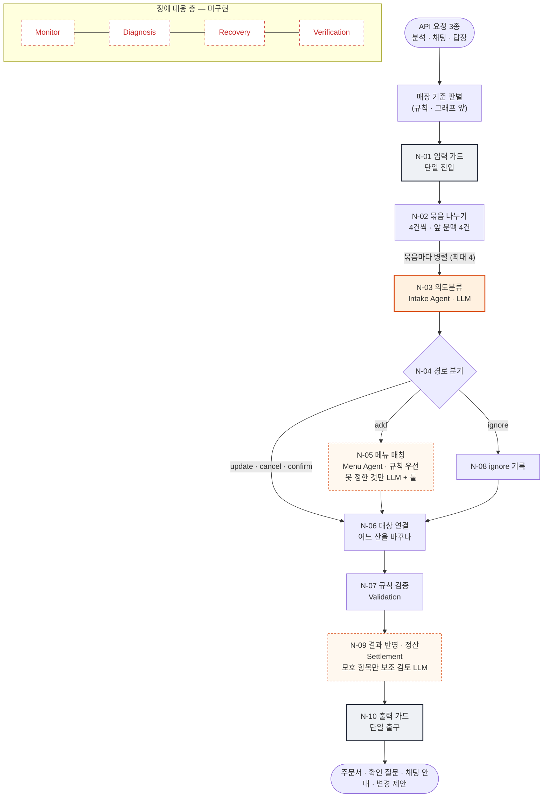
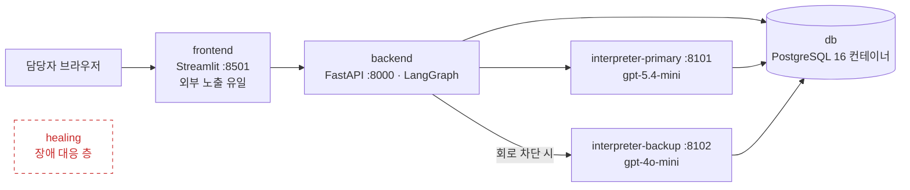

# MOA 멀티 에이전트 현황

**한 줄 요약**: 업무 층은 **LangGraph 노드 10개**로 역할이 나뉜 멀티 에이전트로 동작한다. LLM은 **Intake · Menu · Validation 보조 검토** 3곳에서만 쓰고, **확정 · 판정 · 금액은 전부 규칙**이 한다. 장애 대응 층(Auto Healing)은 **아직 없다.**

| 그래프 노드 | LLM 호출 지점 | 주문 이벤트 경로 | 에이전트 툴 | 메뉴 (스타벅스 / 일반 카페) |          컨테이너          |
| :----------: | :-----------: | :--------------: | :---------: | :-------------------------: | :------------------------: |
| **10** |  **3**  |   **5**   | **5** |      **72 / 16**      | **5** (healing 제외) |

---

## 1. 멀티 에이전트 구조

- **진한 주황 테두리**: LLM을 항상 부르는 노드(N-03). **점선 주황**: 규칙이 못 정한 항목만 LLM을 부르는 노드(N-05 · N-09)
- 공통 검사는 **N-01(단일 진입) · N-10(단일 출구)에만** 있다. 화면 편집 · 질문 답 · 되돌리기도 N-10과 같은 함수를 지난다
- LLM 3곳 모두 **같은 해석 서비스 경계**를 지난다. 5초 제한 · 계약 검증 · PII 가림 · 대체 전환이 한 곳에서 걸린다
- 상한: 순회 25 · 묶음 병렬 4 · 툴 왕복 3 · 재생성 2 · 분석당 LLM 호출 300
- 체크포인터는 쓰지 않는다. 턴 사이 기억은 DB 주문 항목이 가진다
- **Handoff 저장 경계(11-04)**: N-04가 Intake(LLM) 결과를 먼저 DB에 저장한다(`chat_read`). 그 뒤에 죽으면 저장본으로 재개하므로 **LLM을 다시 부르지 않고 같은 결과**가 나온다. 규칙 단계(N-05 ~ N-07)는 N-09에서 한 묶음으로 저장한다

---

## 2. 에이전트별 역할

| 에이전트               | 노드                      | LLM                                             | 하는 일                                                                                                                     | 권한 없음                             |
| ---------------------- | ------------------------- | ----------------------------------------------- | --------------------------------------------------------------------------------------------------------------------------- | ------------------------------------- |
| **Intake**       | N-03                      | **항상** (묶음당 1회 + 재생성 ≤ 2)       | 메시지별 경로 5종 · 주문자 · 근거 · 가리키는 앞 주문 추출. 메뉴 · 사이즈 · 요청은 원문 그대로                          | 메뉴 확정 · 가격 · 판정             |
| **Menu**         | N-05                      | **조건부** (규칙 미확정만 · 분석당 20건) | 규칙(별칭 · 엄격 매칭)이 먼저. 못 정하면 툴로 메뉴판 검색해 후보 · 정렬 · 사유. 메뉴 / 요청을 나눠 주면 규칙이 다시 매칭 | menu_id 확정 (담당자가 질문에서 정함) |
| **Validation**   | N-06 · N-07 · N-09 직후 | **보조 검토만** (모호 항목 · 10건)       | 규칙: 메뉴별 옵션 허용 · 수량 · 사양 판정, 대상이 하나로 좁혀질 때만 연결. 보조 검토: 툴로 항목을 보고 의견 · 사유       | 통과 / 실패 판정 변경                 |
| **Settlement**   | N-09                      | 없음                                            | 기준가 + 옵션 추가금 계산 · 사람별 금액 저장(미노출) · 확인 질문 생성                                                     | —                                    |
| **Orchestrator** | N-01 · 02 · 04 · 10    | 없음                                            | 진입 · 묶음 분배 · 경로 분기 · 출구. 회로 상태로 1차 / 대체 / 규칙 선택                                                  | —                                    |

**툴 5종**: `search_menu` · `find_menu_by_traits` · `get_menu` (Menu) · `list_order_items` · `get_order_item` (보조 검토). 매장 · 세션은 툴이 세션에서 주입받는다(LLM 인자로 받지 않음).

---

## 3. 실행 구성 (Docker Compose)_검토사항

- backend · interpreter-primary는 `restart: no` — Docker가 먼저 되살리면 장애 복구를 잴 수 없다

---

## 4. 참고사항

**메뉴 · 옵션 데이터**

- 스타벅스 메뉴  **72종** — 엑셀에서 `tools/build_sbux_seed.py`로 시드 생성
- 옵션 **5종 확정**: 사이즈 · 얼음 · 샷(+600) · 디카페인(+300) · 개인컵(-400)
- 사이즈에 **숏** 추가 · 사이즈별 가격은 기본 사이즈 대비 차액

**기타 요청 처리**

- 시럽 · 우유 · 휘핑 · 드리즐 · 펌프 수는 **기타 요청**(금액 미반영)으로 원문 보존
- "자바칩 프라푸치노 휘핑 빼주세요": 예전 **주문 취소** → 지금 **주문 + 요청 "휘핑 빼주세요"**
- 규칙이 모르는 요청은 Menu Agent가 메뉴 / 요청으로 나눠 주고, 규칙이 다시 매칭

| 구분      | 무엇                                                                      | 금액   |
| --------- | ------------------------------------------------------------------------- | ------ |
| 옵션 5종  | 사이즈 · 얼음 · 샷 · 디카페인 · 개인컵                                | 반영   |
| 기타 요청 | 시럽 · 우유 종류 · 휘핑 · 드리즐 · 콜드 폼 · 펌프 수 · 빨대 · 포장 | 미반영 |
