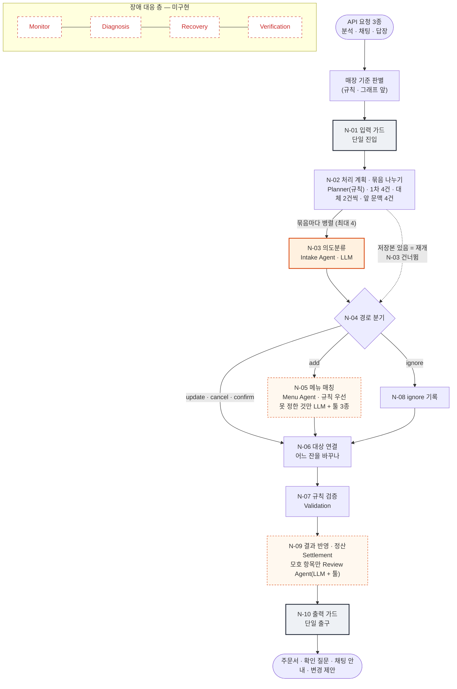
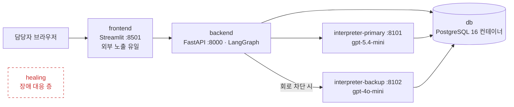

# MOA 멀티 에이전트 현황

업무 층은 LangGraph 노드 10개로 역할이 나뉜 멀티 에이전트로 동작한다. LLM은 LLM 에이전트 3개(Intake · Menu · Review — Menu · Review는 툴을 쓰는 에이전트) 에서만 쓰고 확정 · 판정 · 금액은 전부 규칙이 한다. N-02가 처리 계획(Planner · 규칙) 을 먼저 세워 남긴다. 

| 그래프 노드 | LLM 호출 지점 | 주문 이벤트 경로 | 에이전트 툴 | 메뉴 (스타벅스 / 일반 카페) |          컨테이너          |
| :----------: | :-----------: | :--------------: | :---------: | :-------------------------: | :------------------------: |
| **10** |  **3**  |   **5**   | **5** |      **71 / 16**      | **5** (healing 제외) |

---

## 1. 멀티 에이전트 구조

- 

---

## 2. 에이전트별 역할

| 에이전트                                        | 노드                      | LLM                                                    | 하는 일                                                                                                                       | 권한 없음                             |
| ----------------------------------------------- | ------------------------- | ------------------------------------------------------ | ----------------------------------------------------------------------------------------------------------------------------- | ------------------------------------- |
| **Intake**                                | N-03                      | **항상** (묶음당 1회 + 재생성 ≤ 2) · 툴 없음   | 메시지별 경로 5종 · 주문자 · 근거 · 가리키는 앞 주문 추출. 메뉴 · 사이즈 · 요청은 원문 그대로                            | 메뉴 확정 · 가격 · 판정             |
| **Menu**                                  | N-05                      | **조건부** (규칙 미확정만 · 분석당 20건)        | 규칙(별칭 · 엄격 매칭)이 먼저. 못 정하면 툴로 메뉴판 검색해 후보 · 정렬 · 사유. 메뉴 / 요청을 나눠 주면 규칙이 다시 매칭   | menu_id 확정 (담당자가 질문에서 정함) |
| **Validation** (+ **Review Agent**) | N-06 · N-07 · N-09 직후 | **Review Agent만** (모호 항목 · 10건 · 툴 3종) | 규칙: 메뉴별 옵션 허용 · 수량 · 사양 판정, 대상이 하나로 좁혀질 때만 연결. Review Agent: 툴로 기존 주문을 보고 의견 · 사유 | 통과 / 실패 판정 변경                 |
| **Settlement**                            | N-09                      | 없음                                                   | 기준가 + 옵션 추가금 계산 · 사람별 금액 저장(미노출) · 확인 질문 생성                                                       | —                                    |
| **처리 계획** (Planner)                   | N-02                      | 없음                                                   | 재개 여부 · 회로 상태로 1차 / 대체 / 규칙 선택 · 묶음 분해 · LLM 예산 배정 · 완료 조건을 `plan`으로 기록                | LLM 호출 · 주문 해석 · 수정         |
| **Orchestrator**                          | N-01 · 04 · 10          | 없음                                                   | 진입 · 경로 분기 · 출구. 계획대로 단계 순서 · 상한 관리, 출구에서 계획과 실제 결과 대조                                    | —                                    |

**툴 5종**: `search_menu` · `find_menu_by_traits` · `get_menu` (Menu Agent) · `list_order_items` · `get_order_item` · `get_menu` (Review Agent — `get_menu`는 두 에이전트가 같이 쓴다). 매장 · 세션은 툴이 세션에서 주입받는다(LLM 인자로 받지 않음).

---

## 3. 실행 구성 (Docker Compose)_검토사항

## 4. 참고사항

**메뉴 · 옵션 데이터**

- 스타벅스 메뉴  **72종(활성 71 · 비활성 1)** — 엑셀에서 `tools/build_sbux_seed.py`로 시드 생성
- 옵션 **5종 확정**: 사이즈 · 얼음 · 샷(+600) · 디카페인(+300) · 개인컵(-400)
- 사이즈에 **숏** 추가 · 사이즈별 가격은 기본 사이즈 대비 차액

**기타 요청 처리**

- 시럽 · 우유 · 휘핑 · 드리즐 · 펌프 수는 **기타 요청**(금액 미반영)으로 원문 보존
- "자바칩 프라푸치노 휘핑 빼주세요": 예전 **주문 취소** → 지금 **주문 + 요청 "휘핑 빼주세요"**
- 규칙이 모르는 요청은 Menu Agent가 메뉴 / 요청으로 나눠 주고, 규칙이 다시 매칭

| 구분      | 무엇                                                                      | 금액   |
| --------- | ------------------------------------------------------------------------- | ------ |
| 옵션 5종  | 사이즈 · 얼음 · 샷 · 디카페인 · 개인컵                                | 반영   |
| 기타 요청 | 시럽 · 우유 종류 · 휘핑 · 드리즐 · 콜드 폼 · 펌프 수 · 빨대 · 포장 | 미반영 |
